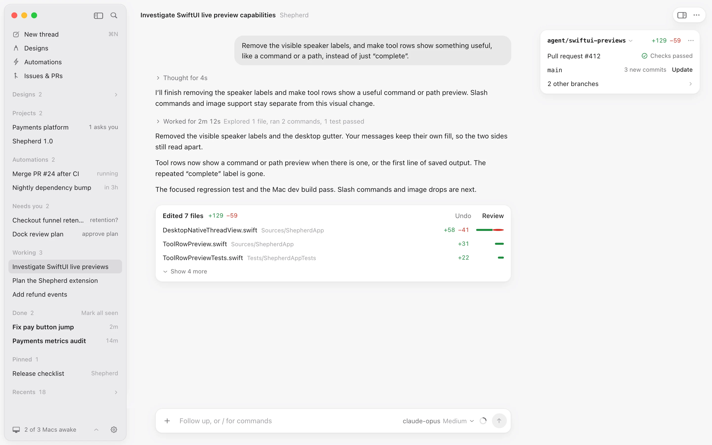

# Shepherd

A native Mac app, with an iPhone and iPad client, for running and supervising many
[pi](https://github.com/earendil-works/pi-coding-agent) coding agents at once.

Shepherd organizes work around agents, not chats. Each agent is a real `pi` process that Shepherd
owns. It has a status, a name it gives itself, and a space it works in. Every agent renders as a
native thread: its transcript, tool calls, questions, and subagents, with a composer for
follow-ups. The sidebar is where you supervise. It groups threads by who needs you, who is
working, and who is done.

<picture>
  <source media="(prefers-color-scheme: dark)" srcset="docs/images/readme-dark.webp">
  
</picture>

## Philosophy

Shepherd is opinionated software. It is built around one workflow and favors staying small and
coherent over covering every use case.

## What it does

- **Spaces and threads.** A space is a project folder; its threads nest beneath it in the
  sidebar. Start one with ⌘N and describe the task. It names itself from your prompt and reports
  whether it is working, waiting on you, or done. ⇧⌘↓ jumps to the next thread that needs you.
- **Native threads.** Each agent is `pi --mode rpc` behind a SwiftUI thread:
  - activity lines: one line per stretch of tool work, live while it runs and a recap when it
    ends ("Explored 7 files, edited 2 files and ran tests"), that expands to its calls and their output
  - a changes card at the end of every turn that edited files, one click from the review pane
  - timed thinking, questions answered in place, pi's slash commands, model and thinking
    pickers, and image attachments
  - messages sent while a turn runs wait in a queue above the composer, where each can be
    edited, reordered, or deleted; Steer now (⌘↩) stops the agent and sends at once
- **Terminals under a thread.** Open a real terminal under a thread with ⌘D, show or hide them
  with ⌘J, or let the agent open, run, read, and close its own. Terminals are tabs, rendered with
  [libghostty](https://ghostty.org).
- **Subagents.** An agent can start child agents and script workflows. Runs appear as live cards
  in the thread and open in an inspector beside it. A subagent never asks you: it asks its
  parent, which answers or asks you in its own thread.
- **Agents working together.** An agent can list, message, and start other agents, read another
  thread, steer or interrupt it, and wait for it to settle. Deleting another agent always asks
  you first.
- **Review.** A review pane docks beside the thread with the working-tree or PR diff and inline
  comments, and sends "request changes" (or "commit") back to the agent as its next turn.
- **Worktrees.** Give a thread its own git worktree, branched from a fresh `origin/<default>`.
  When the work is done, commit, push and open a PR from its branch card, then delete it.
- **Issues & PRs.** Browse a repository's issues and pull requests, with each PR's summary,
  changes and checks. Start a thread from an issue, or hand a PR to an agent with Review with
  agent.
- **Browser.** Each thread has a Browser pane. The agent can open pages, read them, click, type,
  take screenshots and read the console, on a page you can watch and take over.
- **Automations.** Saved prompts that run as their own threads when Shepherd starts, on a
  schedule, or on GitHub activity, and notify you when something needs you.
- **Apps.** Add your dev servers, Storybook or the Simulator to a space in Settings ▸ Apps and
  run them from the thread header. Output goes to the terminal panel, web apps open in the
  Browser pane, and agents you allow can start them and read their output.
- **Instructions, skills, tools and hooks.** Settings ▸ Instructions edits the `AGENTS.md` every
  agent reads, with history. Install skills from skills.sh or a repository, add MCP servers in
  Settings ▸ Tools (or opt into a repository's `.mcp.json`), and add hooks, including ones you
  already wrote for Claude Code or Codex.
- **Fleet.** Pair several Macs and their threads appear together in one sidebar. New threads can
  go to the Mac with the most room, and agents can send work to another Mac. See
  [Fleet and remote access](#fleet-and-remote-access).
- **iPhone and iPad.** The client pairs with your Macs and covers threads, the queue, questions,
  reviews, Issues & PRs, automations, apps and settings, with notifications when an agent needs
  you.
- **Keyboard-first.** A command palette (⌘K) with transcript search across every thread, and
  rebindable shortcuts in Settings ▸ Keyboard.
- **Shepherd Design.** Shepherd's design system, in light and dark, set in Geist and Geist Mono,
  and also applied to terminals. Pi run by hand keeps its own theme.

Settings ▸ Experiments holds features that are off until you turn them on:

- **Design tool.** Draw HTML design boards with an agent, comment on them, tweak and present
  them, export them, and share a design through Git.
- **Projects.** A coordinator thread that plans and tracks work across your spaces, with its own
  goal, instructions and memory.
- **Goals.** `/goal <condition>` keeps a thread working until the condition holds, with a card
  to pause, edit, or clear it.
- **Computer use.** Agents can see and operate the apps on their Mac. It needs Accessibility and
  Screen Recording permission.

### When you quit

Shepherd and Shepherd Nightly run their agents in a background service, so quitting the app
leaves them working. Turn Shepherd off in System Settings ▸ General ▸ Login Items & Extensions to stop that;
agents then run inside the app and stop when you quit it. Either way, relaunching brings the
workspace back with each agent resumed in its pi session.

## Requirements

- A Mac with Apple silicon, on macOS 26 or later. Intel Macs are not supported.
- Nothing else: Shepherd ships its own [pi](https://github.com/earendil-works/pi-coding-agent) and
  runs it in its own folder, with its own sign-ins. A pi you installed yourself stays yours:
  Shepherd never runs it or changes its files. At its first launch Shepherd copies that pi's
  logins and settings into its own once (Settings ▸ Models ▸ Your pi imports them again);
  otherwise, sign in once in Settings ▸ Models.
- To build from source: Xcode with the macOS 26 SDK.

## Install

Download `Shepherd.dmg` from the [latest release](../../releases/latest), open it, and drag
Shepherd to Applications. Updates arrive through Sparkle on the channel you choose in
Settings ▸ General ▸ Updates:

- **Stable:** tagged releases.
- **Beta:** pre-releases. Beta also receives newer stable builds, so you are never stranded
  behind a hotfix.

**Shepherd Nightly** is a separate app built from every push to the `nightly` branch, and the
least tested. Download `Shepherd-Nightly.dmg` from the newest
[nightly release](../../releases?q=nightly&expanded=true). It installs beside Shepherd and keeps
its own agents, settings and support folder (`~/Library/Application Support/Shepherd Nightly`),
so the two run at once. It updates only to newer Shepherd Nightly builds.

The iPhone and iPad client is distributed through internal TestFlight builds.

## Build from source

First run `python3 scripts/pi_engine.py stage` to stage the bundled engine, and repeat after
its pin changes. See [docs/pi-engine.md](docs/pi-engine.md). Then open `Shepherd.xcodeproj`,
pick a scheme, choose My Mac, and Run. There are three Mac schemes, so that a development build
never shares state with your everyday copy. The Dev build also has its own bundle id
(`com.bailycase.shepherd.dev`), so its preferences and notifications stay apart from an
installed Shepherd's, and it never updates itself:

| Scheme | Config | Builds | State directory |
| --- | --- | --- | --- |
| `Shepherd (Dev)` | Debug | Shepherd | `~/Library/Application Support/Shepherd-dev` |
| `Shepherd (Prod)` | Release | Shepherd | `~/Library/Application Support/Shepherd` |
| `Shepherd (Nightly)` | Nightly | Shepherd Nightly | `~/Library/Application Support/Shepherd Nightly` |

`Shepherd iOS` builds the iPhone and iPad client from `App/iOS`.

To build from the command line, and to test the libraries:

```sh
python3 scripts/pi_engine.py stage
xcodebuild -project Shepherd.xcodeproj -scheme 'Shepherd (Dev)' -destination 'platform=macOS' \
  -onlyUsePackageVersionsFromResolvedFile build
scripts/check.py ShepherdCoreUnitTests PaneNodeTests   # one test target, filtered
swift test --filter '<suite>'                          # builds every test target first
```

The GUI runs only through the Xcode project; `ShepherdApp` is a library product. An unfiltered
`swift test` takes about an hour. [docs/build-and-run.md](docs/build-and-run.md) and
[docs/testing.md](docs/testing.md) have the detail, and [CONTRIBUTING.md](CONTRIBUTING.md)
explains the test tiers.

Coming from herdr? With Shepherd quit, run `swift run shepherd-cli --import herdr` to import your
herdr workspaces and pi sessions.

## Fleet and remote access

Every Mac runs its own agents. Settings ▸ Fleet joins Macs into a fleet and pairs phones and
tablets with them.

1. **Another Mac:** on the new Mac, Settings ▸ Fleet ▸ Join a fleet shows a 6 digit code. On a
   Mac already in the fleet, Add a Mac finds it on the local network and takes the code. A Mac
   that isn't nearby can be reached with the pairing link Join a fleet offers, or over SSH. Its
   threads then appear as their own section in the sidebar, with the same rows and threads.
2. **An iPhone or iPad:** on a Mac, Settings ▸ Fleet ▸ Add a device shows a code and a QR. On
   the phone or tablet, Add a Mac takes it.

There is no address or token to type: each device gets a token of its own, which any Mac
revokes from Settings ▸ Fleet ▸ Phones and tablets. Nothing listens on a fresh Mac. The listener opens once a Mac or device is paired or
a code is showing, and Settings ▸ Fleet ▸ Serve this Mac keeps it open. It listens on TCP port
7433 on all interfaces (Shepherd Nightly: 7434).

A connected Mac or device can create, rename, reorder, and delete threads on another Mac, open
terminals, inspect subagents, search transcripts, review diffs, and create and delete worktrees.
Dropped files upload to the Mac that runs the thread, up to 32 MiB each. Disconnecting a client
never stops an agent.

**There is no TLS.** The token keeps other devices on a trusted network out, but the traffic
itself is unencrypted. Use a VPN or trusted network, and never expose the listener to the
internet. See [SECURITY.md](SECURITY.md).

## pi in terminals

Terminals run your configured login shell without wrapping `pi` or injecting a theme.
pi uses its own theme and settings. Shepherd never edits your shell rc files or pi settings.

pi started by hand in a terminal has no Shepherd agent identity, so the agent tools (terminals,
review, browser, automations, peers) and status, naming, and subagent reporting are unavailable
there. Use a Shepherd thread when you want those.

## Documentation

- [AGENTS.md](AGENTS.md): the short working guide for coding agents and contributors, with links
  to build, test, release and the rules that are easy to break.
- [ARCHITECTURE.md](ARCHITECTURE.md): modules, ownership, and where each feature lives in code.
- [DESIGN.md](DESIGN.md): the rules for UI changes.
- [CONTRIBUTING.md](CONTRIBUTING.md) and [SECURITY.md](SECURITY.md).

The code and its tests are the detail; there are no per-feature docs.

## License

[MIT](LICENSE). The vendored terminal package in `Vendor/libghostty-spm` is MIT
([Lakr233/libghostty-spm](https://github.com/Lakr233/libghostty-spm)). It bundles a prebuilt
libghostty from [Ghostty](https://ghostty.org), which carries its own license terms.
