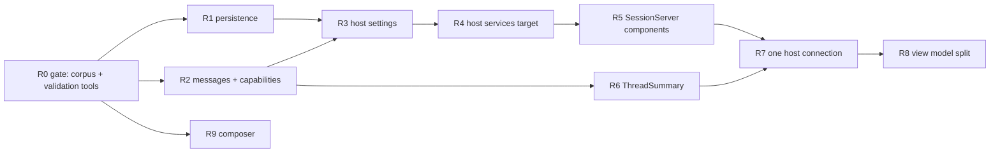

# Foundation audit and rebuild plan

Plan only. No code changed. Baily's premise: a lot of this code is slop and the foundation has to be rebuilt from the basics. This document tests that premise with measurements, names what is actually wrong, and proposes thin slices that replace one piece at a time behind a stable interface. It depends on [the validation plan](https://github.com/bailycase/shepherd/pull/733) (PR #733): every rebuilt piece has to pass the same characterization checks as the code it replaces, and those tools do not exist yet.

## Summary

The foundation is not uniformly bad. Three ground floors are sound and should stay: the `ShepherdCore` model, the NDJSON framing and peer-identity rules, and the one-serial-queue server model. The damage is concentrated in six places, and each one is a class of bug, not a pile of instances.

1. **The host's configuration is the UI's.** The host process (`Shepherd --host`) is assembled inside the `ShepherdApp` module and reads `AppSettings`, a `@MainActor` UserDefaults store. A hand-kept list of 53 keys keeps the host following the app; 62 settings persist, so nine are unlisted and nothing checks. One new host-editable setting touches 16 places (19 when Fleet syncs it). This is why settings were not followed by the host.
2. **Persistence is all-or-nothing and ad hoc.** One decode error in `state.json` quarantines the whole workspace and the app starts empty. Dozens of other JSON files are read with 98 `try?` decodes, and a failed read returns an empty default that the next write then saves over the file.
3. **`SessionServer` is a 17.7k-line object** with 355 stored properties, an 877-line request switch, and 104 fix commits in 85 days. A fix to it also touches the app, remote or protocol modules 59% of the time.
4. **Many Mac app features exist twice: once for this Mac, once for a paired Mac.** `ShepherdViewModel` (11.4k lines, 53 files) holds 32 `remote*` properties beside their local twins, and 139 of 340 app files depend on it. `ARCHITECTURE.md` says no view asks whether a connection is this Mac's; the code still does in 194 places.
5. **The protocol is hand-maintained.** 130 capability constants, about 300 message cases with 147 hand-written `init(from:)` decoders, and a rule sheet that asks for seven edits per message. Business rules are copied across Mac, iOS and host (rows in section 2, F7 and F8).
6. **Verification does not match the speed of change.** 46% of commits that touch code are `fix:` commits. Nightly merges and ships with no test run, 200k lines compile in Swift 5 language mode, and iOS is checked by 18 of 203 files in headless scripts.

The plan is nine slices after one gate. The gate (R0) builds the characterization corpus on the validation plan's tools. Slices R1 to R3 are small and remove the data-loss and settings classes. R4 to R8 take the large objects apart one seam at a time. Slice R9 is a parallel lane for the Mac composer. Nothing is rewritten in place and no slice changes bytes on the wire.

## How this was measured

Repo state: `nightly` at `0de65c60b` (2026-11-19). The repo is 85 days old (first commit 2026-08-27), has 4,325 commits, 495k lines added and 150k deleted in code paths, and 335k lines of production Swift plus 11k of TypeScript today (270k lines of tests). That age matters: part of the fix volume is features shipped days earlier being corrected, not foundation decay. Where a number could mean either, the text says so.

Counting rules: lines are `wc -l` of `.swift`, `.ts`, `.mjs`; a "fix commit" is a non-merge commit whose subject starts `fix`; "touches" means the commit changed the path. Everything is reproducible with `git log --no-merges --name-only` and `grep -c`. Not measured here: statement coverage (nothing in the repo produces it), cold build time on this machine (no build was run, per AGENTS.md), and runtime profiles (see [INSTRUMENTS-AUDIT.md](../../INSTRUMENTS-AUDIT.md) for the existing partial ones).

## 1. The map

### 1.1 Modules

| Module | Files | Lines | Test lines (@Test) | Commits touching | Fix commits | Fix share |
| --- | ---: | ---: | --- | ---: | ---: | ---: |
| `ShepherdCore` | 26 | 5,774 | 2,774 (242) | 94 | 22 | 23% |
| `ShepherdProtocol` | 101 | 28,144 | 11,637 (790) | 299 | 69 | 23% |
| `ShepherdRemote` | 134 | 35,706 | 27,163 (1,696) | 554 | 189 | 34% |
| `ShepherdSessions` | 221 | 70,987 | 11,686 unit + 55,797 integration (2,554) | 608 | 252 | 41% |
| `ShepherdApp` (Mac) | 340 | 93,322 | 24,053 unit + 64,922 integration (3,077) | 1,266 | 547 | 43% |
| `ShepherdUI` | 198 | 51,843 | 3,906 (248) + 19,222 previews (582) | 450 | 171 | 38% |
| iOS app (`App/`) | 210 | 44,207 | `ShepherdIOSChecks` 16,260 (script harness) | 398 | 174 | 44% |
| `Extensions/` (pi extensions, TS) | 30 | 11,443 | 17,474 (82 `.mjs` files) | 189 | 70 | 37% |
| `TerminalSurfaceKit` | 5 | 1,259 | 524 (37) | 39 | 12 | 31% |
| `DesignSurfaceKit` | 11 | 3,381 | 2,002 (72) | 30 | 14 | 47% |
| `ShepherdPTYSpawn` (C) | 1 | 40 | none | 3 | 3 | n/a |

The inner modules are the stable ones: Core and Protocol have the lowest fix share (23%) and the lowest churn. The modules that own behavior (Sessions, App, iOS) fix about four commits in ten. The dependency graph in `ARCHITECTURE.md` matches the imports: Core imports nothing, Protocol imports Core only, Sessions imports Protocol and Remote, and App imports everything (`ShepherdApp` files import Protocol 220 times, Remote 202, Sessions 126).

By feature, measured by file names (they overlap, so they do not sum to the total): Design 144 files and 44k lines, Fleet 119 and 30k, Projects 106 and 21k, Settings 61 and 15k, Review 54 and 11k, Browser 37 and 10k, Forge 28 and 9k. Fleet's 30k lines landed mostly 2026-11-11 to 11-13: 96 commits and 23.7k lines added to Fleet paths in three days. Of the 175 commits whose message mentions Fleet, 32 are `fix`.

### 1.2 The largest types

Counts include every `extension` file.

| Type | Where | Size | Evidence of strain |
| --- | --- | --- | --- |
| `SessionServer` | `ShepherdSessions/SessionServer.swift` plus 28 `SessionServer+*.swift` | 17,724 lines, 673 funcs, 355 stored properties | 331 commits and 104 fixes on the main file alone. `handleRemoteLine` is 877 lines (`:3086`), `handleLine` 437 (`:5445`), `makeSessionOnQueue` 301 (`:9537`) |
| `ShepherdViewModel` | `ShepherdApp/ShepherdViewModel.swift` plus 52 extension files | 11,456 lines, about 600 funcs, 251 stored properties in the main file | 248 commits and 55 fixes on the main file; 139 of 340 app files reference it |
| `RPCThreadState` | `ShepherdSessions/RPCThreadState*.swift` | 3,701 lines in the main file plus 10 extension files | 145 commits, 62 fixes; `handle(_:)` is 262 lines (`:803`) |
| `NativeThreadStore` | `ShepherdRemote/NativeThreadStore.swift` | 3,158 lines | 117 commits, 46 fixes; `derive()` is 230 lines (`:730`) |
| `AppSettings` | `ShepherdApp/AppSettings.swift` | 1,045 lines, 62 persisting properties | see F1 |
| `RemoteRequest` / `RemoteReply` / `ExtensionMessage` / `ExtensionReply` / `NativeThreadRequest` | `ShepherdProtocol` | 81, 69, 68, 44, 42 cases (counted by indentation, so approximate) | 147 hand-written `init(from:)` across Core, Protocol, Sessions and App |

What `SessionServer.swift` holds, by its own `MARK` sections: Fleet glue, lifecycle, the native thread, the TCP and local listeners, Browser tunnels, the extension socket, design references, an agent access policy, Browser drive, state mutations, automations, designs (about 1,100 lines of design store, systems, comments and markup), PTY and RPC sessions, and socket helpers. Nothing in it is shared with another type by an interface; they share fields.

### 1.3 Who owns which state

| State | Authoritative owner | Persisted | Copies and mirrors |
| --- | --- | --- | --- |
| Workspace (spaces, tabs, agents, automations, designs, projects) | `SessionServer` through `StateStore` (`StateStore.swift:21`) | one `state.json`, rewritten whole on each mutation, plus a Project history SQLite beside it | `ShepherdViewModel.state` adopts pushes (`adopt`, 113 lines); `RemoteHostStore` per paired Mac; iOS stores |
| Thread transcript | pi's session file | pi | `RPCThreadState` (host projection) then `NativeThreadStore` (client projection) then views |
| Settings | `AppSettings` (UserDefaults) read by both app and host, plus pi's `settings.json` in the pi home | UserDefaults, `settings.json` | `HostSettings` (wire view, `HostSettings.swift:9`), `ClientSettings`, iOS screens |
| Composer draft, attachments, queue | `NativeThreadStore.draft` (`NativeThreadStore.swift:197`), `ThreadInput` (per thread, `ComposerAttachments.swift:80`), `ComposerDrafts` (UserDefaults, `Thread/ComposerDrafts.swift`) | UserDefaults | iOS `ComposerState` (`App/iOS/Composer/ComposerState.swift`) re-implements attachments, queue rows and slash matches |
| Agent status and Done/unseen | host (`applyAgentStatus`, `SessionServer.swift:6947`) | reset to idle at `start()` | sidebar rules on Mac (`SidebarModel.swift:625`), `FleetSidebar.swift:141` on iOS, `Fleet.swift:469` |
| Terminals | `PTYSession` in the host | none (screen snapshot only) | `HostTerminalLeaf` in the app |
| Selection, sheets, sidebar | `ShepherdViewModel` | UserDefaults for some | none |

### 1.4 Persisted formats and special cases

- About 40 distinct JSON file names appear in Swift code (some are pi's or the user's; Shepherd's own include `state.json`, `automation-runs.json`, `turns.json`, `forge-pins.json`, `push-registrations.json`, `thread-notes.json`, `canvas.json`, `devices.json`, `dispatches.json`, `peers.json`, ...), with 114 `JSONDecoder()` and 110 `JSONEncoder()` construction sites, and 24 version markers in total. UserDefaults is touched at 65 sites outside tests, and `ComposerDrafts` alone adds three keys.
- 98 `try?` decodes in `Sources` and `App`. Most are reads of Shepherd's own files that fall back to empty (examples in F2).
- 130 `*Capability` constants in `ShepherdProtocol` with 358 references; 156 `capabilities.contains` expressions across Sources and App; 55 distinct `SHEPHERD_*` environment variables read by Swift code.
- 108 `@unchecked Sendable`, 98 `MainActor.assumeIsolated`, 50 `NotificationCenter` uses, 337 `queue.async` and 48 `queue.sync` in `ShepherdSessions` (33 of the `sync` calls are in `SessionServer.swift`, mostly start, stop and test hooks).
- `ShepherdRemote`, `ShepherdSessions`, `ShepherdApp`, `TerminalSurfaceKit` and `shepherd-cli` build in Swift 5 language mode (`Package.swift:44,57,65,100,105`). Core and Protocol are the only modules checked for data races by the compiler.

### 1.5 Verification as it exists

| Check | What it covers | Where it runs |
| --- | --- | --- |
| `swift test` | 13 test targets, about 9,300 `@Test` functions across them | locally; CI only on PRs into `master` (`docs/testing.md#ci`). `nightly` ships without rerunning tests. |
| iOS | 18 of the 203 `App/iOS` files are named by `ShepherdIOSChecks` scripts, which compile files with `swiftc` and run executables; the rest is covered by the release `xcodebuild` | scripts, one `@Test` in the directory |
| Extensions | 82 `.mjs` test files, 17k lines, against the staged pi engine | locally |
| Previews | 582 `@Test` renders, light and dark | opt in with `SHEPHERD_PREVIEW_DIR` |
| Coverage | none measured | n/a |

Test-suite hygiene: `docs/testing.md` says never sleep a fixed amount, and the tests contain 313 `sleep` calls against 3,849 `eventually` waits. Two open PRs (#728, #729) remove some. A nightly release takes about 42 minutes on hosted runners; the build cache job 10 to 16 minutes (`gh run list`). `.github/workflows/auto-merge.yml` enables squash auto-merge on any non-draft PR into `nightly` from Baily's account, and `nightly` requires no checks, so a ready PR merges at once.

### 1.6 Churn hot spots

Fix commits and total commits per file, all time (code paths only):

| File | Fix / total |
| --- | ---: |
| `ShepherdSessions/SessionServer.swift` | 104 / 331 |
| `ShepherdApp/Thread/ThreadView.swift` | 69 / 140 |
| `ShepherdSessions/RPCThreadState.swift` | 62 / 145 |
| `ShepherdApp/ShepherdViewModel.swift` | 55 / 248 |
| `ShepherdApp/Thread/Composer.swift` | 48 / 120 |
| `ShepherdRemote/NativeThreadStore.swift` | 46 / 117 |
| `App/iOS/Thread/ThreadScreen.swift` | 35 / 74 |
| `ShepherdRemote/RemoteHostClient.swift` | 33 / 132 |
| `ShepherdRemote/NativeThreadPresentation.swift` | 31 / 70 |
| `ShepherdApp/WorkspaceView.swift` | 26 / 114 |

Of 1,028 fix commits that touch code, 303 touch two or more modules and 110 touch three or more. A fix usually crosses a seam, which is what a missing interface looks like.

## 2. Findings

Ranking is (bugs caused + agent time lost) divided by cost to fix. Bugs are fix commits and the specific failures named in the brief. Agent time is the number of places a routine change must touch. Cost is S (one agent, days), M (about a week, several slices) or L (many slices). F3 and F5 cost the most, so they rank late even though they have the most fixes; the cheaper slices before them also make them safer.

| Rank | Finding | Bugs | Agent time | Cost |
| ---: | --- | --- | --- | --- |
| 1 | F2 Persistence loses data on a decode error | data loss class | every new field | S |
| 2 | F1 Settings: a hand-kept list decides what the host follows | settings not followed, a deadlock | 16 places per setting (19 with Fleet) | M |
| 3 | F9 No verification gate before nightly | all of them | every PR | S to M |
| 4 | F7 Protocol policy is hand-maintained | wire mismatches | 7 edits per message | M |
| 5 | F8 State and rules owned twice (composer, Fleet, status) | 15 composer fixes, Fleet mismatches | per feature | S each |
| 6 | F4 Host composition lives in the UI module | settings, Projects | every host feature | M |
| 7 | F5 Local and paired-Mac code paths are twins | 62 remote fixes, 128 iOS fixes | per feature | L |
| 8 | F3 `SessionServer` | 104 fixes | per feature | L |
| 9 | F6 `ShepherdViewModel` | 55 fixes | per feature | L |
| 10 | F10 Transcript rendering carries a rule book | 81 to 159 scroll and mount fixes | per UI change | open |

### F1. The host follows settings through a hand-kept list

- **Evidence.** `AppSettings.followed` (`AppSettings.swift:994`) lists 53 keys. 62 properties persist (a `didSet` writes them). The nine not listed are `fleetAutoDispatch`, `fleetBatteryCountsHalf`, `fleetCheckIgnores`, `fleetSnapshotExcludes`, `fleetThreadCap`, `fleetThreadsCanSend`, `fleetUncommitted`, `fleetWeights` and `remoteListenerPort`. Fleet's settings may be read another way (`observeWrites`), but nothing says which are meant to be absent, and no test enumerates the properties (`HostModeSettingsTests` has six tests and none checks completeness). `reload()` (`:979`) builds a second `AppSettings` and copies each followed key.
- **Why it is structural.** The host is not a server module. `ShepherdHost.main` and `ShepherdHost.Services` are in `ShepherdApp/ShepherdApp.swift:357,391` and run on the main actor with `AppSettings.shared`. Two processes share a UserDefaults domain and a Darwin notification. Every setting is then declared in `AppSettings`, copied by `HostSettingsMapping.settings(from:)` and `apply(_:to:)` (`ShepherdViewModel+HostSettings.swift`), and again in `HostSettings`.
- **Touch points for one host-visible setting:** the `AppSettings` property and `didSet`, the reset line, `followed`, the `HostSettings` field, its init parameter, its init assignment, `CodingKeys`, the decode line (`HostSettings.swift:249,259`), a `HostSettingChange` case (41 of them, `:368`), the `apply` switch (`:313`), `HostSettingsMapping.settings(from:)`, `HostSettingsMapping.apply`, a Mac row, an iOS row. That is 12 in the list above and 16 counting the key enumeration, load, write and iOS control (19 when Fleet syncs it: its enum and encode and decode switches in `FleetHostSettings.swift`); `skillsInSlashMenu`, `mcpProjectConfig`, `closeOnMerge` and `computerUseEnabled` each appear in 7 to 9 files and 21 to 29 references.
- **Cost it caused.** `057dd7301` (the app's Settings edits did not reach the background host), `54a558f20` (a settings write on the host waited on its own main queue), and the two-Mac run in the validation plan: settings not followed by the receiving host. All three are one design: two processes, one UI-shaped store, a copied list.
- **Cost to fix.** M. See T1 and R3.

### F2. Persistence loses data on a decode error

- **Evidence.** `StateStore.load` (`StateStore.swift:145-163`) decodes `ShepherdState` in one call. `spaces`, `tabs` and `agents` use a strict `decode` (`Models.swift:748-750`), so one agent whose JSON no longer fits makes the load throw and `quarantine` moves the whole file aside (`:165`). The app then starts with an empty workspace. The evidence is kept on disk, but the user's view is a lost workspace. `StateStoreTests.swift:164` covers one historic shape (`aTerminalEraFileLoadsWithoutQuarantine`); there is no corpus of old shapes.
- **Silent empty reads of Shepherd's own files.** `AutomationRuns.swift:37` (`reload()` sets `runs = [:]` when decode fails and the next `publish`/write replaces the file), `Changes/ChangesService+Turns.swift:48` (turn records fall back to `[:]` and the next save overwrites), `ThreadOrigins.swift:150`, `InstructionsStore.swift:114` (history), `Forge/ForgeService.swift:777` (pins), `PushNotifications.swift:77` (registrations), `DesignStore.swift:820` (thread notes), `Hooks/HookSettingsStore.swift:56`, `SuggestionsStore.swift:175`. Each is a different type with its own decoder and no version, so a renamed or newly required field drops the user's data and reports nothing.
- **Why it is structural.** There is no shared persisted-file type. The rule in `docs/rules.md` ("new persisted fields decode with defaults") is a manual convention, and 147 hand-written `init(from:)` implement it by hand.
- **Cost to fix.** S for the helper and the corpus, then one file at a time. See T2 and R1.

### F3. `SessionServer` is the whole host in one object

- **Evidence.** Section 1.2. Its request path is two giant switches (`handleRemoteLine` 877 lines, `handleLine` 437). `stateDidCommit` (`:7149`) is one 90-line function that diffs the old and new workspace to update Project authority, peer deliveries, retired sessions, automation watchers, Fleet and more, so adding a feature to the workspace means editing it. 59% of fixes to the file (61 of 104) also changed App, Remote or Protocol.
- **The queue rule is enforced by comments.** The rules say one serial queue and never `.sync` between server queues. There are 33 `queue.sync` calls in the file, and `dispatchPrecondition` appears nowhere in `Sources`, so no entry point asserts that its caller is on the queue.
- **Cost to fix.** L, but it can be sliced without changing behavior (T3, R5). It comes after the cheaper classes because every slice below needs the characterization corpus.

### F4. The host's services live in the UI module

- **Evidence.** `ShepherdHost.Services` (`ShepherdApp.swift:391`) creates MCP, notifications, worktrees, the Project runtime (`RuntimeHosting.headless`) and settings for `Shepherd --host`. `ProjectCoordinatorController` and `ProjectExecutionController` are `@MainActor` app types the host runs. 126 `ShepherdApp` files import `ShepherdSessions` and 27 mention `SessionServer`, although `ARCHITECTURE.md` says the app never runs a server.
- **Cost.** It is the reason F1 exists, and it means a "server" change needs the app target to build.
- **Cost to fix.** M, after F1. See T4 and R4.

### F5. Local and paired-Mac code paths are twins

- **Evidence.** `ShepherdViewModel.swift` keeps `fileTrees` and `remoteFileTrees` (`:223,225`), `reviewSessions` and `remoteReviews` (`:216,321`), `childRuns` and `remoteChildren` (`:210,310`), `referenceChips` and `remoteReferenceChips`, `designScreens` and `remoteDesignScreens`, plus 32 `remote*` stored properties in all. `RemoteAgentRef` appears 158 times in 46 app files and there are 194 `if let remote` / `.remote(` branches. `ARCHITECTURE.md` already says the local host is transport only and no view should ask whether a connection is this Mac's.
- **Cost.** 62 `fix` commits mention remote or paired hosts and 128 mention iOS; a feature built for one path is rebuilt for the other. The iPhone and iPad client is a third copy: 203 files that re-draw the same threads from the same `ShepherdRemote` stores.
- **Cost to fix.** L. See T5 and R7.

### F6. `ShepherdViewModel` is a god object

- **Evidence.** 53 files, 11,456 lines, 251 stored properties in the main file. It holds Design (32 properties), sidebar caches, review, Fleet, remote and selection state in one `@Observable`, so any feature's change forces edits to the same file (248 commits). Its own doc says it "holds only presentation state".
- **Cost to fix.** L, mechanical once F5 lands. See R8.

### F7. Protocol policy and capabilities are hand-maintained

- **Evidence.** About 300 message cases (section 1.2), each needing the seven edits listed in `docs/rules.md` ("Contracts"): case, `Kind`, `CodingKeys`, both codec arms, a round-trip row, `speaksFor` and `replyID`. 130 capability constants, 156 `capabilities.contains` sites, 358 references; the Mac clients have 43 direct checks and iOS 4, with repeated ones in `RemoteHostStore.swift:170,256,609,740` and `RemoteDesignReferences.swift:21,79`. The extension side builds the same message shapes by hand in TypeScript (`Extensions/shepherd-panes.ts`, 1,281 lines, and others).
- **Cost.** A message missing one of its seven parts fails at runtime or silently on older hosts. `RemoteMessage.swift` has 144 commits, 25 of them fixes.
- **Cost to fix.** M. See T3 and R2. Macros would need `swift-syntax`, a new dependency, so the plan does not use them.

### F8. State and business rules owned twice

These are small and independent, and they are where "tonight's" bugs came from.

| Rule | Where it is implemented | Cost seen |
| --- | --- | --- |
| Composer draft and attachment ownership | Draft in `NativeThreadStore` (`:197`), attachments in `ThreadInput` held per thread by `NativeThreadStores.swift:47,126` and also as `fallbackInput` in `ThreadView.swift:104` and `emptyProjectInput` in `ShepherdViewModel.swift:564`, persisted by `ComposerDrafts`, and re-implemented for iOS in `ComposerState` | `d17441a8f`: closing the second view of a thread dropped an attachment because both composers set one shared `available` flag; an accepted Project send cleared a newer draft. 15 composer data and queue fixes, 48 fixes to `Composer.swift` |
| Model short name | `Composer.swift:1596` and `NativeComposerPresentation.swift:336` (identical bodies), iOS `ComposerControls.swift:68` | `47963d50d` |
| Thinking chip eligibility | `Composer.swift:1000` against the shared rule `NativeComposerPresentation.swift:460` and iOS `ThreadComposer.swift:318` | `7c448f1dc`, `6551964eb`, `b79c44c03` |
| Status words | `SidebarView.swift:395`, `Fleet.swift:611` | status fixes `023343b55`, `d296a87ee` |
| "Working while subagents run" | `Fleet.swift:469` (client) and `SessionServer.swift:7060` (host) | same two fixes |
| Done and unseen | `SidebarModel.swift:625,706` (Mac), `FleetSidebar.swift:141` (shared and iOS), `SessionServer.swift:7901` | cross-device clearing added in `5af921679` |
| Branch and worktree fact | `AgentBranchPresentation.swift:32`, `Fleet.swift:597`, host updates `SessionServer.swift:7805` | `166767aa0`; the validation plan's two-Mac run found wrong branch summaries and status mismatches |

Common cause: the host knows the fact, and each client re-derives it from partial inputs. Rank 5 because each fix is small and the bugs are real and recent.

### F9. Verification does not match the speed of change

- 1,028 of the 2,224 commits that touch code are `fix` (46%). `nightly` has no test CI and auto-merges (section 1.5). The validation plan lists the same gap ("nightly reviewers get uneven evidence").
- `ShepherdRemote`, `ShepherdSessions` and `ShepherdApp` (about 200k lines) compile in Swift 5 language mode with 108 `@unchecked Sendable` and 98 `MainActor.assumeIsolated`: the compiler cannot find a data race in the code whose correctness depends on queue discipline.
- iOS has no `swift test` target; its 203 files are checked through scripts and the release build.
- The test suite is large (2,554 tests for Sessions, 3,077 for the Mac app) but nothing measures what it covers, so "the tests pass" does not say a rebuilt piece is equivalent.

### F10. Transcript rendering carries a rule book

`docs/rules.md` spends 106 of its 407 lines (26%) on "Switching is a visibility flip" and the eager-tail rules: `NativeMountedCost.eagerTailCap`, `ThreadEagerTail`, `ThreadRestore`, `keptStacks` and retry counts. `ThreadView.swift` has 69 fix commits; 159 fix subjects mention scroll, tail, restore, mount, rows, anchor or lazy (81 on a narrower match), and 22 are `lag`, `stall` or memory. iOS spent four fixes between 2026-11-13 and 11-14 on one "bottom marker" bug. [INSTRUMENTS-AUDIT.md](../../INSTRUMENTS-AUDIT.md) measured `AG::Subgraph::update` in 55% of sampled app CPU. The mechanism is a response to SwiftUI list cost, not a bug in one place. This plan does not propose a rewrite: it proposes measuring first (decision D6).

## 3. The target foundation

Constraints kept: one serial server queue, `@Observable` state, no new dependencies, no wire change, ShepherdUI imports nothing from Shepherd. Each design below removes the class of bug.

### T1. One declaration per setting, and the host owns host settings

- Split settings by scope in the type, not by convention. **Device settings** (sidebar width, density, text scale, editor, window chrome) stay in `AppSettings` on UserDefaults and never leave the app process. **Host settings** become one `Codable` value, `HostSettings`, owned by a `HostSettingsStore` in `ShepherdSessions`, saved as one versioned file, changed only through the existing `HostSettingChange` request. The Mac's own Settings uses the request path it already uses for a paired Mac and for iOS.
- Declare each host setting once with its default (a small property wrapper that does `decodeIfPresent ?? default`; no macro). Synthesized `Codable` replaces the hand-written `CodingKeys` and `init(from:)`, and the init parameter list goes away.
- Delete: `AppSettings.followed`, `reload()` and the Darwin-notification follower, `HostSettingsMapping.settings(from:)` and its `apply`, and the second list in `ShepherdViewModel+HostSettings.swift`.
- Result: a new host setting is one declaration, one `HostSettingChange` case and one row per platform. A test enumerates `HostSettings` with `Mirror` and fails for a field without a default, and a second test fails for a `HostSettingChange` case that does not change its field.

### T2. One way to read a persisted file

- `ShepherdCore` gets `PersistedFile<Value>`: a versioned envelope (`{version, value}`, reading the unversioned form as version 1), a lossy array decoder (each element decodes alone; failures are collected with their raw JSON), and one load result: `.loaded`, `.missing`, or `.damaged(movedTo:)`. A failed read never returns a default silently: the file is moved aside, the host logs it, and the app shows a banner naming the file.
- `StateStore.load` uses the lossy decoder for `spaces`, `tabs` and `agents`, so one bad agent drops that agent into `state.json.rejected-<time>` and the rest of the workspace loads.
- The remaining file readers move onto it one by one, starting with the 10 listed in F2.
- Result: adding a required field cannot erase a file. A golden corpus (one fixture per historical shape of each root type) is the check.

### T3. Policy in one table, routes registered by feature, one queue with assertions

- Keep the enums and their wire bytes. Add one `MessageSpec` table keyed by `Kind` that holds the capability a message needs, `speaksFor`, and `replyID`. A test over `Kind.allCases` fails for a missing row or round-trip. Capabilities become a `Capability` type whose raw values are today's 130 strings, listed once, with the consumer checks (`host.supports(.designs)`) in one place.
- `SessionServer` splits along its existing `MARK` lines into components confined to the server queue (Browser, Designs, Automations, Projects, Fleet, Terminals, Remote listener). Each takes a small `ServerContext` (queue, `StateStore`, `send`, `commit`) instead of reaching into the object, and registers routes in a `[Kind: Route]` table so the 877-line switch becomes a lookup. Each entry point starts with `dispatchPrecondition(condition: .onQueue(queue))`, which makes the concurrency rule checkable.
- `stateDidCommit` becomes observers: a component subscribes to `(before, after)` for its own slice of state instead of one function diffing everything.
- Result: adding a message touches its enum case and codec, a spec row and a route. The server file stops being the place where features collide.

### T4. A host target that does not import the UI

- Move `ShepherdHost.Services`, the Project controllers, `WorktreeHosting`, `AgentLaunch` mapping and MCP hosting into a new `ShepherdHostServices` target between Sessions and App (decision D3). It imports Sessions, Remote, Protocol and Core. After T1 it no longer needs `AppSettings`. `ShepherdApp` imports it only for the in-process test host; `Shepherd --host` links it without the UI modules.
- Result: "does the host follow this?" has one answer, and a host change builds and tests without SwiftUI.

### T5. One host connection type, local or paired

- A thread is addressed by `ThreadRef(hostID, agentID)`. `This Mac` is a `HostConnection` like any paired Mac. The parallel local/remote dictionaries in `ShepherdViewModel` become one dictionary per feature keyed by `ThreadRef`, behind a per-feature store (T6). `RemoteAgentRef` and the 194 local-or-remote branches go away. This is what `ARCHITECTURE.md` already claims.

### T6. Derive host facts once, on the host

- A `ThreadSummary` value (effective status including subagents, unseen Done, branch and worktree, pull request) is computed once on the server queue and travels with the thread digest the clients already pull. Mac sidebar, iOS and Fleet draw it; the client copies of "Working while subagents run", Done and unseen, and branch (F8) are deleted. The shared pure rules that exist (`NativeComposerPresentation`) are called from the Mac composer instead of re-implemented.
- Composer: one `ComposerSession` per thread owns draft, attachments, queue hold and which views are attached (the fix in `d17441a8f` is a counted set of attached views); `Composer` and `ThreadComposer` render it. `ComposerDrafts` becomes its persistence.

### T7. The view model split by feature

- `ShepherdViewModel` keeps selection and navigation. Designs, review, Fleet, sidebar caches and the new-thread flow become `@Observable` feature stores owned at the app root and passed to views as plain values, as the Observation rule already requires. Done last, because it is mechanical once T5 removes the twin state.

### T8. The compiler checks races where it matters

- Per module, turn on complete strict-concurrency checking in warning mode first (`ShepherdRemote`, then Sessions, then App), count the warnings, and move a module to language mode 6 only when the count reaches zero without new `@unchecked`. This is a hygiene lane, not a slice (R10).

## 4. What to keep as it is

Not everything is slop. These have low churn, low fix rates, or a rule that is working.

- **`ShepherdCore`.** 5.8k lines, 23% fix share, the lowest churn, 242 tests. `PaneNode`, typed IDs, `AgentStatus` and its transition table are the model. T2 only changes how files are read around it.
- **The one-serial-queue server model.** Every serious bug in this audit is about code being outside the model, not the model. T3 adds assertions; it does not replace it.
- **NDJSON framing, the 1 MiB cap, the extension-socket peer-pid check, the browser rules and the invariants list in `docs/rules.md`.** They are security rules and they have tests.
- **`ShepherdPTYSpawn`, `TerminalSurfaceKit` and `DesignSurfaceKit`.** Small, behind a single importing file each, low fix counts per line (1,259 and 3,381 lines).
- **`ShepherdUI` tokens and `DesignRulesTests`.** The 171 fix commits are mostly visual corrections to screens built from them; the token layer and its literal guard are doing their job.
- **`ShepherdRemote`'s shared thread client** (`NativeThreadStore` and the presentation types). One client for Mac and iOS is the right shape; the plan adds to it (T6) and does not replace it. `NativeThreadStore.derive()` at 230 lines may need a later split.
- **Test isolation** (`ShepherdTestIsolation`, `ScratchServer`, `StubPi`, `AppHarness`, `eventually`): 3,849 uses of `eventually` show the pattern took. The 313 remaining sleeps are an ongoing cleanup, not a redesign.
- **`StateStore` atomic write and quarantine.** Keep the mechanism; T2 narrows what triggers it.
- **The pi extensions** (11k lines TypeScript, 82 test files): dependency-free and inert without their env vars. Their message shapes are a protocol concern (F7), not a reason to rewrite them.

Also not slop, but not foundation: the Design tool (44k lines), Fleet (30k) and Projects (21k) are 28% of the code. Whether to slow them is a product call (D4); the plan only makes them stop depending on `SessionServer` internals (R5).

## 5. The rebuild sequence

Each slice is one or a few PRs into `nightly`. Each replaces one piece behind an interface that already exists or is created in the same slice, with the old path still in the tree until the corpus passes on both. A slice never changes bytes on the wire, never changes the on-disk format in a way an older build cannot read, and ships no behavior change except the one it names.

### The checks every slice cites

These are named here and built under [the validation plan](https://github.com/bailycase/shepherd/pull/733), slices 1 and 2 (the characterization capture, "reference revision against replacement"). The first column is this plan's name.

| Check | What it pins | Built from |
| --- | --- | --- |
| C-STATE | Every historical shape of `state.json` and of the 10 file types in F2 loads without loss; encode then decode is the identity; an unknown field survives | fixtures cut from `git log -p` of `Models.swift` and each store, plus `StateStoreTests` |
| C-WIRE | A golden JSON line for each of the roughly 300 message cases decodes and re-encodes byte-identically; each `Kind` has a spec row | `RemoteMessageTests` (74 tests), `ExtensionMessageTests` (34), generated corpus from the current encoder |
| C-SETTINGS | Every setting is either followed by the host or declared device-only; a change from the Mac row, an iOS client and a paired Mac reaches the host and persists | `HostModeSettingsTests`, `ClientSettings` tests, new property enumeration |
| C-LIFECYCLE | Start, stop, restart, drain and crash restore the workspace, reset statuses to idle, keep terminals and runs as the rules say | `StartupTests` (16), `AgentRecoveryTests` (26), `LocalHostRuntimeTests` |
| C-THREAD | A stub-pi turn yields the same ordered snapshot, revision and activity rows | `StubPi`, `NativeThreadStoreTests` (139), validation slice 5's edit-to-commit case |
| C-UI | The affected screen's control press and render in light and dark | `ControlPress`, `AppHarness`, previews |
| C-SANITY | `swift test --filter` of the affected suites, the docs guards, and `ci_plan.py` for the paths | existing |

### R0. The gate (no production code changes)

1. Land the validation plan's slice 1 (one Mac loop) and slice 2 (characterization capture) first. This plan consumes them; it does not duplicate them.
2. Build C-STATE, C-WIRE and C-SETTINGS from the table above as tests that pass on today's code. They are the reference.
3. Add a coverage baseline once: `swift test --enable-code-coverage` per module, stored as a number per module in the PR, so later slices can say what they covered. (Not run for this plan.)
4. Decide the evidence rule for slices (D5), because `auto-merge.yml` merges a ready PR at once.

Rollback: none needed; it adds tests. Exit: C-STATE, C-WIRE and C-SETTINGS pass on `nightly`, and a deliberately broken field makes the right one fail by name.

### R1. Persistence helper and state load (F2)

- Add `PersistedFile` and the lossy array decoder to `ShepherdCore`. Switch `StateStore.load` to it for `spaces`, `tabs`, `agents`. Then convert the 10 listed readers, one PR each, deleting each `try?`-to-default.
- Checks before: C-STATE (red on purpose for a corrupted element, which today quarantines everything). After: green, with the bad element in `state.json.rejected-*`.
- Rollback: revert the PR. Files written by the new code stay readable by the old (new fields are additive, the envelope is read as v1 if absent). Write the old shape for one release (dual-write if the envelope changes a file), flip the next.

### R2. Message spec table and `Capability` type (F7)

- Add `Capability` with today's raw strings and `MessageSpec` keyed by `Kind`. Replace consumer string checks with `host.supports(_:)`. Do not touch codec bodies.
- Checks: C-WIRE byte-identical; a new test over `Kind.allCases` for a spec row.
- Rollback: revert. No wire change.

### R3. Settings owned by the host (F1)

- Introduce `HostSettingsStore` in Sessions with the existing `HostSettingChange` as its only write path; move one group of settings at a time (Agents, then Worktrees, then Fleet, then Experiments), reading old UserDefaults values once as a migration. Delete `followed`, the Darwin follower and the mapping copies as the last group moves.
- Checks before and after: C-SETTINGS, plus the Mac, iOS and paired-Mac change paths. C-LIFECYCLE for restart.
- Rollback: per group, revert the group's PR. During the migration the old keys are left in UserDefaults and not deleted until the next release, so a downgrade reads them.

### R4. Host services out of the UI module (F4)

- Create `ShepherdHostServices` (D3), move `ShepherdHost.Services`, the Project controllers, `WorktreeHosting`, MCP hosting. `Shepherd --host` and the in-process test host both use it.
- Checks: C-LIFECYCLE, C-SETTINGS, `LocalHostRuntimeTests`, the Project integration suites (`ProjectCoordinator*`, `ProjectExecution*`), and a build that links the host without SwiftUI.
- Rollback: revert; it is a move.

### R5. `SessionServer` by components, then routes (F3)

Order by lowest coupling, one component per PR:

1. The request router: introduce `[Kind: Route]` and move one family of requests at a time out of `handleRemoteLine`, leaving the switch's `default` to the old code. Done when the switch is empty.
2. Browser tunnels and Browser drive (self-contained, `MARK` sections at `:3964` and `:6564`).
3. Designs, design systems, comments and markup (about 1,100 lines, already backed by `DesignStore`).
4. Automations, then Projects (the `SessionServer+Project*.swift` files, about 4k lines, mostly already separate).
5. Fleet glue (`SessionServer.swift:1391` onward).
6. `stateDidCommit` as observers, last, because each earlier slice makes its part removable.

Checks every PR: C-LIFECYCLE, C-WIRE, C-THREAD, the integration suites for that area (`ci_plan.py` selects them), and the `dispatchPrecondition` assertions turned on in tests. Rollback: revert the component's PR; each is a move with the same behavior.

### R6. Host-derived `ThreadSummary` (F8)

- Add the summary to the digest the clients pull, behind a capability. Switch the Mac sidebar, then iOS, then Fleet rows to it; delete each client copy of the rule as it switches. Replace `Composer.swift:1596` and the thinking-chip rule with calls into `NativeComposerPresentation`.
- Checks: C-WIRE (additive field), C-THREAD, the sidebar and Fleet presentation tests (`FleetFollowTests` and the sidebar unit tests), C-UI on the sidebar and a Fleet row, and the validation plan's two-Mac Fleet case when it exists (slice 8).
- Rollback: revert; old clients keep computing their own because the field is additive.

### R7. One host connection type (F5)

- Introduce `ThreadRef` and make This Mac a `HostConnection`. Move one feature at a time from the local/remote twin dictionaries to one keyed store: file trees, review, children, design references, design screens. Delete `RemoteAgentRef` last.
- Checks: C-UI for each feature on both a local and a paired host (`AppHarness` serves both), C-LIFECYCLE, the "visibility flip" tests (`MountedSwitchTests`, `ListPerformanceTests`) so the deck does not remount.
- Rollback: revert the feature's PR. Twin state stays until its feature moves.

### R8. View model split (F6)

- Extract feature stores in this order: Designs (the largest block), review, sidebar caches, Fleet. Views take plain values and the store for their feature.
- Checks: C-UI, `ListPerformanceTests` render counts, the app unit suites (3,077 tests).
- Rollback: revert; it is a move.

### R9. Composer ownership (parallel lane, F8)

- `ComposerSession` per thread with a counted set of attached views; `Composer`, `ThreadComposer` and `ComposerDrafts` use it. Small and independent of R1 to R8; schedule it any time after R0.
- Checks: `ComposerAttachmentSendTests`, `ThreadInputTests`, `ComposerSubmissionTests`, `ComposerRecoveryRelaunchTests`, and a C-UI press scenario that closes a second view of the thread mid-attachment (the bug in `d17441a8f`).
- Rollback: revert.

### R10. Hygiene lane (no ordering)

- T8 per module, starting with `ShepherdRemote`. Remove sleeps from tests as PRs #728 and #729 do. Run the coverage baseline from R0 each month. Measure the transcript (D6) before touching it.

### Order and dependencies



Effort (an estimate, not a measurement; one careful agent with the gate in place): R0 5 to 8 days including the validation tools, R1 3, R2 3, R3 5, R4 3, R5 10 to 15 spread over six PRs, R6 4, R7 8 to 12, R8 5, R9 2. About eight to ten weeks of agent time, with R1, R2 and R9 in parallel at the start and no moment where the app is half converted: every PR leaves `nightly` green and shippable.

## 6. How this depends on the validation plan

The validation plan's own gap 3 ("Fleet mistakes slipped past local tests") and gap 5 ("uneven evidence") are findings F8 and F9. This plan needs from it, in order: slice 1 (a single Mac loop with a readable failure) before R0 can claim a gate; slice 2 (characterization, same named case on the reference and the replacement) as the mechanism behind C-STATE, C-WIRE, C-SETTINGS, C-LIFECYCLE and C-THREAD; slice 4 (affected-check selection) so each rebuild PR runs the suites for its area; slice 8 (two-Mac Fleet) before R6 changes Fleet rows. Items it does not need: the simulator matrix (slice 3) can lag, since R6 and R7 mostly change shared Swift that the Mac checks reach. The two plans edit the same docs guard (`Tests/Release/test_agent_docs.py`); see Known gaps in the PR.

## 7. Open decisions for Baily

- **D1. Approve the gate first.** No slice other than R0 starts until C-STATE, C-WIRE and C-SETTINGS pass on `nightly`. Recommended: yes. Cost: about a week before the first rebuild PR.
- **D2. Who owns host settings.** Recommended: the host (T1), with the Mac's Settings using the request path it already uses for iOS. The alternative is to keep UserDefaults plus the Darwin notification and add the missing completeness test; it is a day of work and leaves the 16-place cost.
- **D3. New `ShepherdHostServices` target.** It is not a new dependency but it changes `ARCHITECTURE.md`'s module graph and the "where new code belongs" table. Recommended: yes. Alternative: fold it into `ShepherdSessions`, which then imports Remote and would need the Project controllers rewritten off `@MainActor`.
- **D4. Feature pace while the seams land.** Design (44k lines), Fleet (30k) and Projects (21k) are 28% of the code and grew the fastest. Options: keep shipping them and accept that R5 moves code under them; or hold feature work in those areas until their seam (R5 steps 3 to 5) lands. Recommended: keep shipping, but new work for these areas goes through the route table once R5.1 exists.
- **D5. Evidence a rebuild PR needs before it is ready.** `auto-merge.yml` merges a ready PR at once and `nightly` requires no checks, so "ready" is the merge. Options: a required check that runs the validation plan's `validate` output; a label; or drafts until Baily approves. Plan PRs, including this one, stay draft for the same reason.
- **D6. Transcript rendering.** Keep the eager-tail machinery, or measure and simplify? Recommended: R10 measures the real cost on an optimized build with the existing probes; decide on numbers. No slice depends on it.
- **D7. Lossy decode policy.** When one element of `state.json` cannot be read, T2 loads the rest and shows a banner. The alternative is to refuse to start and offer a repair. Recommended: load the rest, because an empty workspace is the worst outcome and the rejected element is kept on disk.
- **D8. Swift 6 language mode.** T8 starts as warnings. Moving Sessions or Remote to mode 6 may force real changes to the queue-confined classes. Recommended: warnings only until a module reaches zero without new `@unchecked`.
- **D9. Codec generation.** This plan keeps hand-written codecs and adds a policy table. Generating them needs a macro (`swift-syntax`, a new dependency) or a script. Recommended: not now.
- **D10. Plan PR state.** This PR is a draft because marking it ready would auto-merge it. The orchestrator decides how to mark it ready.

## Appendix: commands

```bash
git log --no-merges --name-only --format='@@%s' -- Sources App Packages Extensions   # churn, fix share, per file
wc -l $(find Sources App Packages/ShepherdUI/Sources -name '*.swift')                 # sizes
grep -rn 'try? *JSONDecoder()\|try? decoder.decode' Sources App --include=*.swift      # swallowed decodes (98)
grep -rhoE '"[A-Za-z0-9_.-]+\.json[l]?"' Sources App --include=*.swift | sort | uniq -c   # persisted file names
grep -rn 'static let [A-Za-z0-9]*Capability' Sources/ShepherdProtocol | wc -l          # capabilities (130)
gh run list --limit 15 --json name,createdAt,updatedAt                                 # CI durations
```
