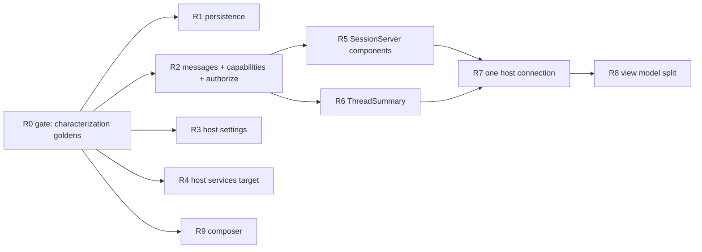

# Foundation audit and rebuild plan

Plan only. No code changed. Baily's premise: a lot of this code is slop and the foundation has to be rebuilt from the basics. This document tests that premise with measurements, names what is actually wrong, and proposes thin slices that replace one piece at a time behind a stable interface. It depends on [the validation plan](validation-tools.md) (`docs/plans/validation-tools.md`): every rebuilt piece has to pass the same characterization checks as the code it replaces, and those tools do not exist yet.

## Summary

The foundation is not uniformly bad. Three ground floors are sound and should stay: the `ShepherdCore` model, the NDJSON framing and peer-identity rules, and the one-serial-queue server model. The damage is concentrated in six places, and each one is a class of bug, not a pile of instances.

1. **The host's configuration is the UI's.** The host process (`Shepherd --host`) is assembled inside the `ShepherdApp` module and reads `AppSettings`, a `@MainActor` UserDefaults store. A hand-kept list of 61 keys keeps the host following the app (53 until #740 added the eight Fleet settings); 62 settings persist, so one is omitted (`remoteListenerPort`, which nothing writes after `init`), and no test checks that the list is complete. One new host-editable setting touches 16 places (19 when Fleet syncs it). The list is the mechanism behind one earlier host-follow bug (`057dd7301`); the nine omissions are unclassified, not nine known defects.
2. **Persistence is all-or-nothing and ad hoc.** One decode error in `state.json` quarantines the whole workspace and the app starts empty. Of the 94 `try?` decodes of JSON, 38 read a file; 13 are Shepherd's own state files that fall back to an empty default which the same type later writes over the file (F2 lists them). Several already carry a `version`; the version does not stop the overwrite.
3. **`SessionServer` is a 17.7k-line object** with 355 stored properties, an 877-line remote request handler (authentication, the pre-hello exceptions, then the main switch from `:3166`), and 104 fix commits in 85 days. A fix to it also touches the app, remote or protocol modules 59% of the time.
4. **Many Mac app features exist twice: once for this Mac, once for a paired Mac.** `ShepherdViewModel` (11.4k lines, 53 files) declares 32 `remote*` members (25 stored, 7 computed; about 20 of the stored ones are paired-Mac twins of local state), and 139 of 340 app files depend on it. `ARCHITECTURE.md` says no view asks whether a connection is this Mac's; the code still does in 194 places.
5. **The protocol is hand-maintained.** 130 capability constants, about 300 message cases with 147 hand-written `init(from:)` decoders, and a rule sheet that asks for seven edits per message. Business rules are copied across Mac, iOS and host (rows in section 2, F7 and F8).
6. **Verification does not match the speed of change.** 46% of commits that touch code are `fix:` commits. Nightly ships with no test run, 200k lines compile in Swift 5 language mode, and iOS is checked by 18 of 203 files in headless scripts.

The plan is nine slices after one gate. The gate (R0) builds the characterization goldens on the validation plan's tools. R0 only characterizes what the code does today. Slices R1 to R3 are small and remove the data-loss and settings classes, each with its own new-behavior checks. R4 to R8 take the large objects apart one seam at a time, with authorization kept ahead of any routing. Slice R9 is a parallel lane for the Mac composer. Nothing is rewritten in place, and the one wire change in the plan (R6's added summary) is named, optional and negotiated.

## Status

As of 2026-11-21, from `git log origin/nightly` and the PR list. "Open" means not merged when this was written.

| Slice | State | PRs |
| --- | --- | --- |
| R0 gates: C-STATE, C-WIRE, C-AUTH, C-SETTINGS | done | #763, #765, #766, #768 |
| R0 gate: C-LIFECYCLE, C-THREAD | not a new check: the existing suites named in the checks table stand for them | none |
| R1a persistence: `PersistedFile` and workspace recovery | done | #775 |
| R1 per-file readers, 12 of 13 | in progress | see the list below |
| R2 message spec table, `Capability`, authorize step | done | #776; the host's `HostSettingChange.capability` check was added by #796 |
| R3a Agents | done | #779 |
| R3b Worktrees | done | #781 |
| R3c Experiments | done | #783 |
| R3d Fleet | done | #786 |
| R3 removal of `followed`, the Darwin follower and the mapping copies | not started (`AppSettings.followed` is still in the tree; the plan defers it to the release after the last group) | none |
| R4 host services target | blocked on decision D3 | none |
| R5 step 1, the request router | in progress, one open PR: the route table and the model catalog request | #859 (open) |
| R5 steps 2 to 6, R6 to R10 | not started | none found |

R1 readers, one file each:

| File | PR |
| --- | --- |
| `.shepherd-imports.json` (pi import state) | #785 |
| `instructions/history.json` | #787 |
| `hooks/settings.json` | #791 |
| `automation-triggers.json` | #804 |
| `changes/turns.json` | #810 |
| `automation-runs.json` | #815 |
| `thread-origins` and saved questions | #823 |
| skill records | #826 |
| design `thread-notes.json` | #829 |
| `push-registrations.json` | #833 |
| `instructions/suggestions.json` | #836 |
| `changes/bases.json` | #839 |
| `forge-pins.json` | #858 (open) |

## How this was measured

Repo state: `nightly` at `0de65c60b` (2026-11-19). The repo is 85 days old (first commit 2026-08-27), has 4,325 commits, 495k lines added and 150k deleted in code paths, and 335k lines of production Swift plus 11k of TypeScript today (270k lines of tests). That age matters: part of the fix volume is features shipped days earlier being corrected, not foundation decay. Where a number could mean either, the text says so.

Counting rules: lines are `wc -l` of `.swift`, `.ts`, `.mjs`; a "fix commit" is a non-merge commit whose subject starts `fix`; "touches" means the commit changed the path. Everything is reproducible with `git log --no-merges --name-only` and `grep -c`. Not measured here: statement coverage (nothing in the repo produces it), cold build time on this machine (no build was run, per AGENTS.md), and runtime profiles (see [INSTRUMENTS-AUDIT.md](../../INSTRUMENTS-AUDIT.md) for the existing partial ones).

## 1. The map

### 1.1 Modules

| Module | Files | Lines | Test lines (@Test) | Commits touching | Fix commits | Fix share |
| --- | ---: | ---: | --- | ---: | ---: | ---: |
| `ShepherdCore` | 26 | 5,774 | 2,774 (242) | 94 | 22 | 23% |
| `ShepherdProtocol` | 101 | 28,144 | 11,637 (790) | 299 | 69 | 23% |
| `ShepherdRemote` | 134 | 35,706 | 27,163 (1,696) | 554 | 189 | 34% |
| `ShepherdSessions` | 221 | 70,987 | 11,686 unit + 55,797 integration (2,554) | 608 | 252 | 41% |
| `ShepherdApp` (Mac) | 340 | 93,322 | 24,053 unit + 64,922 integration (3,077) | 1,266 | 547 | 43% |
| `ShepherdUI` | 198 | 51,843 | 3,906 (248) + 19,222 previews (582) | 450 | 171 | 38% |
| iOS app (`App/`) | 210 | 44,207 | `ShepherdIOSChecks` 16,260 (script harness) | 398 | 174 | 44% |
| `Extensions/` (pi extensions, TS) | 30 | 11,443 | 17,474 (82 `.mjs` files) | 189 | 70 | 37% |
| `TerminalSurfaceKit` | 5 | 1,259 | 524 (37) | 39 | 12 | 31% |
| `DesignSurfaceKit` | 11 | 3,381 | 2,002 (72) | 30 | 14 | 47% |
| `ShepherdPTYSpawn` (C) | 1 | 40 | none | 3 | 3 | n/a |

The inner modules are the stable ones: Core and Protocol have the lowest fix share (23%) and the lowest churn. The modules that own behavior (Sessions, App, iOS) fix about four commits in ten. Fix share is context, not the argument for keeping a module: Core, framing, the queue model and the shared client stay because of the contracts they hold (section 4), not because they churn less. The dependency graph in `ARCHITECTURE.md` matches the imports: Core imports nothing, Protocol imports Core only, Sessions imports Protocol and Remote, and App imports everything (`ShepherdApp` files import Protocol 220 times, Remote 202, Sessions 126).

By feature, measured by file names (they overlap, so they do not sum to the total): Design 144 files and 44k lines, Fleet 119 and 30k, Projects 106 and 21k, Settings 61 and 15k, Review 54 and 11k, Browser 37 and 10k, Forge 28 and 9k. Fleet's 30k lines landed mostly 2026-11-11 to 11-13: 96 commits and 23.7k lines added to Fleet paths in three days. Of the 175 commits whose message mentions Fleet, 32 are `fix`.

### 1.2 The largest types

Counts include every `extension` file.

| Type | Where | Size | Evidence of strain |
| --- | --- | --- | --- |
| `SessionServer` | `ShepherdSessions/SessionServer.swift` plus 28 `SessionServer+*.swift` | 17,724 lines, 673 funcs, 355 stored properties | 331 commits and 104 fixes on the main file alone. `handleRemoteLine` is 877 lines (`:3086`, authentication included; main switch at `:3166`), `handleLine` 437 (`:5445`), `makeSessionOnQueue` 301 (`:9537`) |
| `ShepherdViewModel` | `ShepherdApp/ShepherdViewModel.swift` plus 52 extension files | 11,456 lines, about 600 funcs, 251 stored properties in the main file | 248 commits and 55 fixes on the main file; 139 of 340 app files reference it |
| `RPCThreadState` | `ShepherdSessions/RPCThreadState*.swift` | 3,701 lines in the main file plus 10 extension files | 145 commits, 62 fixes; `handle(_:)` is 262 lines (`:803`) |
| `NativeThreadStore` | `ShepherdRemote/NativeThreadStore.swift` | 3,158 lines | 117 commits, 46 fixes; `derive()` is 230 lines (`:730`) |
| `AppSettings` | `ShepherdApp/AppSettings.swift` | 1,045 lines, 62 persisting properties | see F1 |
| `RemoteRequest` / `RemoteReply` / `ExtensionMessage` / `ExtensionReply` / `NativeThreadRequest` | `ShepherdProtocol` | 81, 69, 68, 44, 42 cases (counted by indentation, so approximate) | 147 hand-written `init(from:)` across Core, Protocol, Sessions and App |

What `SessionServer.swift` holds, by its own `MARK` sections: Fleet glue, lifecycle, the native thread, the TCP and local listeners, Browser tunnels, the extension socket, design references, an agent access policy, Browser drive, state mutations, automations, designs (about 1,100 lines of design store, systems, comments and markup), PTY and RPC sessions, and socket helpers. Nothing in it is shared with another type by an interface; they share fields.

### 1.3 Who owns which state

| State | Authoritative owner | Persisted | Copies and mirrors |
| --- | --- | --- | --- |
| Workspace (spaces, tabs, agents, automations, designs, projects) | `SessionServer` through `StateStore` (`StateStore.swift:21`) | one `state.json`, rewritten whole on each mutation, plus a Project history SQLite beside it | `ShepherdViewModel.state` adopts pushes (`adopt`, 113 lines); `RemoteHostStore` per paired Mac; iOS stores |
| Thread transcript | pi's session file | pi | `RPCThreadState` (host projection) then `NativeThreadStore` (client projection) then views |
| Settings | `AppSettings` (UserDefaults) read by both app and host, plus pi's `settings.json` in the pi home | UserDefaults, `settings.json` | `HostSettings` (wire view, `HostSettings.swift:9`), `ClientSettings`, iOS screens |
| Composer draft, attachments, queue | `NativeThreadStore.draft` (`NativeThreadStore.swift:197`), `ThreadInput` (per thread, `ComposerAttachments.swift:80`), `ComposerDrafts` (UserDefaults, `Thread/ComposerDrafts.swift`) | UserDefaults | iOS `ComposerState` (`App/iOS/Composer/ComposerState.swift`) re-implements attachments, queue rows and slash matches |
| Agent status and Done/unseen | host (`applyAgentStatus`, `SessionServer.swift:6947`) | reset to idle at `start()` | sidebar rules on Mac (`SidebarModel.swift:625`), `FleetSidebar.swift:141` on iOS, `Fleet.swift:469` |
| Terminals | `PTYSession` in the host | none (screen snapshot only) | `HostTerminalLeaf` in the app |
| Selection, sheets, sidebar | `ShepherdViewModel` | UserDefaults for some | none |

### 1.4 Persisted formats and special cases

- About 40 distinct JSON file names appear in Swift code (some are pi's or the user's; Shepherd's own include `state.json`, `automation-runs.json`, `turns.json`, `forge-pins.json`, `push-registrations.json`, `thread-notes.json`, `canvas.json`, `devices.json`, `dispatches.json`, `peers.json`, ...), with 114 `JSONDecoder()` and 110 `JSONEncoder()` construction sites, and 24 version markers in total. UserDefaults is touched at 65 sites outside tests, and `ComposerDrafts` alone adds three keys.
- 94 `try?` decodes of JSON in `Sources` and `App` (appendix command). 38 of them read a file; the other 56 parse wire frames, pi output or text, or read a persisted UserDefaults value (the paired-Mac list and app enrollment, `RemoteHostStore.swift:312,444,448`, which default to empty and are later written back). Of the 38, 13 are Shepherd's own state files that fall back to empty and are written back by the same type, 7 are Fleet caches and records, and 18 are pi-owned files, per-record scans that skip a bad record, or read-only widgets (classified in F2).
- 130 `*Capability` constants in `ShepherdProtocol` with 358 references; 156 `capabilities.contains` expressions across Sources and App; 55 distinct `SHEPHERD_*` environment variables read by Swift code.
- 108 `@unchecked Sendable`, 98 `MainActor.assumeIsolated`, 50 `NotificationCenter` uses, 337 `queue.async` and 48 `queue.sync` in `ShepherdSessions` (33 of the `sync` calls are in `SessionServer.swift`, mostly start, stop and test hooks).
- `ShepherdRemote`, `ShepherdSessions`, `ShepherdApp`, `TerminalSurfaceKit` and `shepherd-cli` build in Swift 5 language mode (`Package.swift:44,57,65,100,105`). Core and Protocol are the only modules checked for data races by the compiler.

### 1.5 Verification as it exists

| Check | What it covers | Where it runs |
| --- | --- | --- |
| `swift test` | 13 test targets, about 9,300 `@Test` functions across them | locally; CI only on PRs into `master` (`docs/testing.md#ci`). `nightly` ships without rerunning tests. |
| iOS | 18 of the 203 `App/iOS` files are named by `ShepherdIOSChecks` scripts, which compile files with `swiftc` and run executables; the rest is covered by the release `xcodebuild` | scripts, one `@Test` in the directory |
| Extensions | 82 `.mjs` test files, 17k lines, against the staged pi engine | locally |
| Previews | 582 `@Test` renders, light and dark | opt in with `SHEPHERD_PREVIEW_DIR` |
| Coverage | none measured | n/a |

Test-suite hygiene: `docs/testing.md` says never sleep a fixed amount, and the tests contain 313 `sleep` calls against 3,849 `eventually` waits. Two open PRs (#728, #729) remove some. A nightly release takes about 42 minutes on hosted runners; the build cache job 10 to 16 minutes (`gh run list`). `nightly` requires no test checks.

### 1.6 Churn hot spots

Fix commits and total commits per file, all time (code paths only):

| File | Fix / total |
| --- | ---: |
| `ShepherdSessions/SessionServer.swift` | 104 / 331 |
| `ShepherdApp/Thread/ThreadView.swift` | 69 / 140 |
| `ShepherdSessions/RPCThreadState.swift` | 62 / 145 |
| `ShepherdApp/ShepherdViewModel.swift` | 55 / 248 |
| `ShepherdApp/Thread/Composer.swift` | 48 / 120 |
| `ShepherdRemote/NativeThreadStore.swift` | 46 / 117 |
| `App/iOS/Thread/ThreadScreen.swift` | 35 / 74 |
| `ShepherdRemote/RemoteHostClient.swift` | 33 / 132 |
| `ShepherdRemote/NativeThreadPresentation.swift` | 31 / 70 |
| `ShepherdApp/WorkspaceView.swift` | 26 / 114 |

Of 1,028 fix commits that touch code, 303 (29%) touch two or more modules and 110 (11%) touch three or more. That is a minority: most fixes stay inside one module. It points at a few missing interfaces (F4, F7, F8), not at every module. The sharper signal is `SessionServer.swift`, where 61 of 104 fixes (59%) also touched another module.

## 2. Findings

Ranking is (bugs caused + agent time lost) divided by cost to fix. Bugs are fix commits and the specific failures named in the brief. Agent time is the number of places a routine change must touch. Cost is S (one agent, days), M (about a week, several slices) or L (many slices). F3 and F5 cost the most, so they rank late even though they have the most fixes; the cheaper slices before them also make them safer. F8 moved above F9 and F7 in this revision: its bugs are recent and each fix is small, while F7's evidence is a process cost (seven edits) with a modest fix count, and F9's "auto-merge" premise was withdrawn. Sequence (section 5) follows dependencies, not rank.

| Rank | Finding | Bugs | Agent time | Cost |
| ---: | --- | --- | --- | --- |
| 1 | F2 Persistence loses data on a decode error | data loss class | every new field | S |
| 2 | F1 Settings: a hand-kept list decides what the host follows | a delivery gap (`057dd7301`), a deadlock (`54a558f20`) | 16 places per setting (19 with Fleet) | M |
| 3 | F8 State and rules owned twice (composer, Fleet, status) | 15 composer fixes, Fleet mismatches | per feature | S each |
| 4 | F9 No verification gate before nightly | all of them | every PR | S to M |
| 5 | F7 Protocol policy is hand-maintained | wire mismatches (25 fixes in 144 commits to `RemoteMessage.swift`) | 7 edits per message | M |
| 6 | F4 Host composition lives in the UI module | settings, Projects | every host feature | M |
| 7 | F5 Local and paired-Mac code paths are twins | 62 remote fixes, 128 iOS fixes | per feature | L |
| 8 | F3 `SessionServer` | 104 fixes | per feature | L |
| 9 | F6 `ShepherdViewModel` | 55 fixes | per feature | L |
| 10 | F10 Transcript rendering carries a rule book | 81 to 159 scroll and mount fixes | per UI change | open |

### F1. The host follows settings through a hand-kept list

- **Evidence.** `AppSettings.followed` (`AppSettings.swift:995`) lists 61 keys. 62 properties persist (a `didSet` writes them). Until #740 (`f8795072f`) it listed 53 and omitted nine: the eight Fleet settings (`fleetAutoDispatch`, `fleetBatteryCountsHalf`, `fleetCheckIgnores`, `fleetSnapshotExcludes`, `fleetThreadCap`, `fleetThreadsCanSend`, `fleetUncommitted`, `fleetWeights`) and `remoteListenerPort`. #740 added the eight. One omission is left, `remoteListenerPort`, and nothing writes it after `init` (no Settings control, no `HostSettingChange`), so it is not a broken setting; the host reads it when it opens the listener (`ShepherdApp.swift:304`). The earlier nine were not nine broken settings either, and the list still has no test that enumerates the properties (`HostModeSettingsTests` has six tests and none checks completeness). `reload()` (`:979`) builds a second `AppSettings` and copies each followed key.
- **Why it is structural.** The host is not a server module. `ShepherdHost.main` and `ShepherdHost.Services` are in `ShepherdApp/ShepherdApp.swift:357,391` and run on the main actor with `AppSettings.shared`. Two processes share a UserDefaults domain and a Darwin notification. Every setting is then declared in `AppSettings`, copied by `HostSettingsMapping.settings(from:)` and `apply(_:to:)` (`ShepherdViewModel+HostSettings.swift`), and again in `HostSettings`.
- **Touch points for one host-visible setting:** the `AppSettings` property and `didSet`, the reset line, `followed`, the `HostSettings` field, its init parameter, its init assignment, `CodingKeys`, the decode line (`HostSettings.swift:249,259`), a `HostSettingChange` case (41 of them, `:368`), the `apply` switch (`:313`), `HostSettingsMapping.settings(from:)`, `HostSettingsMapping.apply`, a Mac row, an iOS row. That is 12 in the list above and 16 counting the key enumeration, load, write and iOS control (19 when Fleet syncs it: its enum and encode and decode switches in `FleetHostSettings.swift`); `skillsInSlashMenu`, `mcpProjectConfig`, `closeOnMerge` and `computerUseEnabled` each appear in 7 to 9 files and 21 to 29 references.
- **Cost it caused.** `057dd7301` (the app's Settings edits did not reach the background host), `54a558f20` (a settings write on the host waited on its own main queue), and the two-Mac run in the validation plan, which saw a setting not followed by the receiving host (not traced; #740 is the follow-list fix for the Fleet settings and is the likely cause). The first two are one design: two processes, one UI-shaped store, a copied list.
- **Cost to fix.** M. See T1 and R3.

### F2. Persistence loses data on a decode error

- **Evidence.** `StateStore.load` (`StateStore.swift:145-163`) decodes `ShepherdState` in one call. `spaces`, `tabs` and `agents` use a strict `decode` (`Models.swift:748-750`), so one agent whose JSON no longer fits makes the load throw and `quarantine` moves the whole file aside (`:165`). The app then starts with an empty workspace. The evidence is kept on disk, but the user's view is a lost workspace. `StateStoreTests.swift:164` covers one historic shape (`aTerminalEraFileLoadsWithoutQuarantine`); there is no corpus of old shapes.
- **Real overwrite paths.** The 94 `try?` decodes split into 56 that parse wire frames, pi output or text, or read a persisted UserDefaults value (not a file; see the last bullet below), and 38 that read a file (heuristic: a `Data(contentsOf:)` or file read within six lines above; reproduce with the appendix command). Of the 38:
  - **13 are Shepherd's own state, defaulted and rewritten by the same type:** `AutomationRuns.swift:37` (`reload()` sets `runs = [:]` when decode fails and the next `publish` writes the file), `Changes/ChangesService+Turns.swift:48` (turn records), `Changes/ChangesService.swift:595` (base recents), `AutomationTriggers.swift:152`, `ThreadOrigins.swift:150`, `InstructionsStore.swift:114` (history), `Forge/ForgeService.swift:777` (pins), `PushNotifications.swift:77` (registrations), `DesignStore.swift:820` (thread notes), `Hooks/HookSettingsStore.swift:56`, `SuggestionsStore.swift:175`, `SkillsStore.swift:573` (records), and `YourPiImport.swift:359-362` (`.shepherd-imports.json`, the pi import state: `state()` returns nil on a decode failure, and `updateState` then starts from a fresh value and saves over the file on the next change, `:381-386`; it was first filed under pi-owned, but Shepherd writes it, so it belongs here). Each has its own decoder. Six of them already carry `version = 1` (`AutomationRuns`, `AutomationTriggers`, `ThreadOrigins`, `InstructionsStore`, `SuggestionsStore`, `SkillsStore`), and the version does not help: a file that fails to decode is still read as empty and then written over.
  - **7 are Fleet caches and records** (`FleetRepoFinder:56`, `FleetRepoKeys:16`, `FleetSync:70`, `FleetMaterializer:115`, `FleetContentSources:288`, `FleetDispatch:297,301`). Most can be rebuilt; the dispatch records cannot, so they go in R1's later group.
  - **18 are not overwrite paths:** pi-owned files (`RPCThreadState`, `PiSessionPreview`, `PiCompactionThreshold`), per-record scans that skip a bad record, the Fleet index and history readers, and the read-only Glance widget.
  - **The non-file remainder is not all wire and text.** Two of the 56 are persisted UserDefaults values: the paired-Mac lists (`shepherd.remote.hosts`, `.notInFleet`, `RemoteHostStore.swift:444,448`, rewritten at `:562,564`) and the app enrollment (`:312`, `:313`). A value that fails to decode reads as empty and the next save replaces it. They are not files, so the 13 above do not include them; R1 classifies them the same way (refuse or rebuild) in its first step.
  I did not read each of the 13 to the write call; R1's first step is to confirm each one before converting it.
- **Why it is structural.** There is no shared persisted-file type. The rule in `docs/rules.md` ("new persisted fields decode with defaults") is a manual convention, and 147 hand-written `init(from:)` implement it by hand.
- **Quarantine is whole-file and comes after validation.** `StateStore.load` quarantines when decode or `validate()` throws (`StateStore.swift:145-163`). Dropping one space, tab or agent is not a safe fix by itself: surviving records reference them (`StateValidation.swift:105-166` rejects a tab without its space, an agent without its tab or pane, an automation without its agent). Recovery has to produce a graph that validates, or write nothing.
- **Cost to fix.** S for the helper and the corpus, then one file at a time. See T2 and R1.

### F3. `SessionServer` is the whole host in one object

- **Evidence.** Section 1.2. Its request path is two giant functions (`handleRemoteLine` 877 lines from `:3086`, `handleLine` 437). `handleRemoteLine` is not only a switch: it decodes, answers the three pre-hello fleet requests (`fleetIdentify`, `fleetPair`, `fleetPairDevice`) with a rate limit, requires `hello` and the protocol version, authenticates the peer or device (local sockets never take a token), and only then reaches the main switch at `:3166`. That front half is an authorization boundary, and several cases in the switch add their own (negotiated capability, visible-agent scope, a 64-thread cap, "only a Mac in the fleet answers a call"). `stateDidCommit` (`:7149`) is one 90-line function that diffs the old and new workspace to update Project authority, peer deliveries, retired sessions, automation watchers, Fleet and more, so adding a feature to the workspace means editing it. 59% of fixes to the file (61 of 104) also changed App, Remote or Protocol.
- **The queue rule is enforced by comments.** The rules say one serial queue and never `.sync` between server queues. There are 33 `queue.sync` calls in the file, and `dispatchPrecondition` appears nowhere in `Sources`, so no entry point asserts that its caller is on the queue.
- **Cost to fix.** L, but it can be sliced without changing behavior (T3, R5). It comes after the cheaper classes because every slice below needs the characterization corpus.

### F4. The host's services live in the UI module

- **Evidence.** `ShepherdHost.Services` (`ShepherdApp.swift:391`) creates MCP, notifications, worktrees, the Project runtime (`RuntimeHosting.headless`) and settings for `Shepherd --host`. `ProjectCoordinatorController` and `ProjectExecutionController` are `@MainActor` app types the host runs. 126 `ShepherdApp` files import `ShepherdSessions` and 27 mention `SessionServer`, although `ARCHITECTURE.md` says the app never runs a server.
- **Cost.** It is one cause of F1, and it means a "server" change needs the app target to build. The `--host` mode and the app are the same executable (`App/ShepherdLauncher.swift:1-15` dispatches on `--host`), so any change here moves code between targets; it does not make a second executable.
- **Cost to fix.** M, after F1. See T4 and R4.

### F5. Local and paired-Mac code paths are twins

- **Evidence.** `ShepherdViewModel.swift` keeps `fileTrees` and `remoteFileTrees` (`:223,225`), `reviewSessions` and `remoteReviews` (`:216,321`), `childRuns` and `remoteChildren` (`:210,310`), `referenceChips` and `remoteReferenceChips`, `designScreens` and `remoteDesignScreens`, plus 25 stored `remote*` properties in all (the 32 `remote*` declarations include 7 computed ones; five of the stored ones are connection infrastructure or this Mac's listener status, not twins). `RemoteAgentRef` appears 158 times in 46 app files and there are 194 `if let remote` / `.remote(` branches. `ARCHITECTURE.md` already says the local host is transport only and no view should ask whether a connection is this Mac's.
- **Cost.** 62 `fix` commits mention remote or paired hosts and 128 mention iOS; a feature built for one path is rebuilt for the other. The iPhone and iPad client is a third copy: 203 files that re-draw the same threads from the same `ShepherdRemote` stores.
- **Cost to fix.** L. See T5 and R7.

### F6. `ShepherdViewModel` is a god object

- **Evidence.** 53 files, 11,456 lines, 251 stored properties in the main file. It holds Design (32 properties), sidebar caches, review, Fleet, remote and selection state in one `@Observable`, so any feature's change forces edits to the same file (248 commits). Its own doc says it "holds only presentation state".
- **Cost to fix.** L, mechanical once F5 lands. See R8.

### F7. Protocol policy and capabilities are hand-maintained

- **Evidence.** About 300 message cases (section 1.2), each needing the seven edits listed in `docs/rules.md` ("Contracts"): case, `Kind`, `CodingKeys`, both codec arms, a round-trip row, `speaksFor` and `replyID`. 130 capability constants, 156 `capabilities.contains` sites, 358 references; the Mac clients have 43 direct checks and iOS 4, with repeated ones in `RemoteHostStore.swift:170,256,609,740` and `RemoteDesignReferences.swift:21,79`. The extension side builds the same message shapes by hand in TypeScript (`Extensions/shepherd-panes.ts`, 1,281 lines, and others).
- **Cost.** A message missing one of its seven parts fails at runtime or silently on older hosts. `RemoteMessage.swift` has 144 commits, 25 of them fixes.
- **Cost to fix.** M. See T3 and R2. Macros would need `swift-syntax`, a new dependency, so the plan does not use them.

### F8. State and business rules owned twice

These are small and independent, and they are where "tonight's" bugs came from.

| Rule | Where it is implemented | Cost seen |
| --- | --- | --- |
| Composer draft and attachment ownership | Draft in `NativeThreadStore` (`:197`), attachments in `ThreadInput` held per thread by `NativeThreadStores.swift:47,126` and also as `fallbackInput` in `ThreadView.swift:104` and `emptyProjectInput` in `ShepherdViewModel.swift:564`, persisted by `ComposerDrafts`, and re-implemented for iOS in `ComposerState` | `d17441a8f`: closing the second view of a thread dropped an attachment because both composers set one shared `available` flag; an accepted Project send cleared a newer draft. 15 composer data and queue fixes, 48 fixes to `Composer.swift` |
| Model short name | `Composer.swift:1596` and `NativeComposerPresentation.swift:336` (identical bodies), iOS `ComposerControls.swift:68` | `47963d50d` |
| Thinking chip eligibility | `Composer.swift:1000` against the shared rule `NativeComposerPresentation.swift:460` and iOS `ThreadComposer.swift:318` | `7c448f1dc`, `6551964eb`, `b79c44c03` |
| Status words | `SidebarView.swift:395`, `Fleet.swift:611` | status fixes `023343b55`, `d296a87ee` |
| "Working while subagents run" | `Fleet.swift:469` (client) and `SessionServer.swift:7060` (host) | same two fixes |
| Done and unseen | `SidebarModel.swift:625,706` (Mac), `FleetSidebar.swift:141` (shared and iOS), `SessionServer.swift:7901` | cross-device clearing added in `5af921679` |
| Branch and worktree fact | `AgentBranchPresentation.swift:32`, `Fleet.swift:597`, host updates `SessionServer.swift:7805` | `166767aa0`; the validation plan's two-Mac run found wrong branch summaries and status mismatches |

Common cause: the host knows the fact, and each client re-derives it from partial inputs. Rank 5 because each fix is small and the bugs are real and recent.

### F9. Verification does not match the speed of change

- 1,028 of the 2,224 commits that touch code are `fix` (46%). `nightly` has no test CI (section 1.5). The validation plan lists the same gap ("nightly reviewers get uneven evidence").
- `ShepherdRemote`, `ShepherdSessions` and `ShepherdApp` (about 200k lines) compile in Swift 5 language mode with 108 `@unchecked Sendable` and 98 `MainActor.assumeIsolated`: the compiler cannot find a data race in the code whose correctness depends on queue discipline.
- iOS has no `swift test` target; its 203 files are checked through scripts and the release build.
- The test suite is large (2,554 tests for Sessions, 3,077 for the Mac app) but nothing measures what it covers, so "the tests pass" does not say a rebuilt piece is equivalent.

### F10. Transcript rendering carries a rule book

`docs/rules.md` spends 106 of its 407 lines (26%) on "Switching is a visibility flip" and the eager-tail rules: `NativeMountedCost.eagerTailCap`, `ThreadEagerTail`, `ThreadRestore`, `keptStacks` and retry counts. `ThreadView.swift` has 69 fix commits; 159 fix subjects mention scroll, tail, restore, mount, rows, anchor or lazy (81 on a narrower match), and 22 are `lag`, `stall` or memory. iOS spent four fixes between 2026-11-13 and 11-14 on one "bottom marker" bug. [INSTRUMENTS-AUDIT.md](../../INSTRUMENTS-AUDIT.md) measured `AG::Subgraph::update` in 55% of sampled app CPU. The mechanism is a response to SwiftUI list cost, not a bug in one place. This plan does not propose a rewrite: it proposes measuring first (decision D5).

## 3. The target foundation

Constraints kept: one serial server queue, `@Observable` state, no new dependencies, no wire change except R6's named one, authorization checks stay ahead of routing, ShepherdUI imports nothing from Shepherd. Each design below removes the class of bug.

### T1. One declaration per setting, and the host owns host settings

- Split settings by scope in the type, not by convention. First classify all 62 persisting settings as **host**, **device** or **both**, which also settles the one remaining omission (`remoteListenerPort`). **Device settings** (sidebar width, density, text scale, editor, window chrome) stay in `AppSettings` on UserDefaults and never leave the app process.
- **Stored preferences are not the wire reply.** `HostSettings` is a projection: `ShepherdViewModel+HostSettings.swift:44-60` fills it per request with live listener port and failure, the background-service state, Shepherd and pi versions, the slash-command catalog and the installed extensions (read from pi's `settings.json` off the main actor). None of that is a preference and none is persisted. The host owns a separate `StoredHostPreferences` value (`Codable`, versioned, one file) in a `HostSettingsStore` in `ShepherdSessions`; the `HostSettings` reply is built from it plus the live facts at request time, as it is today.
- Writes arrive only through the existing `HostSettingChange` request. Cases that are deliberately inert today stay inert (`:128-150`: the legacy goal checker, Finalize and pi-update switches change nothing and still answer `ok`), and capability-gated cases keep their `capability`. Today only iOS and paired Macs use that request path. A setting can have several write paths, and R3 records all of them, not one: the Mac's own Settings writes `AppSettings` directly and the host follows through the Darwin notification (`ShepherdApp.swift:281`); an incoming Fleet sync applies the setting in the host with no `.hostSettings` request (`ShepherdApp.swift:332-334`); iOS and paired Macs send the request; and device-only settings such as sidebar width have no case at all. R3 moves a Mac write onto the request path only per group and only with a test that covers the move, and keeps each local path (including the Mac's listener switch and its relisten hook) until its replacement is tested.
- Declare each stored preference once with its default (a small property wrapper that does `decodeIfPresent ?? default`; no macro). Synthesized `Codable` replaces the hand-written `CodingKeys` and `init(from:)` for the stored value; the wire `HostSettings` keeps its own codec because its bytes do not change.
- **Migration keeps the old copy current.** The new store reads the old UserDefaults values once, then writes every change to both the new file and the old UserDefaults key (the keys the previous release reads) for at least one release. Upgrade, change a setting, downgrade must leave the new value in effect, not just an old key present. The old keys stop being written only in a later release, after the compatibility window.
- Delete when the last group has moved and the window has closed: `AppSettings.followed`, `reload()` and the Darwin-notification follower, `HostSettingsMapping.settings(from:)` and its `apply`, and the second list in `ShepherdViewModel+HostSettings.swift`.
- Result: a new host setting is one declaration, one `HostSettingChange` case and one row per platform. A test enumerates the stored preferences with `Mirror` and fails for a field without a default, and a second test fails for a `HostSettingChange` case that does not change its field, exempting the intentionally inert cases and the settings that have no case (device-only, the Mac listener switch).

### T2. One way to read a persisted file, and a recovery that cannot lose the workspace

- `ShepherdCore` gets `PersistedFile<Value>`: one load result (`.loaded`, `.missing`, or `.damaged` with the original preserved), a lossy array decoder (each element decodes alone; failures are collected with their raw JSON), and a rule that a damaged file is never replaced by a silent default. A store that finds its file damaged refuses its own writes (as `StateStore` already does through `recoveryError`, `StateStore.swift:182,188`), logs, and surfaces a banner naming the file. Derived caches (most Fleet files) may rebuild instead; that is a per-file choice written down in R1.
- **Keep the legacy file shape.** An old build cannot read `{version, value}`. In the release that adds `PersistedFile`, the reader accepts both shapes but every writer still writes the shape the previous release reads (bare value, or the file's existing `version` field). The envelope is written only in a later release, after the previous release's reader has been out for a full cycle. Fields are additive only.
- **`state.json` recovery, in order.** (1) Only the process that owns the workspace exclusively recovers; a read-only or non-exclusive loader never moves, writes or repairs (the `readOnly` rule in `StateStore.load`). (2) Copy the original bytes to `state.json.recovery-<id>` before anything else; the original stays in place until a validated graph is written. (3) Decode `spaces`, `tabs` and `agents` element by element and keep each rejected element's raw JSON in `state.json.rejected-<id>`. (4) Do not repair silently: an element whose dependency was rejected (a tab whose space failed, an agent whose tab or space failed, an automation whose agent failed) is rejected with it into the same file. (5) Run `validate()` on the recovered graph. If it passes, adopt it and write nothing until the next ordinary mutation, which writes the legacy shape. (6) If any step fails or the recovered graph does not validate, set `recoveryError` so every write, staged or committed, is refused before any file or Project history is touched, leave `state.json` untouched, and show a repair state. Never fall back to an empty workspace that the next mutation can write over the file.
- The remaining file readers move onto it one by one, starting with the 13 in F2, each after reading its write path.
- Result: adding a required field cannot erase a file. Checks: R0's goldens (what loads today) plus R1's recovery cases.

### T3. Policy in one table, routes registered by feature, authorization ahead of both, one queue with assertions

- Keep the enums and their wire bytes. Add one `MessageSpec` table keyed by `Kind` that holds the declarative parts: the capability a message needs, `speaksFor`, `replyID`, and an authorization class (answerable before `hello`, local-only, peer-or-device, extension-agent). A test over `Kind.allCases` fails for a missing row or round-trip. Capabilities become a `Capability` type whose raw values are today's 130 strings, listed once, with the consumer checks (`host.supports(.designs)`) in one place.
- **A row does not replace the checks.** `Kind` plus one capability cannot express what `handleRemoteLine` does today: the three fleet requests answered before `hello` with a per-connection limit (`fleetIdentify`, `fleetPair` and `fleetPairDevice`, `SessionServer.swift:3107-3113`), the protocol-version and token checks, the rule that local sockets never present a token, the requirement that a capability be both *offered by the host and negotiated by this client* (`:3166-3218`), and payload-dependent scope (visible agents for this client, coordinator exclusion, a 64-thread watch cap, `HostSettingChange.capability` per case, `HostSettings.swift:438` ff, which the host checks in the `.hostSettings` route since #796: see below). On the extension socket, peer identity (`LocalPeer.isTrusted`, `peerPID`, `connection(_:speaksFor:)` at `:10781`, `isPiProcess`) decides who may speak for an agent. All of these stay in code, in front of the route table: one `authorize(request, client)` step runs first (pre-hello rules, local-only, offered-and-negotiated capability, then the route's named scope guard), and only an authorized request reaches a route. A route cannot be reached without it.
- **Client capability checks and host refusals are different things, and the host now does both.** `RemoteHostClient.hostSettings` (`RemoteHostClient.swift:1240`) refuses a change whose `capability` the host did not advertise, before sending anything. Since #796 the host repeats the check. The `MessageSpec` row for `.hostSettings` requires the base `hostSettings.v1` capability to be *offered to this connection* (`.offered`, not `.negotiated`), and the `.hostSettings` route (`SessionServer.swift`, `case .hostSettings`, the `change.capability` test) refuses a change whose capability is not in `offeredCapabilities(to: client)`, with the `unsupported` reply, before the app's handler runs. Both tests ask what the host offers that connection (the host's list, narrowed for a Fleet device, a non-local socket and a client that did not list `files`); neither asks whether the client listed the capability in its own `hello`, so a client that never negotiated it is still served if the host offers it. After that, a refusal comes only from `HostSettingsMapping.apply` (`settings_failed`) or from there being no handler (`unavailable`).
- `SessionServer` splits along its existing `MARK` lines into components confined to the server queue (Browser, Designs, Automations, Projects, Fleet, Terminals, Remote listener). Each takes a small `ServerContext` (queue, `StateStore`, `send`, `commit`) instead of reaching into the object, and registers routes in a `[Kind: Route]` table so the post-authentication switch (from `:3166`) becomes a lookup. Each entry point starts with `dispatchPrecondition(condition: .onQueue(queue))`, which makes the concurrency rule checkable.
- `stateDidCommit` becomes observers: a component subscribes to `(before, after)` for its own slice of state instead of one function diffing everything.
- Result: adding a message touches its enum case and codec, a spec row and a route, and cannot skip authorization. The server file stops being the place where features collide.

### T4. A host services target that does not import the UI

- Move `ShepherdHost.Services`, the Project controllers (they import Foundation only), `WorktreeHosting`, `AgentLaunch` mapping and MCP hosting into a new `ShepherdHostServices` target between Sessions and App (decision D3). It imports Sessions, Remote, Protocol and Core, not SwiftUI, AppKit or `AppSettings`. Until R3 lands, `Services` takes a small settings-source protocol that the app satisfies with an adapter around `AppSettings`; R4 does not wait for R3.
- **The executable does not change.** `Shepherd --host` is the app's own executable (`App/ShepherdLauncher.swift:1-15`), so it still links the UI modules and still selects host mode by argument. What changes is that the host's code builds and tests as its own target without SwiftUI. A separate host executable would touch the launchd service, bundle and signing; it is not part of this plan and would need Baily's decision.
- Result: a host change builds and tests without SwiftUI, and "does the host follow this?" has one answer once R3 follows.

### T5. One host connection type, local or paired

- A thread is addressed by `ThreadRef(hostID, agentID)`. `This Mac` is a `HostConnection` like any paired Mac. The parallel local/remote dictionaries in `ShepherdViewModel` become one dictionary per feature keyed by `ThreadRef`, behind a per-feature store (T6). `RemoteAgentRef` and the 194 local-or-remote branches go away. This is what `ARCHITECTURE.md` already claims.

### T6. Derive host facts once, on the host

- A `ThreadSummary` value (effective status including subagents, unseen Done, branch and worktree, pull request) is computed once on the server queue and travels with the thread digest the clients already pull, as an optional field sent only to clients that negotiated a new capability (R6 names this as the plan's one wire change). Mac sidebar, iOS and Fleet draw it; the client copies of "Working while subagents run", Done and unseen, and branch (F8) are deleted once every host version the app still pairs with sends the summary (until then they are the fallback). The shared pure rules that exist (`NativeComposerPresentation`) are called from the Mac composer instead of re-implemented.
- Composer: one `ComposerSession` per thread owns draft, attachments, queue hold and which views are attached (the fix in `d17441a8f` is a counted set of attached views); `Composer` and `ThreadComposer` render it. `ComposerDrafts` becomes its persistence.

### T7. The view model split by feature

- `ShepherdViewModel` keeps selection and navigation. Designs, review, Fleet, sidebar caches and the new-thread flow become `@Observable` feature stores owned at the app root and passed to views as plain values, as the Observation rule already requires. Done last, because it is mechanical once T5 removes the twin state.

### T8. The compiler checks races where it matters

- Per module, turn on complete strict-concurrency checking in warning mode first (`ShepherdRemote`, then Sessions, then App), count the warnings, and move a module to language mode 6 only when the count reaches zero without new `@unchecked`. This is a hygiene lane, not a slice (R10).

## 4. What to keep as it is

Not everything is slop. Each item below is kept for the contract it holds or the rule that works, with churn as supporting context only.

- **`ShepherdCore`.** It imports nothing, and `PaneNode`, typed IDs, `AgentStatus` and its transition table are the vocabulary every other module shares (242 tests; 23% fix share as context). T2 adds `PersistedFile` beside the model and changes how files are read around it.
- **The one-serial-queue server model.** It is the rule that makes the server's state coherent, and the bugs in this audit are about code outside it, not the rule. T3 adds assertions; it does not replace it.
- **NDJSON framing, the 1 MiB cap, the extension-socket peer-pid check, the browser rules and the invariants list in `docs/rules.md`.** They are security rules and they have tests.
- **`ShepherdPTYSpawn`, `TerminalSurfaceKit` and `DesignSurfaceKit`.** Small, behind a single importing file each, low fix counts per line (1,259 and 3,381 lines).
- **`ShepherdUI` tokens and `DesignRulesTests`.** The 171 fix commits are mostly visual corrections to screens built from them; the token layer and its literal guard are doing their job.
- **`ShepherdRemote`'s shared thread client** (`NativeThreadStore` and the presentation types). One client for Mac and iOS is the right shape (it is the contract both platforms decode against); the plan adds to it (T6) and does not replace it. `NativeThreadStore.derive()` at 230 lines may need a later split.
- **Test isolation** (`ShepherdTestIsolation`, `ScratchServer`, `StubPi`, `AppHarness`, `eventually`): 3,849 uses of `eventually` show the pattern took. The 313 remaining sleeps are an ongoing cleanup, not a redesign.
- **`StateStore` atomic write and preservation of the original.** Keep both; T2 adds a recovery step in front of them and a refusal to write when recovery fails.
- **The pi extensions** (11k lines TypeScript, 82 test files): dependency-free and inert without their env vars. Their message shapes are a protocol concern (F7), not a reason to rewrite them.

Also not slop, but not foundation: the Design tool (44k lines), Fleet (30k) and Projects (21k) are 28% of the code. Whether to slow them is a product call (D4); the plan only makes them stop depending on `SessionServer` internals (R5).

## 5. The rebuild sequence

Each slice is one or a few PRs into `nightly`. Each replaces one piece behind an interface that already exists or is created in the same slice, with the old path still in the tree until the checks pass on both. A slice never changes existing bytes on the wire, never changes an on-disk format in a way the previous release cannot read, and ships no behavior change except the one it names. The only wire addition in the plan is R6's, named there.

### The checks every slice cites

Two kinds, kept apart. **Characterization goldens (R0)** pin what the code does today at a stable boundary: the wire, persisted JSON and the UI. They are built as [the validation plan](validation-tools.md) slice 2 describes: one named case, seeded fixture inputs, observations recorded in order, normalized for generated IDs and temp roots, captured **twice on unchanged code**, committed under `Tests/Fixtures/`, read relative to `#filePath`. A replacement runs the same named test against the committed golden without building the reference revision or regenerating the file. Known bugs stay out of the golden; intended changes are reviewed explicitly. **New-behavior checks (R1 to R3, R5, R6)** assert what a slice adds. They are written in the slice that adds the behavior, never in R0, because they fail on the reference code by design.

| Check | Kind | What it pins | Built from |
| --- | --- | --- | --- |
| C-STATE | golden | Each historical shape of `state.json` and of the 13 own-state files in F2 loads to the recorded value, and re-encoding that value gives the same JSON, compared as canonical JSON (parsed and compared with sorted keys), because the plain `JSONEncoder` in `StateStore` does not fix object-key order. Damaged inputs record today's outcome (quarantine and an empty start), not an improvement. | fixtures cut from `git log -p` of `Models.swift` and each store, `StateStoreTests` (`aTerminalEraFileLoadsWithoutQuarantine`) |
| C-WIRE | golden | Each message case that exists today encodes from its fixture value to the recorded JSON line and decodes back to the same value; named request sequences against a scratch host (as in the validation plan's rename case) record request and reply. No `MessageSpec` row is required and nothing about unknown fields is promised. | `RemoteMessageTests` (74), `ExtensionMessageTests` (34), the current encoder |
| C-AUTH | golden | The refusal corpus: for each request family, the reply and the observable state after a request that must be refused: before `hello`, wrong protocol version, an unsupported or not-negotiated capability on the families whose host code checks it (push, thread subscribe, fleet digest; the host settings request is refused when the host does not offer its capability, a row added by #796, and is not refused for a client that did not list the capability), the three rate-limited pre-hello fleet requests (`fleetIdentify`, `fleetPair`, `fleetPairDevice`) including the `busy` reply past the limit, local-only access from a network client, another agent's id or an invisible one, a `fleetPeerAnswer` from a non-peer; on the extension socket, a wrong-PID peer (opting back into the peer checks that `ScratchServer` relaxes). Recorded as reply bytes plus `state.json` bytes, a `stateFetch` before and after, and the absence of side effects (no process started, no file written). | `RemoteAuthTests`-style cases on `ScratchServer`, the existing extension peer tests |
| C-SETTINGS | golden | For each of the 62 persisting settings: the `HostSettingChange` a client sends today, the value stored, and the `HostSettings` fields it changes; the 61 followed keys and the one omission (`remoteListenerPort`) recorded as they are today. Each setting records **every write path that applies**, from this set (several can hold at once; none is "one of"): **(a)** a direct `AppSettings` write by the Mac's own Settings or Fleet page, followed by the host through the Darwin notification when the key is in `followed` (no wire request); **(b)** a `HostSettingChange` request from iOS or a paired Mac, applied by `HostSettingsMapping.apply`; **(c)** an incoming Fleet sync, which applies the same change through `HostSettingsMapping.apply` in the host with no `.hostSettings` request and no capability check (`ShepherdApp.swift:332-334`, `FleetSources.swift`), for the 20 synced settings (the 12 `FleetHostSetting` cases outside Fleet's own page, the five Fleet policy cases, and the per-Mac weights, per-space snapshot excludes and per-Mac Check ignores); **(d)** none: device-only, with no case, no `HostSettings` field and no host reader. Example, `fleetAutoDispatch`: (a) Mac Settings writes defaults (`SettingsView.swift:220-222`) and the host follows (since #740), (b) `.fleetAutoDispatch` with `fleetDispatchCapability`, (c) Fleet sync `host.fleetAutoDispatch`. The other seven Fleet settings have the same three: `fleetThreadsCanSend`, `fleetThreadCap`, `fleetBatteryCountsHalf` (`SettingsView.swift:223-225`), `fleetUncommitted` and `fleetSnapshotExcludes` (`:215-219`), and `fleetWeights` and `fleetCheckIgnores` (Fleet page, `ShepherdViewModel.swift:891,901`). Sidebar width is the device-only example: no `HostSettingChange` and no `HostSettings` field, yet in `followed` (`AppSettings.swift:1001`), so it has (a) only. `remoteListenerPort` has no write path after `init`. The Mac's listener switch (`remoteListenerEnabled`) is (a) only: it writes defaults and the host relistens from `settings.onRemoteListenerChange` (`ShepherdViewModel.swift:1387-1393`, `ShepherdApp.swift:319`); there is no wire request. Intentionally inert cases (below) are recorded as inert. | `HostModeSettingsTests`, `ClientSettings` tests, `AppSettings` |
| C-LIFECYCLE | golden | Start, stop, restart, drain and crash restore the workspace, reset statuses to idle, keep terminals and runs as the rules say. | `StartupTests` (16), `AgentRecoveryTests` (26), `LocalHostRuntimeTests` |
| C-THREAD | golden | A stub-pi turn yields the same ordered snapshot, revision and activity rows. | `StubPi`, `NativeThreadStoreTests` (139), validation slice 5's edit-to-commit case |
| C-UI | golden | The affected screen's control press and render in light and dark. | `ControlPress`, `AppHarness`, previews |
| C-SANITY | existing | `swift test --filter` of the affected suites, the docs guards, and `ci_plan.py` for the paths. | existing |

### R0. The gate: characterization only, no production code changes

1. Land the validation plan's slice 1 (one Mac loop) and slice 2 (characterization capture). This plan consumes them; it does not duplicate them.
2. Write C-STATE, C-WIRE, C-AUTH, C-SETTINGS (and name the existing suites that stand for C-LIFECYCLE, C-THREAD, C-UI) as slice 2 does: a named case, two matching captures from the unchanged implementation, the reference revision and seed inputs recorded in the golden, committed. Observations are wire fields, persisted fields and accessibility output only, never view-model or server type names.
3. Add a coverage baseline once: `swift test --enable-code-coverage` per module, stored as a number per module in the PR, so later slices can say what they covered. (Not run for this plan.)

Everything R0 asserts passes on `nightly` today. A check that would fail there is not an R0 check: `MessageSpec` completeness, unknown-field preservation, lossy recovery, a settings completeness test and the `dispatchPrecondition` assertions all move into the slice that introduces them (R1, R2, R3, R5).

Rollback: none needed; it adds tests. Exit: every R0 case gives the same verdict on two consecutive runs on `nightly`, and a deliberately changed reply, field or stored value produces a field-level diff that names the case.

### R1. Persistence that cannot lose the workspace (F2)

- First step: read the write path of each of the 13 own-state files (including `.shepherd-imports.json`) and the two persisted UserDefaults values from F2, and decide per item: refuse writes while damaged, or rebuild (caches). Add `PersistedFile` and the lossy array decoder to `ShepherdCore`.
- `StateStore.load` follows the six-step recovery in T2: exclusive owner only, copy of the original, element-wise decode with dependents rejected together, `validate()` on the recovered graph before any write, and `recoveryError` (refuse writes, `state.json` untouched) if anything fails. Then convert the 13 file readers one PR each (`.shepherd-imports.json` with the pi import state, `YourPiImport.updateState`), deleting each `try?`-to-default.
- **Refuse before staging, not only at commit.** `commitLogicalProjects` and `persist` already check `recoveryError`, but a mutation stages first: `StateStore.stage` creates a `.logical-project-state-*` file, and `stageLogicalProjects` and `stageUpdate` open and advance Project history (`ProjectHistoryStore.prepare`, `StateStore.swift:74-105`) before the commit that would refuse it. The check moves to the queue-side preparation in each staging caller (`SessionServer+StatePersistence.swift`, `+LogicalProjects`, `+ProjectExecution`, `+ProjectRuntimePersistence`) through one store method that throws `recoveryError`, ahead of any file or history work; the commit-time check stays as the second guard.
- Measured on the current toolchain: Foundation's JSON decoding already reports invalid UTF-8, UTF-32 and a literal NUL as damage, and UTF-16 input decodes and is rewritten as UTF-8 with the same content, so `PersistedFile` needs no byte check of its own. `PersistedFileTests` pins this (#861, open at the time of writing).
- Legacy file shape: every writer keeps writing what the previous release reads. The reader accepts both shapes now; the envelope is written no earlier than the next release.
- `changes/turns.json` is not a cache. It holds the turn's Git snapshot IDs and the journal for interrupted Undo/Redo. Fix access permissions or restore a known-good copy on the host, then refresh Changes. As a last resort, delete the damaged file and refresh. The running host starts with empty turn history. This loses Undo/Redo for past turns and cannot finish an interrupted operation, but leaves the working tree untouched.
- New checks (written here, red on the reference code on purpose): C-RECOVER, a corpus of damaged `state.json` files (one bad agent; a bad space with surviving tabs and agents that point at it; a bad tab layout; a truncated file; an unreadable file). For each: either the recovered graph validates, the original is byte-identical in `state.json.recovery-*`, and the rejected raw JSON is in `state.json.rejected-*`; or no write happens and `state.json` is byte-identical after a mutation attempt. For a damaged store, a refused ordinary mutation and a refused Project mutation each leave `state.json`, the Project history files beside it and the workspace untouched, and leave no `.logical-project-state-*` file. A rollback check writes fixtures with the new code and compares them with the previous release's shape (the committed legacy goldens from R0) as canonical JSON, or decodes them with the frozen legacy reader and compares the values; the shape is stable but object-key order is not. Raw-byte equality is kept for the preserved original (`state.json.recovery-*` equals the input) and for the no-write cases.
- Before and after: C-STATE and C-LIFECYCLE stay green for every undamaged input.
- Rollback: revert the PR. Files written by the new code are readable by the previous release because the JSON shape did not change (key order may differ); the preserved copies are extra files.

### R2. Message spec table, `Capability` type, authorization step (F7)

- Add `Capability` with today's raw strings, `MessageSpec` keyed by `Kind`, and the single `authorize` step in front of routing (T3). Authorization is extracted as it is: same order, same replies, same close-versus-error behavior (a frame without an id still closes the connection; pre-hello requests get `unauthenticated`, except the three rate-limited fleet requests, `fleetIdentify`, `fleetPair` and `fleetPairDevice`, which are served before `hello` and answered `busy` past `FleetService.unauthenticatedRequestLimit`). Client-side capability checks (`RemoteHostClient`) stay in the client; the extraction preserves only the host's own refusals. #776 shipped it that way, and #796 then added the host's check of `HostSettingChange.capability` as its own change, against what the host offers that connection. Replace consumer string checks with `host.supports(_:)`. Do not touch codec bodies.
- New check, here and not in R0: a test over `Kind.allCases` for a spec row, with the authorization class asserted for the families C-AUTH covers.
- Gate: C-WIRE byte-identical and C-AUTH identical for every family, including that each refused request causes **no mutation** (state bytes, `stateFetch`, side effects), not only an identical encoded reply.
- Rollback: revert. No wire change.

### R3. Stored preferences owned by the host (F1)

- Step 0: classify the 62 settings (host, device, both), record every write path of each (the Mac's direct write the host follows, a `HostSettingChange` case, incoming Fleet sync, or none for device-only) and the fate of `remoteListenerPort`; update C-SETTINGS' golden review accordingly. Device-only settings (sidebar width) get no case and leave `followed` with the list. The Mac listener switch keeps its local path until a tested replacement exists.
- Introduce `StoredHostPreferences` and `HostSettingsStore` in Sessions (T1), separate from the `HostSettings` wire reply, which keeps its live fields and its codec. `HostSettingChange` stays the wire path for the settings that have a case; the Mac's direct write, incoming Fleet sync (`setFleetHostSettings`) and the paths of settings that have no case (device-only, the Mac listener switch) keep theirs until each is moved and tested; inert legacy cases stay inert. Move one group at a time (Agents, then Worktrees, then Fleet, then Experiments). Each change is written to the new file and to the old UserDefaults key.
- New checks: C-MIGRATE, run per group: seed the old defaults, start the new build, change the setting through each path it actually has (the Mac's direct write, a `HostSettingChange` from iOS or a paired Mac, and incoming Fleet sync for the 20 synced settings), requiring a request and reply only on the paths that have one (incoming Fleet sync has neither), then start the previous release's reader (a frozen reader test over the old keys) and assert it sees the **new** value. A second case covers upgrade with no old key (defaults) and a downgrade-then-upgrade round trip. A `Mirror` test for defaults and a `HostSettingChange`-changes-its-field test come with the store; the field test exempts the intentionally inert cases (the legacy goal checker, Finalize and pi-update switches) and covers only settings that have a case.
- Gate: C-SETTINGS golden for every setting not yet moved, C-LIFECYCLE for restart, and the reply from the Mac, iOS and paired-Mac paths still carrying listener, version and extension facts.
- Delete `followed`, the Darwin follower and the mapping copies only in the release after the last group moved, once the old keys no longer need writing.
- Rollback: per group, revert the group's PR. The old keys have been kept current, so the reverted build reads current values.

### R4. Host services target, same executable (F4)

- Create `ShepherdHostServices` (D3), move `ShepherdHost.Services`, the Project controllers, `WorktreeHosting`, MCP hosting. `Services` takes a settings-source protocol with an `AppSettings` adapter in the app, so R4 does not wait for R3. `Shepherd --host` and the in-process test host both use it. `ShepherdLauncher` and the `--host` dispatch are unchanged: the shipped executable still links the UI modules.
- Checks: C-LIFECYCLE, C-SETTINGS, `LocalHostRuntimeTests`, the Project integration suites (`ProjectCoordinator*`, `ProjectExecution*`), and a build of the new target that imports no SwiftUI, AppKit or `AppSettings` (`swift build --target ShepherdHostServices`, plus a test target for it).
- Independent of R1 to R3 and of R5; it can ship alone.
- Rollback: revert; it is a move.

### R5. `SessionServer` by components, then routes (F3)

Order by lowest coupling, one component per PR:

1. The request router: introduce `[Kind: Route]` behind R2's `authorize` step and move one family of requests at a time out of the post-authentication switch (from `:3166`), leaving the switch's `default` to the old code. The authentication and pre-hello block (`:3086-3165`) stays where it is until last, and moves only with its own C-AUTH gate. Done when the switch is empty.

   Rules for each moved family (from the review of the first router PR):

   - The route table stays in `SessionServer.swift`.
   - Handlers are `remote<Family>` methods under their own `MARK`.
   - A family with several kinds points every kind at one handler that switches itself.
   - The old case body is deleted in the same commit, and the kind joins the one shared "moved" case.
   - Payload-scope checks travel with the handler, in the same order.
   - The C-AUTH rows for the family land first, in a test-only commit that passes against the unchanged server.
   - Every PR stamps C-LIFECYCLE (`StartupTests`, `AgentRecoveryTests`, `LocalHostRuntimeTests`) and C-THREAD (`NativeThreadStoreTests`), plus the area's suites.
2. Browser tunnels and Browser drive (self-contained, `MARK` sections at `:3964` and `:6564`).
3. Designs, design systems, comments and markup (about 1,100 lines, already backed by `DesignStore`).
4. Automations, then Projects (the `SessionServer+Project*.swift` files, about 4k lines, mostly already separate).
5. Fleet glue (`SessionServer.swift:1391` onward).
6. `stateDidCommit` as observers, last, because each earlier slice makes its part removable.

Gate for each moved family, before the PR: C-AUTH cases for that family are on `nightly` (add them first if the family has none). After: the same cases pass, and a refused request produces **no mutation** (state bytes, `stateFetch`, no side effect), not only the same encoded reply. The extension-socket routes keep their peer-PID and `speaksFor` checks in front of the route; extension families are gated on C-AUTH with the peer checks opted back in.
Also every PR: C-LIFECYCLE, C-WIRE, C-THREAD, the integration suites for that area (`ci_plan.py` selects them), and the `dispatchPrecondition` assertions turned on in tests (new here). Rollback: revert the component's PR; each is a move with the same behavior.

### R6. Host-derived `ThreadSummary` (F8)

- **The wire change, named.** The digest reply gains an optional `summary` field (effective status, unseen Done, branch and worktree, pull request), and the protocol gains one capability that gates it. This is an exception to "no wire change": a host sends the field only to a client that negotiated the capability, so the bytes an unnegotiated client receives are unchanged (C-WIRE golden for the old digest stays green).
- **Fallbacks both ways.** Old client, new host: the host never sends the field (no capability), the client is unchanged. New client, old host: the host does not advertise the capability, so the client keeps computing status, Done/unseen and branch with its existing rule. A client copy of a rule is deleted only after every host version the app still pairs with advertises the capability; until then it is the fallback. Tests for both directions: a new client against a stub host without the capability, and an old-client fixture against the new host, each asserting the rendered row and the bytes.
- Switch the Mac sidebar first, then iOS, then Fleet rows. Replace `Composer.swift:1596` and the thinking-chip rule with calls into `NativeComposerPresentation`.
- Gates: the iOS change is gated on iOS checks (`bash Tests/ShepherdIOSChecks/run.sh`, and the simulator render for the affected screen when the validation plan's slice 3 exists; not run if it does not). The Fleet switch is gated on the validation plan's two-Mac Fleet case (slice 8); if that case is unavailable, defer the Fleet switch and ship the rest. Also C-THREAD, the sidebar and Fleet presentation tests (`FleetFollowTests`, the sidebar unit tests) and C-UI on the sidebar and a Fleet row.
- Each client switch ships separately and can be reverted separately.
- Rollback: revert; clients that did not negotiate the capability never saw the field.

### R7. One host connection type (F5)

- Introduce `ThreadRef` and make This Mac a `HostConnection`. Move one feature at a time from the local/remote twin dictionaries to one keyed store: file trees, review, children, design references, design screens. Delete `RemoteAgentRef` last.
- Checks: C-UI for each feature on both a local and a paired host (`AppHarness` serves both), C-LIFECYCLE, the "visibility flip" tests (`MountedSwitchTests`, `ListPerformanceTests`) so the deck does not remount.
- Rollback: revert the feature's PR. Twin state stays until its feature moves.

### R8. View model split (F6)

- Extract feature stores in this order: Designs (the largest block), review, sidebar caches, Fleet. Views take plain values and the store for their feature.
- Checks: C-UI, `ListPerformanceTests` render counts, the app unit suites (3,077 tests).
- Rollback: revert; it is a move.

### R9. Composer ownership (parallel lane, F8)

- `ComposerSession` per thread with a counted set of attached views; `Composer`, `ThreadComposer` and `ComposerDrafts` use it. Small and independent of R1 to R8; schedule it any time after R0.
- Checks: `ComposerAttachmentSendTests`, `ThreadInputTests`, `ComposerSubmissionTests`, `ComposerRecoveryRelaunchTests`, and a C-UI press scenario that closes a second view of the thread mid-attachment (the bug in `d17441a8f`).
- Rollback: revert.

### R10. Hygiene lane (no ordering)

- T8 per module, starting with `ShepherdRemote`. Remove sleeps from tests as PRs #728 and #729 do. Run the coverage baseline from R0 each month. Measure the transcript (D5) before touching it.

### Order and dependencies



R4 no longer waits for R3, and R6 waits only for R2. R3 needs R1's `PersistedFile` only if it chooses to store its file with it; it can use a plain versioned file otherwise.

Effort (an estimate, not a measurement; one careful agent with the gate in place): R0 5 to 8 days including the validation tools, R1 4, R2 4, R3 6 (the old-key write-through and the downgrade checks), R4 3, R5 10 to 15 spread over six PRs, R6 5, R7 8 to 12, R8 5, R9 2. About nine to eleven weeks of agent time, with R1 to R4 and R9 able to run in parallel after R0 and no moment where the app is half converted: every PR leaves `nightly` shippable.

## 6. How this depends on the validation plan

The validation plan's own gap 3 ("Fleet mistakes slipped past local tests") and gap 5 ("uneven evidence") are findings F8 and F9. This plan needs from it, in order: slice 1 (a single Mac loop with a readable failure) before R0 can claim a gate; slice 2 (characterization: the same named case captured twice on unchanged code, committed as a golden) as the mechanism behind every R0 check; slice 4 (affected-check selection) so each rebuild PR runs the suites for its area; slice 8 (two-Mac Fleet) before R6 changes Fleet rows, with the Fleet switch deferred if it is unavailable. Slice 3 (the simulator matrix) can lag for R7 and R8, which mostly change shared Swift that the Mac checks reach; R6's iOS switch needs the iOS checks. Both plans are admitted by one explicit allowlist (`KEPT_PLANS` in `Tests/Release/test_agent_docs.py`, no glob); each entry is deleted with its plan.

Plan PRs merge after review. This plan adds no workflow change.

## 7. Open decisions for Baily

- **D1. Approve the gate first.** No slice other than R0 starts until the R0 goldens pass on `nightly`. Recommended: yes. Cost: about a week before the first rebuild PR. R0 is characterization only.
- **D2. Who owns host settings.** Recommended: the host (T1), with stored preferences separate from the wire projection and the old keys written through for a release. The alternative is to keep UserDefaults plus the Darwin notification and add the missing completeness test; it is a day of work and leaves the 16-place cost.
- **D3. New `ShepherdHostServices` target, same executable.** It is not a new dependency but it changes `ARCHITECTURE.md`'s module graph and the "where new code belongs" table. Recommended: yes. Alternatives: fold it into `ShepherdSessions`, which then imports Remote and would need the Project controllers rewritten off `@MainActor`; or a separate host executable, which changes the launchd service and signing and is not proposed.
- **D4. Feature pace while the seams land.** Design (44k lines), Fleet (30k) and Projects (21k) are 28% of the code and grew the fastest. Options: keep shipping them and accept that R5 moves code under them; or hold feature work in those areas until their seam (R5 steps 3 to 5) lands. Recommended: keep shipping, but new work for these areas goes through the route table once R5.1 exists.
- **D5. Transcript rendering.** Keep the eager-tail machinery, or measure and simplify? Recommended: R10 measures the real cost on an optimized build with the existing probes; decide on numbers. No slice depends on it.
- **D6. Unreadable `state.json` policy.** T2 recovers only when the recovered graph validates, preserving the original and the rejected elements; otherwise it refuses writes and shows a repair state. The alternative is to refuse to start. Recommended: the recovery above, because an empty workspace that can be written over is the worst outcome.
- **D7. Swift 6 language mode.** T8 starts as warnings. Moving Sessions or Remote to mode 6 may force real changes to the queue-confined classes. Recommended: warnings only until a module reaches zero without new `@unchecked`.
- **D8. Codec generation.** This plan keeps hand-written codecs and adds a policy table. Generating them needs a macro (`swift-syntax`, a new dependency) or a script. Recommended: not now.

## Appendix: commands

```bash
git log --no-merges --name-only --format='@@%s' -- Sources App Packages Extensions   # churn, fix share, per file
wc -l $(find Sources App Packages/ShepherdUI/Sources -name '*.swift')                 # sizes
grep -rn 'try? *JSONDecoder()\|try? decoder.decode' Sources App --include=*.swift      # swallowed JSON decodes (94; 38 read a file, see F2)
grep -rhoE '"[A-Za-z0-9_.-]+\.json[l]?"' Sources App --include=*.swift | sort | uniq -c   # persisted file names
grep -rn 'static let [A-Za-z0-9]*Capability' Sources/ShepherdProtocol | wc -l          # capabilities (130)
gh run list --limit 15 --json name,createdAt,updatedAt                                 # CI durations
```
