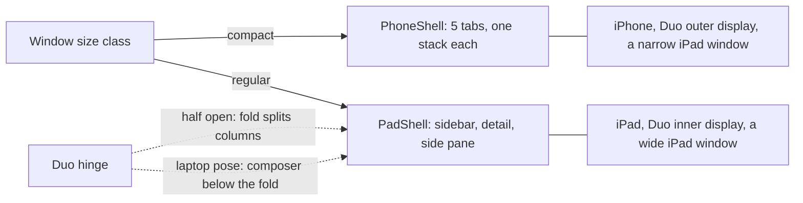

# Platform parity: macOS, iPhone, iPhone Duo and iPad

Plan only. Nothing here is implemented. It maps what each platform can do, ranks the gaps, and cuts them into PR-sized slices. Measured on branch `docs/platform-parity` at `origin/nightly` 710d9eade. Section 4 was updated after the iOS 27.0 runtime was installed.

How to read it: cells come from reading code and `docs/remote-protocol.md`, not from running the apps. Where a number or a behavior was measured on this machine the text says so. "Not run" means I did not run it, with the reason.

## 1. The five platforms are three shells

`MobileRoot` picks the shell from the horizontal size class alone (`App/iOS/App/MobileRoot.swift:25`). There is no idiom switch.



| Platform | Shell | Notes |
| --- | --- | --- |
| Mac | `Sources/ShepherdApp`, one `Window` (`ShepherdApp.swift:137`) | Owns the host process, local terminals, menu bar, Dock. |
| iPhone | `PhoneShell` (`App/iOS/App/PhoneShell.swift:8`) | Compact width. |
| Duo outer | `PhoneShell` | Same code as iPhone. Only the system moves bars into a side column (`VerticalBars`, `Support/Fold.swift:74`). |
| Duo inner | `PadShell` (`App/iOS/App/PadShell.swift:11`) | Regular width. The `duo-unfold` fixture asserts `layout == .pad` after unfolding (`Tests/ShepherdIOSChecks/Fixtures/DuoFixtures.swift`). Fold-aware. |
| iPad | `PadShell` | Regular width, or `PhoneShell` when a Stage Manager or Split View window is compact. |

So for most rows below, iPhone and Duo outer are the same cell, and iPad and Duo inner are the same cell except for fold behavior (section 3) and windows.

## 2. Feature matrix

Legend: **Full**, **Partial** (what is missing), **Absent**, **n/a** (by design, with the reason), **Unmeasured** (depends on something I could not observe). Columns: Mac, iPhone, Duo outer, Duo inner, iPad. "iOS" means all four non-Mac columns. Evidence paths are relative to the repo root.

### Threads and composer

| Feature | Mac | iPhone | Duo out | Duo in | iPad | Evidence and notes |
| --- | --- | --- | --- | --- | --- | --- |
| Transcript, tools, questions, errors | Full | Full | Full | Full | Full | `Sources/ShepherdApp/Thread/ThreadView.swift:33`; `App/iOS/Thread/ThreadScreen.swift:19`. |
| New thread (host, folder, worktree and base, model, images, Add repo) | Full | Full | Full | Full | Full | `NewThread/NewThreadScreen.swift:12`; Add repo uses `addSpace` (`NewThreadModel.swift:456`). |
| Model, thinking, speed, slash commands, skills | Full | Full | Full | Full | Full | `Composer/ThreadComposer.swift:141,328`. |
| Attachments | Full | Partial | Partial | Partial | Partial | iOS takes images from a Photos picker only (`Composer/ComposerControls.swift:18`). Mac also takes drop, paste and files (`Thread/ComposerAttachments.swift:170,242`). No drag and drop on iPad, no paste, no file or camera source. |
| Queue, edit, reorder, steer now | Full | Full | Full | Full | Full | `Composer/QueueSection.swift:12`. |
| Goals, context meter, compaction | Full | Full | Full | Full | Full | `Composer/GoalCard.swift:6`, `ContextMeter.swift:86`. |
| Retry a stopped agent, Start new conversation | Full | Absent | Absent | Absent | Absent | Mac `Thread/Composer.swift:384`. iOS shows the problem as text (`ThreadScreen.swift:222`). Host has `agent.restart.v1`. Open lane `feat/ios-retry-agent`. |
| Rename, pin, delete | Full | Full | Full | Full | Full | `Home/ThreadRowMenu.swift:38,67,95`. |
| Fork thread | Full | Absent | Absent | Absent | Absent | Mac `ShepherdViewModel+AgentMenu.swift:10` forks the pi session file locally. Remote start with a session is `startThread`, local socket only (`docs/remote-protocol.md:36-41`). Needs host work. |
| Copy transcript | Full | Absent | Absent | Absent | Absent | Only subagent runs have it (`Subagents/SubagentRunScreen.swift:248`). |
| Mute a thread's notifications, Follow on Lock Screen | n/a | Full | Full | Full | Full | iOS only: `ThreadRowMenu.swift:47,70`. Mac posts local banners instead. |
| Undo and redo a turn's edits | Full | Full | Full | Full | Full | `Thread/ThreadScreen.swift:563`. |
| Open in new window, Send to window | n/a | n/a | n/a | Full | Full | Mac has one main window. iPhone and Duo outer cannot open windows; Duo inner only upright (`Sources/ShepherdRemote/WindowAvailability.swift`, `Windows/WindowHooks.swift:13`). |

### Changes, review, commit, Forge, files

| Feature | Mac | iPhone | Duo out | Duo in | iPad | Evidence and notes |
| --- | --- | --- | --- | --- | --- | --- |
| Changes, diffs, review notes, revert | Full | Full | Full | Full | Full | `Review/PadReviewScreen.swift:12` (wide), `ChangesScreen.swift:11`, `ReviewRevert.swift`. |
| Commit, push, open PR, ask agent to commit | Full | Full | Full | Full | Full | `Commit/CommitScreen.swift:10`. |
| Branch card, update, abort | Full | Full | Full | Full | Full | `Thread/ThreadBranch.swift:9`. |
| Issues and PRs (GitHub): filter, comment, review, merge, checks, line comments | Full | Full | Full | Full | Full | `Forge/ForgeListScreen.swift:11`. Neither side has Linear. |
| Files: browse, search, read | Full | Full | Full | Full | Full | `Files/ThreadFilesPane.swift:11`. |
| Files: edit and save | Full | Absent | Absent | Full | Full | Compact width is read-only (`ThreadFilesPane.swift:200`). Wide needs `files.write.v1` (`:28`). Phone, Duo outer and a compact iPad window: deferred (G11). |
| Subagents: list, transcript, steer, re-run | Full | Full | Full | Full | Full | `Subagents/SubagentRunScreen.swift:63`. |

### Terminals, browser, apps

| Feature | Mac | iPhone | Duo out | Duo in | iPad | Evidence and notes |
| --- | --- | --- | --- | --- | --- | --- |
| Terminals: tabs, start, rename, kill, key row | Full | Full | Full | Full | Full | `Terminal/TerminalScreen.swift:10`, `TerminalPanes.swift:216`. Duo laptop pose puts the terminal above the fold. |
| Terminal font and shell settings | Full | n/a | n/a | n/a | n/a | Mac `SettingsTerminal.swift:9`. The shell runs on the host. |
| Browser: page, address, reload | Full | Partial | Partial | Partial | Partial | iOS shows one host dev-server page through a port tunnel (`Browser/BrowserPage.swift:55`). No tabs, no console. |
| Browser: pick an element for the composer | Full | Absent | Absent | Full | Full | Pane only ("The phone's board has none", `ThreadBrowserPane.swift:174`). Phone and Duo outer: deferred (G11). |
| Browser: agent drives the page (read, click, type) | Full | Absent | Absent | Absent | Absent | Host hands the call to a viewer on the Mac app. No iOS caller of `browserClaim`, `browserAnswer` or `browserDrive`. With the Mac app quit the call is refused (`docs/remote-protocol.md:46-49`). |
| Apps (dev servers): Run, Stop, Restart | Full | Full | Full | Full | Full | `Thread/ThreadApps.swift:8` (`apps.v1`). |
| Apps: process list, output | Full | Absent | Absent | Absent | Absent | `apps.v2` has `processes`, `output`, `restart` and a nil-space `run`/`stop` (`RemoteApps.swift:82-98`), and no iOS caller. |
| Apps: define, edit, delete | Full | Absent | Absent | Absent | Absent | Mac `SettingsApps.swift:10`. No remote request creates, edits or deletes a definition. Needs host work (G9). |

### Designs, automations, projects, Fleet

| Feature | Mac | iPhone | Duo out | Duo in | iPad | Evidence and notes |
| --- | --- | --- | --- | --- | --- | --- |
| Designs: library, boards, comments, markup, export, ask agent | Full | Full | Full | Full | Full | `Designs/DesignBoardScreen.swift:20`; pad canvas with Chat, Tweak, Comments `DesignPad/PadDesignScreen.swift:19`. |
| Design systems | Full | Full | Full | Full | Full | `Designs/DesignSystemsScreen.swift:8`. Depth of the Mac reference page not compared. |
| Design Git (publish, merge, conflicts) | Full | Absent | Absent | Absent | Absent | Protocol has `designGit*` (`RemoteDesigns.swift:366-413`). No iOS caller. No phone or iPad board exists. |
| Design thread notes (read, Resolve) | Full | Absent | Absent | Absent | Absent | `threadNotes` and `removeThreadNote` (`design.threadNotes.v1`, `RemoteDesigns.swift:394`) are remote requests with no iOS caller. `designNotesChanged` is pushed to this Mac's own app only (`docs/remote-protocol.md`, `designs.v1`), and a note-only write emits no `designChanged`, so iOS has to refresh explicitly (S11). iPad and Duo inner: S11. Phone and Duo outer: deferred (G10). |
| Design import from a local folder | Full | n/a | n/a | n/a | n/a | iOS imports a ZIP (`importBegin`). A phone has no project folder. |
| Automations: list, detail, create, edit, run, stop, delete | Full | Full | Full | Full | Full | `Automations/AutomationsScreen.swift:13`. |
| Projects (logical): conversation, tasks, files, settings | Full | Full | Full | Full | Full | `Projects/ProjectScreen.swift:10`. |
| Projects: run elsewhere, per-project MCP, cookies | Full | Absent | Absent | Absent | Absent | Mac `ProjectRunElsewhere.swift:108`, `ProjectMCPSettings.swift:7`, `ProjectBrowserSettings.swift:4`. No match in `App/iOS`. Settings ▸ Spaces has the space-file side (below). |
| Fleet: view Macs, readings, dispatches, check and update, pair | Full | Full | Full | Full | Full | `Fleet/FleetScreen.swift:16`. Move to Mac in the thread menu. |
| Fleet: dispatch, sync, serve, mesh | Full | n/a | n/a | n/a | n/a | Devices are not offered member capabilities (`docs/remote-protocol.md`, Fleet). |

### Settings pages

Mac pages are `SettingsSection` (`Sources/ShepherdApp/SettingsView.swift:349`). iOS pages are `SettingsPage` (`App/iOS/Settings/SettingsRoute.swift`).

| Page | Mac | iPhone | Duo out | Duo in | iPad | Notes |
| --- | --- | --- | --- | --- | --- | --- |
| General | Full | Partial | Partial | Partial | Partial | iOS has notifications only. Keep running, sounds, open-files-in, update channel are host or Mac settings: n/a on a phone. |
| Appearance | Full | Partial | Partial | Partial | Partial | iOS: mode. Sidebar density, text size, font are Mac chrome: n/a. |
| Keyboard | Full | n/a | n/a | Absent | Absent | No page and no chords to list (section 5, G2). |
| Models, sign-in | Full | Full | Full | Full | Full | `Settings/HostInventoryScreens.swift`. "Your pi" re-import is Mac-only by design. |
| Agents, Instructions, Skills, Tools (MCP), Hooks, Git | Full | Full | Full | Full | Full | `Settings/SkillsScreens.swift:15`, `HooksScreens.swift:13`, `InstructionsScreens.swift:14`. |
| Spaces: lifecycle (rename, hide, reorder, remove) | Full | Absent | Absent | Absent | Absent | `spaceAction`, local socket only (`docs/remote-protocol.md:26`). Adding a repo works from New thread. Owner decision (G12). |
| Spaces: configuration (file saves, MCP actions, skill install, inheritance) | Full | Absent | Absent | Absent | Absent | iOS Settings ▸ Spaces is read-only (`SpacesScreens.swift:7`) and only calls `projects(.list/.files/.context)`. `projects.v2` already has `save`, `delete`, `mcp`, `installSkills`, `inheritance` and `organize` (`Projects.swift:14-40`). Client-only (G7). |
| Apps | Full | Absent | Absent | Absent | Absent | See Apps. |
| Fleet | Full | Partial | Partial | Partial | Partial | By design, see Fleet. |
| Advanced | Full | Partial | Partial | Partial | Partial | iOS has Diagnostics (Sentry). Workspace state, extension socket, confirmations are Mac-only. |
| Experiments | Full | Full | Full | Full | Full | `Settings/ExperimentsScreens.swift:15`. |
| Settings search | Full | Absent | Absent | Absent | Absent | Mac `SettingsView.swift:21`. No `searchable` under `App/iOS/Settings`. |

### Needs you, search, keyboard, system

| Feature | Mac | iPhone | Duo out | Duo in | iPad | Evidence and notes |
| --- | --- | --- | --- | --- | --- | --- |
| Needs you list, answer questions | Full | Full | Full | Full | Full | `Home/NeedsYouScreen.swift:8`; list and detail on wide (`PadListDetail`). |
| Push notifications with Reply and option buttons | n/a | Full | Full | Full | Full | iOS only, APNs relay (`Push/PushActions.swift:8`). |
| Local alerts for goals | Full | Full | Full | Unmeasured | Absent | `GoalNotifications.swift:20` requires `userInterfaceIdiom == .phone`. Whether Duo reports the phone idiom on both displays is unmeasured. |
| Search and command palette | Full | Full | Full | Full | Full | Phone: pushed search (`Search/MobileSearchScreen.swift:9`). Wide: ⌘K palette (`SearchPalette.swift:12`). |
| Keyboard shortcuts | Full (31 actions, rebindable) | Partial | Partial | Partial | Partial | iOS has ⌘K (`Search/SearchRoute.swift:63`), ⌘↩ (`ThreadComposer.swift:358`), ⌘S in Files (`ThreadFilesSplit.swift:305`), Esc. Mac list `Sources/ShepherdApp/Keybindings.swift:10-45`, menus `AppCommands.swift:123-326`. |
| Widgets, Live Activity, Control Center, Watch | n/a | Full | Full | Full | Full | iOS only (`App/Glance`, `App/Widgets`). Not rendered on Duo or iPad here. |
| Pair a device (QR, code, link) | Full | Full | Full | Full | Full | Mac shows the code; iOS scans (`Hosts/HostPairScreen.swift:10`). |
| Menu bar, Dock, background service, quit behavior | Full | n/a | n/a | n/a | n/a | The Mac owns the host. |

Reverse direction, verified: iOS-only features are push, widgets and Live Activity, Control Center, QR scanning, and several windows (the Mac has one). Move to Mac is on both: the Mac thread menu installs it too (`SidebarView.swift:285`, `FleetMoveViews.swift:234`). Nothing on the Mac is missing that an iOS device does better, except the multi-window point.

## 3. Duo and resizing

### What happens when the window changes size

- **Layout switch.** `MobileRoot` recomputes the layout on every size class change and calls `navigator.adopt(layout)` (`MobileRoot.swift:42`). `adopt` carries the active stack across: phone tab and stack become `padSelection` and `padPath`, and back (`App/iOS/App/MobileNavigator.swift:229`). `takePaneScreens` turns a pushed Changes, Terminal, Subagents, Files or Browser screen into the side pane's tab on unfold (`:215`). Going compact turns an open ⌘K palette into pushed search (`:260`).
- **Hinge.** `onHingeClosedChange` sets `navigator.hingeClosed` (`MobileRoot.swift:44`). `PadShell` reads `verticalFold` (`PadShell.swift:45,93`) and `horizontalFold` (`:36`), which come from `reservedRegions(kind: .division)` (`Support/Fold.swift:9,27`).
- **Keyboard.** A style change inside the split view rebuilds its columns and would drop the keyboard mid-draft. `refocusComposer` is the existing workaround (`MobileNavigator.swift:88`).
- **Windows.** Each window has its own navigator and scene storage. A new window opens only on the inner display held upright (`WindowAvailability`).

### Fold-aware surfaces

| Fold-aware (reads the fold or lays out around it) | Evidence |
| --- | --- |
| Sidebar and detail split at the fold | `PadShell.swift:45` |
| Side pane beside the thread | `SidePane/ThreadSidePane.swift:24` |
| Laptop pose: transcript above, composer below | `Thread/ThreadArrangement.swift:19` |
| Review, design pad | `Review/PadReviewScreen.swift:599`, `DesignPad/PadDesignScreen.swift:39` |
| List and detail: Settings, Needs you, Automations, Project tasks, Issues and PRs | `Support/Fold.swift:104` (`PadListDetail`), `Forge/ForgeRoute.swift:60` |
| Bars as a side column: thread, Issues and PRs | `VerticalBars` at `Thread/ThreadScreen.swift:49`, `Forge/ForgeListScreen.swift:17` |
| Fleet row style | `Fleet/FleetScreen.swift:68` |

No fold code in: Home overview (`Home/PadOverview.swift`), Files split (`Files/ThreadFilesSplit.swift`), Search palette (`Search/SearchPalette.swift`), the New thread sheet, Add a Mac, Designs list, Browser. Most sit in a detail column that `PadShell` already starts after the fold, so they may be fine. I did not render them, so that is untested.

### Legacy APIs the `app-resizability` skill flags

Searched `App`, `Sources`, `Packages` outside Mac-only code.

| Hit | Where | Verdict |
| --- | --- | --- |
| `UIDevice.current.userInterfaceIdiom == .phone` as a capability gate | `App/iOS/Composer/GoalNotifications.swift:20` | Replace. It disables local goal alerts on iPad and is the only idiom gate that changes behavior. |
| `userInterfaceIdiom == .pad` and `UIDevice.current.name` | `App/iOS/Hosts/MobileHosts+Device.swift:6` | Keep. It labels this device in the Fleet list, not a layout. |
| `UIApplication.shared.open(url)` | `App/iOS/Terminal/TerminalSurface.swift:139` | Replace with `@Environment(\.openURL)`. |
| Process-wide `weak var current: UIWindow?` picked across scenes | `App/iOS/Designs/DesignHost.swift:240` | Keep, with care. It already follows scene phase for Duo folding. |
| `UIApplication.shared.registerForRemoteNotifications()`, `UIApplicationDelegate` | `Push/PushManager.swift:46`, `Push/PushAppDelegate.swift:13` | Keep. APNs has no scene API. |
| `UIDevice.current.model` | `Settings/SettingsStore.swift:67`, `Browser/BrowserPage.swift:74` | Label only. Keep. |

No hits for `UIScreen.main`, `interfaceOrientation`, `UIDeviceOrientation`, `safeAreaInsets`, `keyWindow`. Fixed widths exist, none proven wrong: a 0×0 spacer (`ThreadScreen.swift:665`), the search palette's results list at 420 pt (`MobileLayout.paletteListWidth`, used at `Search/SearchPalette.swift:47`), and the Files tree at 210 pt (`MobileLayout.filesTreeColumn`, used at `Files/ThreadFilesSplit.swift:33`). The last two are resize checks for S3: does the palette fit a narrow Stage Manager window, and does the Files split keep a usable reader beside the tree at its minimum width. Neither is a defect until a render shows one. The three prerequisite checks pass: launch screen generated (`project.pbxproj:715`), iPad lists all four orientations (`:717`), `UIRequiresFullScreen` absent. Not verified: the built Info.plist has no explicit `UIApplicationSupportsMultipleScenes` (only `UIApplicationSceneManifest_Generation`, `:714`), while `run-simulator.sh:101-107` sets it for `-w` "as the shipped app does".

### Findings

- **D1. Wrong Xcode silently drops all Duo behavior.** Measured: `xcode-select` points at `Xcode-beta.app` (27.0, SDK 27.0, SwiftUI 8.0.79). A probe file with `#if canImport(SwiftUI, _version: 8.0.85) #error` fails to compile under `/Applications/Xcode.app` (27.1, SwiftUI 8.0.85) and compiles clean under Xcode-beta. Every hinge API in the app sits behind that check (`Fold.swift:12,28,58,78`, `ThreadArrangement.swift:16`), so a default local build has no fold, no laptop pose and no side-column bars, and still builds. Release CI sets `DEVELOPER_DIR=Xcode_27.1` for this reason (`.github/workflows/release.yml:410-412`). `run-simulator.sh`, `docs/build-and-run.md` and `docs/testing.md` do not mention it.
- **D2. Shell swap loses screen-local state.** `PhoneShell` and `PadShell` are different view types in one `Group` (`MobileRoot.swift:26-30`), so a fold or a Stage Manager resize across the compact line rebuilds the screen. Navigation and the stores survive; `@State` inside a screen does not. Unmeasured candidates: an open instruction or file editor, a terminal view, a Browser page, a half-filled sheet. The composer draft is safe (`store.draft`).
- **D3. The carry logic has no unit tests.** `adopt` and `takePaneScreens` live in `App/iOS`, which no SwiftPM target compiles. Only `PadSplitLayout` and `WindowAvailability` were pulled into `ShepherdRemote` and tested (`Tests/ShepherdRemoteUnitTests`). One simulator fixture (`duo-unfold`, Subagents) covers the transition; 14 other route families do not.
- **D4. Poses cover 10 of 344 fixtures.** `run-simulator.sh --list` prints 344 screens. Ten are `duo-*` and eight `windows-*`. The rest render in one pose.

## 4. Render capability today

Updated after the orchestrator installed an iOS 27.0 runtime (`~/Developer/Shepherd-worktrees/SIMULATORS.md`). Re-measured here with `simctl create` and `delete`.

| Platform | Device type | Runtime | Result |
| --- | --- | --- | --- |
| iPhone | `iPhone-18-Pro` | `iOS-27-0` | Creates. |
| iPad | `iPad-Pro-13-inch-M5-16GB` | `iOS-27-0` | Creates. |
| iPhone Duo (closed is compact, open is regular) | `iPhone-Duo` | `iOS-27-1` | Creates. The 27.1 runtime supports only this type. |

Each was created in a custom set under this worktree's `.orchestrator/` and deleted at once; no devices remain. Before the install, the iPhone 17 Pro and iPad Pro 13-inch (M5) creates on iOS 27.1 failed with `Incompatible device` (code 403), which is why those two are on 27.0.

| Check | Result |
| --- | --- |
| Xcodes | `xcode-select`: Xcode-beta 27.0 (27A5228h), no hinge code. `/Applications/Xcode.app`: 27.1 (27A9275), hinge code compiles in (D1). |
| Duo poses | `run-simulator.sh -f closed|book|open` with `DuoPose/duopose.m` (private SpringBoard service, simulator only). |
| Mac renders | `ShepherdPreviewTests` (95 files) render off-screen, no simulator. Not run here. |

What each platform needs:

| Platform | Renderable now | Needs |
| --- | --- | --- |
| Mac | Yes (`SHEPHERD_PREVIEW_DIR=… swift test --filter …Preview…`) | Nothing. |
| iPhone | Yes, iPhone 18 Pro on 27.0 | Nothing for the compact shell. Hinge code does not apply. |
| iPad | Yes, iPad Pro 13-inch on 27.0, portrait and landscape, `--sidebar`, `-w` windows | Nothing. Stage Manager sizes are not scriptable by `run-simulator.sh`. |
| Duo outer | Yes, `-f closed` | `DEVELOPER_DIR=/Applications/Xcode.app/Contents/Developer` (D1). |
| Duo inner | Yes, `-f book`, `-f open`, landscape for the laptop pose | Same. |

Open points, not measured:

- **Custom device sets.** `SIMULATORS.md` tells agents to create devices in a custom set. `run-simulator.sh` calls `simctl` without `--set` (0 of its calls pass it), so it looks up `-d <udid>` in the default set and will say `no simulator`. Needs a `--set` option or an environment variable in the script (added to S1).
- **Mixed SDKs.** The script builds one app with one Xcode. Building with 27.1 and installing on the 27.0 runtime should work because every hinge use is behind `#available(iOS 27.1, *)` (`Fold.swift:12`), but I did not run it. One build for all three platforms would be a saving; if it fails, iPhone and iPad need the default Xcode and Duo needs 27.1.
- Not run: any render. The load average was 166 at 22:41 and builds go through `~/Developer/Shepherd-worktrees/bin/gated`. Command for one Duo shot, adapted for the set:

```bash
export DEVELOPER_DIR=/Applications/Xcode.app/Contents/Developer
set=.orchestrator/sims
udid=$(xcrun simctl --set $set create parity com.apple.CoreSimulator.SimDeviceType.iPhone-Duo com.apple.CoreSimulator.SimRuntime.iOS-27-1)
~/Developer/Shepherd-worktrees/bin/gated bash Tests/ShepherdIOSChecks/run-simulator.sh -d "$udid" -o /tmp/parity -f closed home   # fails today: no --set
xcrun simctl --set $set shutdown "$udid"; xcrun simctl --set $set delete "$udid"
```

## 5. Gaps, ranked by user value

"Client-only" means the protocol already supports it and only `App/iOS` or `ShepherdRemote` changes. Enablers come first because they decide whether any later slice can be proven.

**Enablers**

- **E1.** Default Xcode compiles out all Duo code (D1). Tooling only.
- **E2.** Resolved: iPhone and iPad render on the iOS 27.0 runtime, Duo on 27.1 (section 4). Remaining: `run-simulator.sh` does not accept a custom simulator set, and a mixed-SDK build is unverified.

**What a person supervising from a phone, a Duo or an iPad cannot do that the Mac can**

| # | Gap | Who it hurts | Work |
| --- | --- | --- | --- |
| G1 | Retry a stopped agent or start a new conversation | Any phone user whose agent stopped away from the desk | Client-only (`agent.restart.v1`). Open lane. |
| G2 | Hardware keyboard: 4 chords against the Mac's 31 actions | iPad, Duo laptop pose | Client-only. |
| G3 | Fold and resize transitions are untested beyond one route, and a shell swap can drop screen state (D2, D3, D4) | Duo and Stage Manager users | Client-only, needs E1. |
| G4 | Browser: one page, no tabs or console, agent cannot drive it, and with the Mac app closed the agent's browser calls fail | Anyone watching a web task from a device | Tabs and console client-only. Agent driving needs a viewer on iOS (`browserClaim`, `browserDrive` exist, large). |
| G5 | Fork a thread | Phone users branching a conversation | Host work: fork is a local file copy plus a local-only `startThread`. |
| G6 | Attach only from Photos: no paste, no drag and drop, no files | iPad, Duo inner | Client-only. |
| G7 | Space configuration is read-only on iOS: no saving a space's config files, MCP actions, skill install or inheritance | Setup from a device | Client-only. `projects.v2` already carries `save`, `delete`, `mcp`, `installSkills`, `inheritance` (`Projects.swift:14-40`). Independent of G12. |
| G8 | iPad gets no local goal alerts (idiom gate; Duo inner unmeasured); no Settings search; no Copy transcript; `UIApplication.shared.open` in the terminal | iPad users | Client-only, small. |
| G9 | Apps: no process list or output (client-only); no create, edit or delete of a definition (host work) | Dev-server workflows | Process controls over `apps.v2`. Definitions need a new request and capability: `apps.v2` cannot write one. |
| G10 | Design Git, design thread notes, project run-elsewhere, project MCP and cookies | Design and project users | Client-only for designs, and needs a design board first: none exists for a phone or iPad. Notes on iPad and Duo inner are S11; on phone and Duo outer deferred. Projects parts wait (see below). |
| G11 | Compact width cannot edit files or pick a browser element | Phone, Duo outer, compact iPad window | Deferred. Both are wide-pane features by design (`ThreadFilesPane.swift:200`, `ThreadBrowserPane.swift:174`) and no board draws a compact version. Revisit when S3's report shows how compact windows behave. |
| G12 | Space lifecycle: rename, hide, reorder, remove | Setup from a device | Owner decision (below). Host and security work if yes: `spaceAction` and `projectRequest` are local-only on purpose. `projects.v2 organize` already renames a registered space in Shepherd's record, which may cover rename alone. |

**Decision for the owner (G12).** May a paired device token send `spaceAction` (rename, hide, reorder, remove)? Yes opens S10. No closes G12 only: G7 (configuration) still ships as S10a. Rename through `organize` is a separate question for the owner: it is allowed today but only edits Shepherd's name for the space.

What the Mac cannot do: nothing material beyond several windows (iPad and Duo inner have them, the Mac has one `Window`).

## 6. Slices

Each slice is one PR. Shared logic goes to `ShepherdRemote` with Swift Testing unit tests, as `PadSplitLayout` did, because `App/iOS` has no SwiftPM test target. Render checks use `Tests/ShepherdIOSChecks/run-simulator.sh` with `DEVELOPER_DIR` set to Xcode 27.1 (S1), light and dark. Each PR renders the platforms it touches on iPhone 18 Pro, iPad Pro 13-inch and Duo (outer and inner), per `SIMULATORS.md`. Mac-touching slices use `ShepherdPreviewTests`.

Open lanes to avoid duplicating: `feat/ios-retry-agent`, `fix/duo-thread-scroll`, `fix/ios-lazy-lists`, `feat/next-needing-you`, `feat/sidebar-filters`, `feat/spend-rollup`, `feat/stop-all-running`. Their briefs were read in the other worktrees, read-only.

| # | Slice | Platforms | Files | Done when | Overlap |
| --- | --- | --- | --- | --- | --- |
| S1 | Duo toolchain guard | iOS tooling | `Tests/ShepherdIOSChecks/run-simulator.sh`, `docs/build-and-run.md`, `docs/testing.md` | A pose run (`-f`) under a SwiftUI older than 8.0.85 exits non-zero naming `DEVELOPER_DIR`. The script accepts a custom simulator set (`--set` or an environment variable, since `SIMULATORS.md` has agents create devices there) and prints "not run" for a platform whose device cannot be created. Creating a device is not render proof: S1 ends with one fixture PNG per device type (iPhone 18 Pro, iPad Pro 13-inch, iPhone Duo) rendered from the custom set, and the PR records which Xcode built and rendered each runtime (iOS 27.0 for iPhone and iPad, iOS 27.1 for Duo). Docs say which Xcode renders Duo and which runtime each platform uses. | `docs/plans/validation-tools.md` slice 3 (render matrix). S1 is its smallest precursor. |
| S2 | Carry logic as a tested value | iPhone, Duo, iPad | New `Sources/ShepherdRemote/NavigationCarry.swift`, `App/iOS/App/MobileNavigator.swift`, `Tests/ShepherdRemoteUnitTests` | `adopt` and `takePaneScreens` call a pure function. Unit tests cover phone to pad and back for every `MobileRoute` family, a sheet, the palette, an empty stack, a forgotten host. No behavior change. | None. |
| S3 | Duo and resize fixtures and report | Duo outer and inner, iPad | New fixtures under `Tests/ShepherdIOSChecks/Fixtures/`, a report in the PR body. A change to `run-simulator.sh` only as the next sentence needs. No `App/iOS` fixes | Needs S1. Fixtures render the seven surfaces with no fold code (Home overview, Files split, Search palette, New thread sheet, Add a Mac, Designs list, Browser) in closed, book, open and landscape on Duo, and in portrait and landscape on iPad, light and dark. Survival is recorded separately from the renders: `run-simulator.sh` sets a non-zero status and saves no PNG on `FIXTURE CHECK FAILED`, so the mid-run resize fixture (editor, terminal and sheet open, D2) prints one result per object (editor, terminal, sheet) as evidence, and a lost editor, terminal or sheet is a reported defect with a PNG taken on that path, never a failed run that blocks this report-only PR. The 420 pt palette list and 210 pt Files tree are exercised at a narrow regular width stated in the report: a full-screen iPad rotation never reaches minimum width, so those fixtures use a windowed run (`-w`) or a framed host at that width. The 0×0 thread-header fallback (`ThreadScreen.swift:665`) is exercised at a width where the branch chip no longer fits. Any of these three that cannot be run is marked "not run" with the reason, not skipped. The report lists each surface as fine or as a defect with a PNG, and gives survival, the two fixed columns and the header fallback each as fine, defect or not run. Done when the fixtures run under `run-simulator.sh` and the report covers all seven surfaces and those separate entries. Surface fixes are not in this PR: each defect becomes its own follow-up slice. | Transcript scrolling on the Duo is `fix/duo-thread-scroll`'s (jump-to-bottom loop on the inner display): S3 does not touch it. Fixtures only, so it clashes with no other lane. |
| S4 | iPad and Duo keyboard | iPad, Duo inner | New `App/iOS/App/MobileCommands.swift`, `Windows/MobileWindowRoot.swift` (`MobileWindowCommands`), `Search/SearchRoute.swift`; table in `ShepherdRemote` | New thread, stop, rename, previous and next thread, toggle sidebar, toggle side pane, model picker, toggle terminal, each in the menu bar and the shortcut overlay, same chords as `Keybindings.swift` where they make sense. Unit test: no two iOS chords collide, none shadows the system's. Hardware-keyboard behavior is "not run" (no keyboard in headless renders). | `feat/next-needing-you` adds the Next chord. Leave it to that lane. |
| S5 | Small iPad and phone fixes | iPad, Duo inner, all iOS | `Composer/GoalNotifications.swift`, `Terminal/TerminalSurface.swift`, `Settings/SettingsScreen.swift`, thread menu | Goal alerts work on iPad and Duo inner (gate on notification authorization, not idiom; unit test the predicate). Terminal links use `openURL`. Settings search over page and row titles, as the Mac. Copy transcript in the thread menu. Renders: Settings search on Duo outer and inner. | None. |
| S6 | Composer image input | iPad, Duo inner, iPhone | `Composer/ComposerControls.swift`, `Composer/ThreadComposer.swift`, classifier in `ShepherdRemote` | Images from paste, drop and a Files source, on iPad, Duo inner and iPhone where the source exists. Scope is images only: a native send carries text and images, while `session.upload.v1` begins only against a live terminal session (`SessionServer.swift:3303`), so a non-image file chip would not reach the agent. A non-image drop is rejected with a visible message. It joins this slice only with proof that the agent reads a dropped non-image file from a host path (the send names a path the host wrote). Unit tests for the provider-to-attachment classifier (including the non-image rejection) and the size and count limits. Renders: composer with image chips, Duo outer and inner. | None. |
| S7 | Fork thread | Mac, iPhone, iPad, Duo | `Sources/ShepherdProtocol/RemoteMessage.swift`, `Sources/ShepherdSessions/SessionServer.swift`, `Sources/ShepherdRemote`, `Home/ThreadRowMenu.swift`, Mac menu | New action behind `agent.fork.v1`, host does the session copy and creates the agent. Full contract checklist from `AGENTS.md` (enum case, `Kind`, `CodingKeys`, both codec arms, round-trip row, `speaksFor`/`replyID`) and an integration test for the mutation. Thread menu row on iOS. | None. |
| S8 | Browser tabs and console | iPad, Duo inner | `Browser/ThreadBrowserPane.swift`, `Browser/BrowserPage.swift`, `ShepherdRemote/BrowserPagePorts.swift` | Tabs and a console strip in the pane, as `BrowserTabs*` boards. Unit tests for tab and port bookkeeping. A spike note, not code, on iOS as a `browserClaim` viewer (G4) with an estimate. | `fix/browser-port-suspend` worktree touches browser ports: check before starting. |
| S9 | Apps: processes and output | iPhone, iPad, Duo | New `Settings/AppsScreens.swift`, `Settings/SettingsRoute.swift`, `Thread/ThreadApps.swift` | Client-only. Settings ▸ Apps lists every app's run (`processes`) and shows its output (`output`), with run, stop and restart, over `apps.v2`. Definitions are shown read-only from `list`. Unit tests on the presentation. Renders match the `Apps*` boards. | None. |
| S9b | Apps: edit definitions | Mac host, iPhone, iPad, Duo | `Sources/ShepherdProtocol/RemoteApps.swift`, `SessionServer.swift`, `Settings/AppsScreens.swift` | Host plus client, after S9. A new `apps.v3` request to create, edit and delete a definition (a space's or the host's), with the full contract checklist from `AGENTS.md` and an integration test that the host stores it and that a device cannot edit another host's. Deferred until an owner wants it: S9 ships without it. | None. |
| S10a | Space configuration from a device | iPhone, iPad, Duo | `Settings/SpacesScreens.swift`, `ShepherdRemote` model | Client-only over `projects.v2`: edit and save a space's allowlisted config files (`save`, with `expected`), MCP actions (`mcp`), install skills (`installSkills`), delete a resource file, set inheritance. Each gated on its capability. Unit tests on the model, including a stale `expected`. Renders on iPhone, iPad, Duo. No decision needed. | None. |
| S10 | Space lifecycle from a device | Mac host, iPhone, iPad, Duo | `RemoteMessage.swift`, `SessionServer.swift`, `Settings/SpacesScreens.swift` | Blocked on the G12 owner decision. If yes: rename, hide, reorder, remove with integration tests that a device cannot touch another host's spaces. If no: close G12. S10a is unaffected. | None. |
| S11 | Design thread notes on iPad | iPad, Duo inner | `DesignPad/`, `ShepherdRemote/RemoteDesignLibrary.swift` | Blocked on an iPad board. Client-only: read `threadNotes` and Resolve with `removeThreadNote`. Writing a note changes `thread-notes.json` only, so the host emits no `designChanged` (`DesignStore.swift:806`) and sends `designNotesChanged` to this Mac's own app alone. The iPad therefore refreshes explicitly: on open, on pull to refresh and after its own Resolve, as well as on `designChanged`. Done when a render of the pad canvas shows the notes list and Resolve removes the row without reopening the design. Git (`designGit*`) is split out as a later slice with its own testable endpoint (a publish, merge or conflict flow with a stated final state) and is deferred until the owner asks. Phone and Duo outer: deferred, no phone board. | None. |

G1 (retry) is covered by `feat/ios-retry-agent` and has no slice here. G10's project run-elsewhere, MCP and cookies parts wait until S11's board work shows what a device wants from projects. Deferred explicitly: compact file editing and compact browser element selection (G11), design thread notes on phone and Duo outer and design Git on iPad (G10), definition editing in S9b, non-image file attachments from a device (S6).

Order reasoning: S1 and S2 first because they are small and unblock proof. S3 is the direct answer to "Duo at parity": it measures, and the fixes follow as their own slices. S4 and S5 are cheap and fix daily friction on iPad. S6 to S9 and S10a add features with protocol support. S7 and S9b need host work. S10 and S11 are gated on a decision or a design.

## 7. Validation of this plan

- Device types, runtimes, Xcode versions: measured with `xcrun simctl list devicetypes`, `list runtimes`, `list runtimes -j`, `simctl create` (and `delete`), `xcodebuild -version`, and a `#error` probe under each Xcode's SDK.
- Fixture count: `bash Tests/ShepherdIOSChecks/run-simulator.sh --list | wc -l` gave 344.
- Matrix: built from code reading by me and three read-only scouts (Mac inventory, iOS inventory, protocol). I re-checked every cell I use for a gap. One scout claim was wrong and is corrected: `addSpace` does have an iOS caller (`NewThreadModel.swift:456`).
- Not run: any app, any simulator render, any Swift build or test. Duo idiom reporting (`GoalNotifications.swift:20`) and the built `UIApplicationSupportsMultipleScenes` are unmeasured.

When all slices ship or are deferred, delete this file and its allowlist entry in `Tests/Release/test_agent_docs.py` in the same PR.
