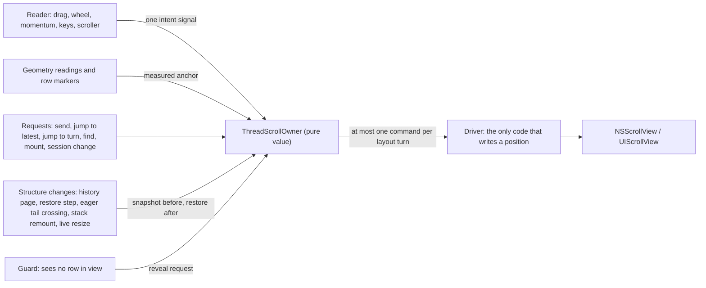

# Thread scroll: one owner for the transcript's position

Plan only. Nothing here is implemented, and no app, build or test was run to write it. Measured on branch `chore/scroll-audit` at `origin/nightly` 640f95c1d.

How to read it: every "can fire while the user scrolls" and "fights with" cell comes from reading the code and the commit messages, not from watching the app. Section 6 lists what that leaves unproven and how slice 1 proves it. The scroll-stability measurement case is built by another lane; section 5 says what each slice needs from it.

## 1. The problem in numbers

`git log -i --grep=scroll` on nightly returns 205 commits. About 70 of them touch the thread's scroll files; the rest are diff review, the design canvas, the sidebar and composer menus. The thread-scroll files today:

| Platform | Files | Lines |
| --- | --- | --- |
| Mac | `ThreadTailGuard`, `ThreadHistoryAnchor`, `ThreadEagerTail`, plus the scroll parts of `ThreadView` (1,763 lines, 143 commits) | 593 + the scroll parts of `ThreadView` |
| iOS | `ThreadTailGuard`, `ThreadTailPin`, `ThreadTailHold`, `ComposerPresentation`, plus the scroll parts of `ThreadScreen` (826 lines, 80 commits) | 665 + the scroll parts of `ThreadScreen` |
| Shared | `NativeScrollFollower`, `NativeTailRepin`, `NativeScrollProbe`, `NativeHistoryPaging` (`NativeThreadPresentation.swift`), `NativeTranscriptPlace` | about 600 |

The history reads as a series of patches that each add a writer:

- Sep 30: `389c91021` removes the bottom anchors on the Mac because the thread drew blank after a send. `94daa2bdd` puts them back for macOS 26 the same day.
- Oct 1 to Oct 29: `543843823` adds the tail guard. Nine more commits widen it (`fcc8f9292`, `091275531`, `489c2d66c`, `efd96d3e5`, `b4c1d64c0`, `2b10f7f47`, `3ec96e88f`, `27dc06a7c`, `c14888595`) until it can rebuild the scroll view. `9e2d1feb4` then turns the native anchors back on and lays out an eager tail so they stay honest.
- Nov 7 to Nov 13 on iOS: `ec3950c80` adds `ThreadTailPin`, `271925d5b` the iOS guard, `bf0dc0a41` a mount at the tail, `f91a3a24f` turns that off on iOS 27.1, then `a3a25c721` and six follow-ups add `ThreadTailHold` and a marker the place hands out and withholds.
- Nov 12 to Nov 20 on the Mac: more than 20 commits on restore, release, eager-tail and window-drag passes, each one gated on whether the reader is at the tail, typing, scrolling or flicking.
- Nov 20: `74d58d0d4` releases the history anchor so Jump to latest lands.

The pattern: no code owns the position. Each new symptom got a writer plus a gate that stops it from fighting the writers before it. This plan removes the need for the gates.

## 2. Actors that change what a thread transcript shows

Mac is `Sources/ShepherdApp/Thread/…`, iOS is `App/iOS/Thread/…`. "While the user scrolls" means a drag, a wheel or trackpad, or the momentum after it.

### 2.1 Writers: code that sets the position

| ID | Actor (file:line) | Trigger | While the user scrolls | Added or patched by |
| --- | --- | --- | --- | --- |
| M1 | Follower re-pin: `proxy.scrollTo(bottom)` in `onScrollGeometryChange`, `ThreadView.swift:319-330` (rule in `NativeScrollFollower.observe(from:to:)`) | Any geometry reading where the reader follows and the layout changed or the view sits past the tail | Held off by `gesture` (wheel intent for 350 ms, or the `.interacting` phase). A trackpad's momentum keeps sending wheel events, so it is covered; a scroller drag, key paging, or the first reading of a drag whose rows re-measure is not | `83634bd7a`, `de0db951b`, `389c91021`, `529223bd3`, `481026454`, `f2ac0c3dc`, `a99d9ec6d` |
| M2 | Native bottom anchor for the initial offset, `ThreadView.swift:1680` (`ThreadTailAnchor`) | A mount, and a thread shown again | No | `94daa2bdd`, `9e2d1feb4`, `4b6171e32` |
| M3 | Native bottom anchor for size changes while following, `ThreadView.swift:1683` | Every content or inset size change while `follower.sticky` | Yes. Sticky stays true until a reading shows intent, and a drag up re-measures rows, so the anchor can pull the view back under the hand (the bug `529223bd3` fixed for the follower only) | `94daa2bdd`, `9e2d1feb4` |
| M4 | Native bottom anchor for alignment while a released thread restores, `ThreadView.swift:1687` | `restored != nil` | Yes, no gate | `970a1aa17` |
| M5 | History scroll position: `.scrollPosition($historyAnchor.position)` at `ThreadView.swift:287`, `position.scrollTo(id:anchor:.top)` at `:299`, reset in `ThreadHistoryAnchor.cancel()` (`:38`) | A page of older rows joins above the reader (`rows.first?.id` changes) | Cancelled on `.interacting` (`:334-348`) and on every wheel event over the thread (`:1008`), so trackpad momentum cancels it. A scroller drag or key paging does not | `aac19e5d4`, `4d930172b`, `4f534d6b0`, `fda4d7108` |
| M6 | History correction: `clip.scroll(to:)` in `ThreadHistoryAnchor.scheduleCorrection`, `ThreadHistoryAnchor.swift:87-107`, called from `moved()` for every geometry reading and every marker layout while engaged | Same as M5, then every layout until cancelled | Same as M5: engaged until one of those cancels it | `aac19e5d4`, `e855f4eca`, `4d930172b`, `58afe76c7`, `fc9d9a1eb` |
| M7 | Tail guard: walk (`clip.scroll`, `ThreadTailGuard.swift:311`), `reachTheEnd` (`:291`), and `land()` (`:280`), run by `settle()` (`:255`) | The scroll view shows no row, or a following view rests short of its end, after `quiet` (80 ms) or `busy` (600 ms) | Held off by `userScrolling` (`.interacting`) and `readerUntil` (500 ms after a wheel event or a drag). A scroller drag or key paging can set neither | `543843823`, `fcc8f9292`, `091275531`, `489c2d66c`, `efd96d3e5`, `27dc06a7c`, `c14888595` |
| M8 | Scroll view rebuild: `tailGuard.rebuild` bumps `transcriptRevision`, which is the identity of the `ScrollView` (`ThreadView.swift:278`, `:903`) | The guard used its 8 attempts and the view is still stranded | Held off by `userScrolling` and `readerUntil` | `b4c1d64c0`, `2b10f7f47` |
| M9 | Send: `proxy.scrollTo(bottom)` at `ThreadView.swift:364`, plus `follower.sent` | `store.sentCount` changes, when the reader was not already following | The reader's own action, no gate | `481026454`, `1d318fc01` |
| M10 | Jump to latest pill, `ThreadView.swift:393` | Click | The reader's own action | `799eafedb`, `74d58d0d4` |
| M11 | Turn jump ⌥⌘↑/↓ (`ThreadView.swift:962`, `:968`) and Find / Show summary (`:986`): animated `scrollTo(row, .top)` | Command center, context details | The reader's own action. The animation can be interrupted by a scroll | `a99d9ec6d`, `f2ac0c3dc`, `cebd3597e` |
| M12 | Restore: `restoreRows` calls `follower.jumpToLatest(); tailGuard.land()` at `ThreadView.swift:670-673`, then adds rows a step at a time | A hidden thread is shown again | Waits on `userScrolling`, `decelerating`, `!sticky`, `inputRecent` (`:641-643`), then force-lands a reader who left | `4b6171e32`, `9474ce2f7`, `60be152d0`, `9be86ae05`, `970a1aa17`, `89edf5417` |
| I1 | Position binding: `.scrollPosition(id:anchor:.top)` fed by `ComposerPresentation.position(tail:)` and written back by `noteVisibleTurn`, `ThreadScreen.swift:363` | SwiftUI scrolls to the id whenever the value handed to it changes: a kept turn, the bottom marker handed back by `hold`, `pinHistoryTurn` | Yes. The value can change at any layout | `de0db951b`, `bf0dc0a41`, `18f258a4c`, `a3a25c721`, `a29855afc`, `8eeb163f4`, `f7f67e803`, `74d58d0d4` |
| I2 | Native anchors, `ThreadScreen.swift:376-377`. On iOS 27.1 and later they are off (`ComposerPresentation.nativeTail`) | Initial offset, size changes | Yes, before iOS 27.1 | `bf0dc0a41`, `f91a3a24f` |
| I3 | Tail pin landing: `proxy.scrollTo(bottomID)` at `ThreadScreen.swift:521`, called from `ThreadTailPin` in the layout pass that asked (up to 8 times, `ThreadTailPin.swift:61`) or one turn later (`:150`) | A reading the follower wants repinned, output at the tail, an ask | Held off while `scrolling`, except an ask when no finger is down | `ec3950c80`, `c799742b1`, `030c7deca`, `4a719af61`, `5b1ff17e3`, `e75f461bc`, `5ee4a89e4`, `74d58d0d4` |
| I4 | iOS tail guard: `setContentOffset` in `goToPlacedRows` (`ThreadTailGuard.swift:117`), `walkBack` (`:207`), `walkDown` (`:222`), then `land()` (`:182`) | No row in view after 150 ms of quiet; within a second of a mount, at once | Held off by `isTracking/isDragging/isDecelerating` | `271925d5b`, `79672dadb` |
| I5 | Tail hold: hands the bottom marker back to I1 500 ms after a landing, `ThreadTailHold.swift` | A landing after rows joined | Skipped while a finger is down (`ComposerPresentation.hold`) | `a3a25c721`, `3344b5f90` |
| I6 | Send, ask, jump pill, Find, user turn arrival: `ThreadScreen.swift:409`, `:421`, `:438`, `:481` | The reader's actions | No gate | `8132e110a`, `18f258a4c`, `c799742b1` |
| I7 | Mount and leave: `presentation.mount()`, `leave()`, `newSession()` change what I1 is handed (`ThreadScreen.swift:368`, `:374`, `:446`, `:452`, `NativeTranscriptPlace`) | The transcript appears, a pushed screen pops, the session changes | Not a gesture | `a6d41f473`, `f7f67e803` |
| I8 | Interactive keyboard dismiss (`.scrollDismissesKeyboard(.interactively)`) changes the bottom inset while the finger moves | The reader drags the thread down over the keyboard | It is the user, but a landing in that window ends the drag | `8132e110a` |

### 2.2 Layout changes: code that moves rows under a position nobody is holding

A scroll view that holds no anchor keeps its offset from the top. Anything that changes the height of content above the viewport then moves what the reader sees. On the Mac, a reader who scrolled up (`follower.sticky == false`) has no anchor at all (`ThreadView.swift:1683` passes `nil`); only a history prepend gets one (M5, M6).

| ID | Actor (file:line) | Trigger | While the user scrolls | Added or patched by |
| --- | --- | --- | --- | --- |
| L1 | Lazy stack estimate to measured height, rows realized or forgotten (`LazyVStack`, `ThreadView.swift:600`, `ThreadScreen.swift:324`) | Scrolling reveals rows; `.id(StackID)` rebuilds the stack | Yes, by construction | The reason for `ThreadEagerTail`, `ThreadHistoryCache`, `ThreadHistoryBuilt`, both tail guards |
| L2 | Eager tail moves rows between the real stack and the lazy one, `ThreadEagerTail.update` (`ThreadEagerTail.swift:43`), called from `ThreadView.restingCount` (`:544`) | Rows change, a row's cost changes, the window height changes | Yes. A detached reader moves 2 rows at a time (`AppLayout.eagerTailCrossing`); a follower loses rows at once. A crossing rebuilds the row and drops its state | `bcc94fc7d`, `1d387b9f2`, `67158a053`, `290bd2af8` |
| L3 | Restore steps add rows, `ThreadRestore.advance` from `restoreRows` (`ThreadView.swift:677-686`) | Thread shown again | Waits for scroll, typing and a reader away from the tail | `4b6171e32`, `9474ce2f7`, `89edf5417` (see M12) |
| L4 | Live resize: `eagerCover`, `returnEagerTail` (`ThreadView.swift:464-480`, `:581`), and `parksHistory` (`:572`) removes the lazy stack from the tree during a drag when the reader follows | The window or a pane is dragged | A drag is not a scroll, but a hand is on the window | `08bddc18b`, `3af3deab3`, `1854f5bce` |
| L5 | Stack remount, `ThreadHistoryBuilt.stack` (`ThreadView.swift:1153`) changes the identity of the history stack | 16 rows joined since the stack began, reader at rest at the tail | Gated: `atRest` (`:185`) | `796e69aba` |
| L6 | History page prepend: `store.loadOlder` from `loadVisibleHistory` (`ThreadView.swift:920`, `ThreadScreen.swift:466`), sentinel `onScrollVisibilityChange` (`:258`, `ThreadScreen.swift:344`) | The reader reaches the top | Yes. `historyEnabled` excludes `animating` and `sticky` but not momentum | `de0db951b`, `aac19e5d4`, `5a8b75cc1`, `1854f5bce` |
| L7 | Streaming reply grows; a finished turn settles into its footer; a live row flips from shell to content (`ThreadRowContent`, `ThreadView.swift:807`) | Every chunk, every turn end | Yes | `5f82157a6`, `5d08a29dc`, `8269d07bb` |
| L8 | Async parse lands: a large reply parses off the main thread and draws as nothing until then (`NativeThreadStore.parseOffMain`, `tailAwaitsParse`, `rowCostRevision`) | A reply larger than 8 KB | Yes. A row above the viewport can change from nothing to full height | `20026fc5b`, `a6819eb93` |
| L9 | Disclosures animate their height: activity lines (`ThreadTools.swift:159`, `:254`, `:267`), thinking (`Messages.swift:494`), prose parts (`ProseParts.swift:215`), compaction | A click | The reader's own action, but the rows below and the anchor (M3) respond | `cebd3597e` |
| L10 | Web content reports its height: Mermaid (`Mermaid.swift:26`), HTML blocks (`HTMLBlock.swift:19`); images load (`ThreadImageViews.swift:82`) | A block scrolls into view or finishes loading | Yes | `b880e98f1`, `1d4f4a875` |
| L11 | Composer height: `ComposerInsetPadding` (`ThreadView.swift:290`, `ComposerInset`); iOS composer in a bottom safe-area inset (`ThreadScreen.swift:95`) and the keyboard | Typing multi-line, a question or queue appears, the keyboard opens | The reader may be typing, not scrolling | `6b466bd1a`, `5496c5022`, `e413d4f7b` |
| L12 | Width: window, side pane, inspector, terminal panel; iOS rotation, Split View, the Duo fold, side pane on iPad. Every row re-wraps | Resize | No | `271925d5b`, `529223bd3` |
| L13 | Rows above the lazy stack: notices (`ThreadView.swift:211`), the fleet move card (`safeAreaInset(edge: .top)`, `:282`), the iOS banner and spinner (`ThreadScreen.swift:307-320`) | Host drops, a dispatch moves | Yes | `5e77dfe08` |
| L14 | Thread switch: `AgentLayoutDeck` flips visibility; `active` toggles `ThreadRest`, the `dormant` branch (`:302`, calls `follower.jumpToLatest()` for a reader away), `withdrawStack`, `unpin`, and `NativeThreadStores` release rows over a budget (`:478-513`) | Selecting another thread, a window going away | A key press, not a scroll | `7befa3738`, `3fa60a4e2`, `11004ddc6`, `5a8b75cc1` |

### 2.3 Gates: who decides "the reader is scrolling"

There are seven clocks, and each writer reads a different subset.

| Signal | Source | Read by |
| --- | --- | --- |
| `follower.userScrolling` | `.interacting` phase (`ThreadView.swift:338`) | M1, M7, M8, M12, L5 |
| `input.hasWheelIntent` (350 ms) | wheel monitor (`ThreadView.swift:1008`) | M1 |
| `input.decelerating` | `.decelerating` phase | M12, L5 |
| `tailGuard.readerUntil` (500 ms) | wheel monitor, `.interacting` | M7, M8 |
| `historyAnchor.animating` | `.animating` phase | `historyEnabled` only |
| `userActivity.inputRecent` (750 ms) | app-level key, scroll, drag monitor | M12, L3, hidden-stack release |
| `NativeTailRepin.scrolling/touching` (iOS) | phase | I3 |
| `UIScrollView.isTracking/isDragging/isDecelerating` (iOS) | UIKit | I4 |

Writers that ignore all of them: M3, M4, M6 in momentum, L2, L7, L8, L10.

## 3. Pairs that can fight

"Fight" means two writers can act in one layout turn or on adjacent frames and leave the view somewhere neither alone would. IDs are for later reference.

| ID | Pair | Why they can collide | Evidence in the repo |
| --- | --- | --- | --- |
| F1 | M3 native size anchor and M1 follower re-pin | On a layout change with the reader following, both aim at the tail. The follower skips a reading past the tail while layout changes (`nativeAnchor`), but re-pins when `layoutChanged && distance > 4` | `NativeScrollFollower.observe` doc, `ThreadView.swift:321-326`; `ThreadTailAnchor` comment: `scrollTo` "builds every row of a long thread" |
| F2 | M3 and the reader's first drag up | Sticky is still true when the drag starts; the rows it reveals re-measure; the anchor holds the tail | `529223bd3` fixed the follower half only; `ThreadView.swift:1683` still keys on `sticky` |
| F3 | M6 history correction and a scroll that is not a wheel or a touch drag (scroller drag, ⌘↑ / Page Down) | Neither the phase handler nor the wheel monitor cancels the anchor, so `clip.scroll` is a second writer under the reader. Trackpad momentum is covered by the wheel monitor, so this is narrower than it first looks | `ThreadView.swift:334-348`, `:1008` |
| F4 | M5 `position.scrollTo(id:)` and M6 correction | SwiftUI resolves the id against the stack's estimates, then M6 moves again by the measured delta on a later main-queue turn. The reader sees both | `ThreadHistoryAnchor.swift:64-107`: two `DispatchQueue.main.async` hops |
| F5 | M7 walk and M3, and M7 `land` and M1 | The guard sets the offset by hand while content grows and the native anchor re-pins. `repairing` mutes the follower (M1) only | `ThreadView.swift:326`; M3 has no equivalent |
| F6 | Three callers of the same landing: M1, M7's `land()` and M12's `tailGuard.land()` | Each calls `proxy.scrollTo(bottom)` against estimates that change between calls. On iOS the first landing after new rows came out 5,563 pt short | `NativeTranscriptPlace` doc |
| F7 | L2/L3/L4/L5 (structure changes) and M3 | Rows that join the eager tail change height above the tail; only a view held to the tail takes that without moving. Each of these gates itself on `follower.sticky`, which is stale in the first frames of a drag (F2) | Comment at `ThreadView.swift:457` |
| F8 | A detached reader and L1, L2, L6, L7, L8, L9, L10 | No writer holds them. The offset stays; the content above them changes | `ThreadView.swift:1683` (`nil` when not sticky); no anchor in the lazy stack |
| F9 | M12 `follower.jumpToLatest(); land()` and the reader | Force re-attaches a reader who scrolled away while the thread came back. Same in `onChange(of: dormant)` (`:302`) | `ThreadView.swift:668-673` |
| F10 | M8 rebuild and everything | Replaces the scroll view: offset, anchors, markers and the position binding all reset, while follower state survives | `ThreadView.swift:278`, `:903-910` |
| F11 | M11/I6 animated jump and M1 or history load | `follower.jumping` and `historyEnabled` carry flags for this | `f2ac0c3dc`, `ThreadView.swift:916` comment: starting history during an animated jump drops its restoration request |
| F12 | I1 position binding, I3 pin landing and I2 native anchor | The marker handed to SwiftUI scrolls on change; the pin lands the same marker; below 27.1 the anchor also acts. `NativeTranscriptPlace` withholds and returns the marker only to keep these three apart | `NativeTranscriptPlace.swift` doc; `ThreadTailHold.swift` |
| F13 | I4 walk and I3 pin | `standAside` / `NativeTailRepin.hold` exist for this | `ThreadTailPin.standAside` |
| F14 | I3 landing and the interactive keyboard dismiss (I8) | A programmatic scroll ends the drag; "the reader could never leave the tail" | `529223bd3` |

Platform fork: Mac always runs M2 to M4 plus M1. iOS before 27.1 runs I2 plus I3. iOS from 27.1 runs I3 alone and keeps the turn it is on (`ComposerPresentation.nativeTail`). Three behaviors, so a fix that works on one can break another.

Copies of the same follow logic: `SubagentInspector.swift:286-340` (Mac inspector transcript), `SubagentRunScreen.swift:74-190` (iOS run screen, uses its own `ThreadTailPin`), and `SentCommand.swift:90`. They share the problem at smaller scale.

## 4. Proposed design: one owner decides, everyone else asks

### 4.1 The model

One value type, `ThreadScrollOwner`, in `ShepherdRemote` (Mac and iOS both import it). It replaces `NativeScrollFollower`, `NativeTranscriptPlace` and the decision half of `NativeTailRepin`. It holds one mode:

- `following`: the reader is at the tail. The anchor is the bottom of the content, measured from the scroll view, not from a lazy stack estimate.
- `pinned(row, offset)`: the reader is somewhere else. The anchor is the row at the top of the viewport and its distance from the viewport top. This generalizes what `ThreadHistoryAnchor` already does for a prepend (its marker and `viewportTop`).
- `jumping(target)`: a requested animated move; it ends when it lands or the reader takes over.

Rules:

1. Only the driver writes a position. The driver is a small per-platform object over the AppKit or UIKit scroll view. It receives at most one command per layout turn: `land`, `restore(row, offset)`, or `scroll(to: row, animated)`. Every `proxy.scrollTo`, `clip.scroll`, `setContentOffset`, `ScrollPosition` and `defaultScrollAnchor` call listed in section 2.1 is removed or becomes a driver call.
2. One intent signal. `isUserMoving` is true from the first touch, wheel event or scroller grab until momentum ends (`NSEvent.momentumPhase` on the Mac, `UIScrollView` state on iOS). The owner never writes while it is true, with one exception: a reader's own ask (send, Jump to latest) on iOS still ends a coast, as `ThreadTailPin` does today. The owner keeps updating its anchor from the measured position every frame, so the moment the reader stops, the anchor is where they are.
3. Layout shifts are compensated, not fought. After each layout the owner compares where the anchor row sits against where it was. In `pinned`, a difference not explained by the reader's own offset change is corrected by the same amount in that layout turn. In `following`, the same for the bottom. That removes the need for the eager-tail rule to keep estimates out of the reader's way (F8), and it covers async parse, disclosures, web content and notices with no case-by-case code.
4. Structure changes go through the owner. The history page, a restore step, an eager-tail crossing, a stack remount and a live resize call `owner.transaction { … }`. The owner records the anchor, the change runs, and the owner restores it after layout. This is what `ThreadHistoryAnchor.prepended` does today for one case. The `follower.sticky` gates in F7 go away, because a pinned reader is no longer disturbed by them.
5. Requests have an order. A reader's motion cancels every non-reader request except an iOS ask. A newer request replaces an older one. A `jumping` target survives layout but not the reader.
6. The tail guard becomes a detector. It still notices "no row in view" (placement evidence from the row markers is the part that works), but its repair is `owner.reveal(lastPlacedRow)`. The walks go. The rebuild stays as the last resort and runs as a transaction.
7. The native SwiftUI anchors are not part of the model. Decision D1 below says whether they stay as the driver's way to hold the tail.

State the owner keeps across mounts: mode, the pinned row and offset. This replaces `NativeTranscriptPlace`'s turn, `markerTail` and `withheld` flags, and the marker hand-back (`ThreadTailHold`, I5) with a measured position, which removes F12 and the iOS version fork.

### 4.2 What goes away

| Today | After |
| --- | --- |
| M1 to M4, M9 to M12 | One driver call each, from the owner |
| M5, M6, `ThreadHistoryAnchor.position`, the `.scrollPosition` binding | `pinned` plus a transaction |
| M7 walks, `reachTheEnd`, M8 identity bump as a first resort | `reveal`; rebuild stays as a transaction |
| I1, I2, I3, I5, I7, the marker dance, `nativeTail` | Driver plus the owner's saved anchor |
| `hasWheelIntent`, `follower.userScrolling`, `input.decelerating`, `readerUntil`, `animating`, `NativeTailRepin.scrolling/touching` | `isUserMoving` |
| `follower.sticky` gates in restore, stack remount, eager tail | Transactions |
| About 1,600 lines in the files of section 1 | A pure owner (about 300 lines estimated, not measured) and two drivers of about 100 lines each |

### 4.3 Decisions this plan makes, and the ones left open

- D1, open, resolved by slice 4's A/B run: keep `defaultScrollAnchor(.bottom, for: .sizeChanges)` as the driver's way of holding `following` (the owner never writes while following, except asks and mounts), or drop it and let the driver write the offset after layout. The first has fewer writes; the second is one mechanism on both platforms and survives the iOS 27.1 behavior. The case decides; the owner interface is the same either way.
- D2, decided: while the reader moves, the owner records and does not write. The cost is a visible correction when they stop if the layout moved under them. Slice 5 measures that residue; if it shows, slice 5 switches to compensating during momentum only.
- D3, decided: the anchor for `pinned` is the topmost row whose marker intersects the viewport, using the row markers that `ThreadTailGuard.RowMarker` and `TailRowMarker` already register. No new per-row cost.
- D4, open for the user: platform parity. `AGENTS.md` asks that a user-facing change ships on Mac and iOS in one PR unless scoped. Slices 4 to 8 are Mac-only and slices 9 to 12 are iOS-only here because the two drivers share only the owner. Say if you would rather have each slice on both platforms; it roughly doubles the size of every PR after slice 3.
- D5, decided: no feature flag. Each slice is small enough to revert as a commit. A flag would keep both writers alive, which is the problem this plan removes.

## 5. Migration in PR slices

Every slice is judged by the scroll-stability case from the other lane. This plan asks it for these outputs (if it lacks one, slice 1 or the slice's own PR adds it, so no slice is judged by eye):

- Displacement: per frame, the change in viewport y of the row nearest the top, minus the reader's own scroll delta. Pinned target: at most 1 pt on every frame a reader is not touching.
- Blank frames: frames in which no row intersects the viewport. Target: zero.
- Tail gap at rest while following. Target: at most `NativeScrollFollower.repinSlack` (4 pt).
- Position writes per scenario, by actor (from slice 1). Target for each slice: the writers it removes read zero, none are added.
- Settle time after a request (send, Jump to latest, mount).

Scenarios it must cover, from section 2: stream at the tail; scroll up while streaming; flick into the history and page in; send while scrolled up and at the tail; Jump to latest and a turn jump; window and pane resize; switch away and back; a disclosure toggle above and below the viewport; a large reply's parse landing; composer growth and keyboard (iOS); rotation or fold (iOS).

Each slice below states its scenarios and passes only if every scenario holds the baseline and the named ones improve. The baseline is the case run on nightly before slice 2, per platform.

| Slice | PR | Changes | Judged by | Removes |
| --- | --- | --- | --- | --- |
| 1 | Writer ledger | `SHRenderProbe.tick` at every writer in 2.1 (`thread.write.<id>`), no behavior change, Mac and iOS. Lets the case report writes by actor and confirm or refute F1 to F14 | Baseline for all scenarios; F-pairs observed as two ticks within one frame | Nothing |
| 2 | One intent signal | `ScrollIntent` object (shared): fed by phase, wheel with `momentumPhase`, scroller and keys on the Mac, UIKit state on iOS. M1, M6, M7, M8, M12, L5, I3, I4 read it; the seven clocks go. Writers now also stand down in momentum | Scroll up while streaming; flick into history; flick as a thread is restored; scroller drag and key paging on the Mac. Writes during momentum and scroller drags go to zero | `hasWheelIntent`, `decelerating`, `readerUntil`, `userScrolling` reads |
| 3 | Pure owner | `ThreadScrollOwner` and its unit tests in `ShepherdRemote`. It replays the cases `ScrollFollower*Tests` (jump, layout, repin, send) and `NativeTranscriptPlaceTests` cover. No UI wiring | Unit tests only, no case | Nothing yet |
| 4 | Mac: following | Mac driver over `NSScrollView`. M1, M9, M10, M12's landing and the guard's `land()` become owner commands; `ThreadTailAnchor` resolved per D1 | Stream at the tail; send; Jump to latest; mount; composer growth; a turn finishing. Blank frames zero, tail gap within 4 pt, one write per frame at most, F1, F5, F6 read zero | `proxy.scrollTo(bottom)` sites, `repairing`, probably M3/M4 |
| 5 | Mac: pinned | Generalize `ThreadHistoryAnchor` to `pinned(row, offset)` for every detached reader and compensate layout shifts | Scroll up while streaming; disclosure toggle; large reply parse landing; flick into history; width resize while scrolled up. Displacement at most 1 pt. This is the slice with the largest expected user-visible change (F8) | The detached gap in 2.2 |
| 6 | Mac: history and turn jumps | History prepend, M11 and Find become owner requests and a transaction; `.scrollPosition` and `ThreadHistoryAnchor.position` go | History page-in; turn jump; Find; switch away and back while paging | M5, M6, M11, F3, F4, F11 |
| 7 | Mac: structure changes | Restore steps, `returnEagerTail`, `parksHistory`, `ThreadHistoryBuilt` remount and eager-tail crossing run in transactions; their `sticky`, `decelerating` and `inputRecent` gates go (typing stays as a CPU hint, outside the owner) | Switch away and back; live resize; heavy thread open; a stream for 16+ turns | F7, F9, L2 to L5 gates |
| 8 | Mac: guard | `ThreadTailGuard` detects only; repair is `reveal`; walks and `reachTheEnd` deleted; rebuild stays | All scenarios with the `thread.tailRepair` tick at zero. If any scenario still repairs, the slice stops and files why | M7 walks, F5, F10 |
| 9 | iOS: following | iOS driver over `UIScrollView`. `ThreadTailPin` and `NativeTailRepin` landings become owner commands; send, ask and Jump to latest go through it | Stream at the tail; send; Jump to latest on the phone and the Duo; rotation; keyboard dismiss. Tail gap within 4 pt, F13, F14 zero | I3, I6 |
| 10 | iOS: pinned and mount | Owner's saved anchor replaces the position binding, the marker hand-back and `nativeTail`. Same code on every iOS version | Re-open a followed and a scrolled thread; scroll up while streaming; history page-in. Displacement at most 1 pt on 27.0 and 27.1 | I1, I2, I5, I7, `NativeTranscriptPlace`, `ThreadTailHold` |
| 11 | iOS: guard | `ThreadTailGuard` detects only, as slice 8 | Side pane open, iPad turn, Duo fold, first-second mount, with the repair tick at zero | I4 walks |
| 12 | Other transcripts | `SubagentInspector`, `SubagentRunScreen`, `SentCommand` use the owner; delete the old follower types | The case's subagent run scenarios if it has them; otherwise `ThreadScrollingTests` and the existing run-screen fixtures | Copies of the follow logic |

Order: 1, 2 and 3 are independent and can merge in any order after 1. Slices 4 and 5 are independent; the case's baseline picks which goes first (the one with the larger displacement or blank count), default 4 then 5. Slice 8 needs 4 to 7. Slices 9 to 11 need 3 and 2, and can run in parallel with the Mac slices on a second branch.

Per slice:

- Update only the docs the change makes wrong. The first doc to move is the "Rules that bite" tail and eager-tail paragraphs in `docs/rules.md` (lines about 180 to 261), at slice 7.
- Reuse existing tests. `ThreadTailFlowTests`, `ThreadSendScrollTests`, `ThreadScrollingTests`, `ThreadBlankScreenTests` and `ScrollTrace` stay green; the ones that pin an old mechanism by name (for example the guard's known-issue run) change in the slice that removes the mechanism and say so in the PR.
- Stop rule: a slice that regresses any scenario is reverted or fixed in its own PR before the next starts. No slice adds a gate to hide a regression.

## 6. What this plan does not prove

- None of the "can fire while the user scrolls" and F1 to F14 entries were observed; slice 1 exists to confirm or refute each one with a count. Entries I am least sure of: F2 on the Mac (whether the native anchor really pulls back in the first drag frames), F3 (which non-wheel scrolls reach it), F4 and F5 (timing of the main-queue hops).
- The 70-of-205 count is files-touched, found with `git log -i --grep=scroll` crossed with the file list; commit subjects were read for about 50 of them, not every diff.
- The line counts and the "300 plus two drivers" estimate are not measured.
- D1 and D2 depend on how SwiftUI's lazy stack and `ScrollPosition` behave on macOS 27 and iOS 27.0/27.1, which I did not run. The plan's shape holds either way; the driver's internals may change.
- The owner assumes the row markers give a measured top-of-viewport row cheaply. `ThreadHistoryAnchor.Marker.viewportTop` and the guards' markers do this today for one row and for visibility; reading it for every layout turn is not measured. Slice 5's first commit is to measure that cost with the render probe before building on it.
