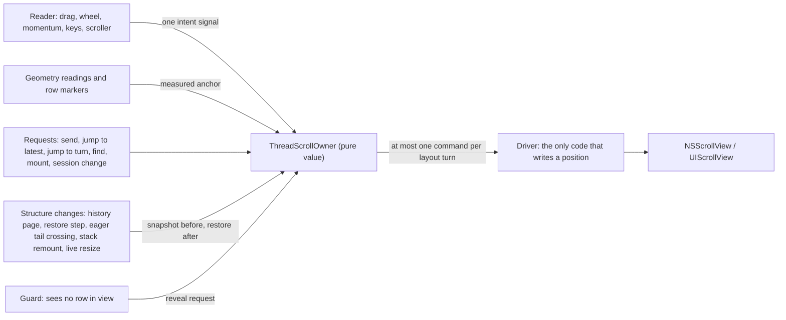

# Thread scroll: one owner for the transcript's position

Plan only. Nothing here is implemented, and no app, build or test was run to write it. Measured on branch `chore/scroll-audit` at `origin/nightly` 640f95c1d.

How to read it: every "can fire while the user scrolls" and "fights with" cell comes from reading the code and the commit messages, not from watching the app. Section 6 lists what that leaves unproven and how slice 1 measures it. The scroll-stability measurement case is built by another lane; section 5 says what each slice needs from it.

## 1. The problem in numbers

`git log -i --grep=scroll` on nightly returns 205 commits. About 70 of them touch the thread's scroll files; the rest are diff review, the design canvas, the sidebar and composer menus. The thread-scroll files today:

| Platform | Files | Lines |
| --- | --- | --- |
| Mac | `ThreadTailGuard`, `ThreadHistoryAnchor`, `ThreadEagerTail`, plus the scroll parts of `ThreadView` (1,763 lines, 143 commits) | 593 + the scroll parts of `ThreadView` |
| iOS | `ThreadTailGuard`, `ThreadTailPin`, `ThreadTailHold`, `ComposerPresentation`, plus the scroll parts of `ThreadScreen` (826 lines, 80 commits) | 665 + the scroll parts of `ThreadScreen` |
| Shared | `NativeScrollFollower`, `NativeTailRepin`, `NativeScrollProbe`, `NativeHistoryPaging` (`NativeThreadPresentation.swift`), `NativeTranscriptPlace` | about 600 |

The history reads as a series of patches that each add a writer:

- Sep 30: `389c91021` removes the bottom anchors on the Mac because the thread drew blank after a send. `94daa2bdd` puts them back for macOS 26 the same day.
- Oct 1 to Oct 29: `543843823` adds the tail guard. Nine more commits widen it (`fcc8f9292`, `091275531`, `489c2d66c`, `efd96d3e5`, `b4c1d64c0`, `2b10f7f47`, `3ec96e88f`, `27dc06a7c`, `c14888595`) until it can rebuild the scroll view. `9e2d1feb4` then turns the native anchors back on and lays out an eager tail so they stay honest.
- Nov 7 to Nov 13 on iOS: `ec3950c80` adds `ThreadTailPin`, `271925d5b` the iOS guard, `bf0dc0a41` a mount at the tail, `f91a3a24f` turns that off on iOS 27.1, then `a3a25c721` and six follow-ups add `ThreadTailHold` and a marker the place hands out and withholds.
- Nov 12 to Nov 20 on the Mac: more than 20 commits on restore, release, eager-tail and window-drag passes, each one gated on whether the reader is at the tail, typing, scrolling or flicking.
- Nov 20: `74d58d0d4` releases the history anchor so Jump to latest lands.

The pattern: no code owns the position. Each new symptom got a writer plus a gate that stops it from fighting the writers before it. This plan removes the need for the gates.

## 2. Actors that change what a thread transcript shows

Mac is `Sources/ShepherdApp/Thread/…`, iOS is `App/iOS/Thread/…`. "While the user scrolls" means a drag, a wheel or trackpad, or the momentum after it.

### 2.1 Writers: code that sets the position

| ID | Actor (file:line) | Trigger | While the user scrolls | Added or patched by |
| --- | --- | --- | --- | --- |
| M1 | Follower re-pin: `proxy.scrollTo(bottom)` in `onScrollGeometryChange`, `ThreadView.swift:319-329` (rule in `NativeScrollFollower.observe(from:to:)`) | Any geometry reading where the reader follows and the layout changed or the view sits past the tail | Held off by `gesture`: the `.interacting` phase, or wheel intent. Wheel intent counts only when its direction matches the direction of the geometry delta (`hasWheelIntent`, `ComposerAttachments.swift:101-107`) and only while the pointer hovers the thread (the monitor records it under `hovering`, `ThreadView.swift:1008-1015`). Momentum is not categorically covered: a layout adjustment in the opposite direction during a coast passes the gate. A scroller drag or key paging may set neither. Separately, a first drag reading whose rows re-measure arrives before interaction is signaled and can leave `sticky` true; that is a gap in what M1 knows, not a write. Once the drag is signaled, M1 does not re-pin (`NativeThreadPresentation.swift:809` requires `!gesture`; `ScrollFollowerLayoutTests.swift:36` covers it), and what can still move the view is the ungated M3 | `83634bd7a`, `de0db951b`, `389c91021`, `529223bd3`, `481026454`, `f2ac0c3dc`, `a99d9ec6d` |
| M2 | Native bottom anchor for the initial offset, `ThreadView.swift:1680` (`ThreadTailAnchor`) | A mount, and a thread shown again | No | `94daa2bdd`, `9e2d1feb4`, `4b6171e32` |
| M3 | Native bottom anchor for size changes while following, `ThreadView.swift:1683` | Every content or inset size change while `follower.sticky`, with no motion check | The anchor stays enabled at drag onset: sticky stays true until a reading shows intent, and a drag up re-measures rows. Whether it pulls a frame back under the hand is a measurement question (F2); `529223bd3` fixed the follower only | `94daa2bdd`, `9e2d1feb4` |
| M13 | Non-native size anchor while detached, `ThreadView.swift:1692` (`.defaultScrollAnchor(sticky ? nil : .top, for: .sizeChanges)`) | `nativeTail == false`. The app keeps `ThreadTailAnchor.isNative = true`, so only the tests reach it (`ThreadTailFlowTests.swift:196`) | Yes, no gate, when it is on | `529223bd3` |
| M4 | Native bottom anchor for alignment while a released thread restores, `ThreadView.swift:1687` | `restored != nil` | Yes, no gate | `970a1aa17` |
| M5 | History scroll position: `.scrollPosition($historyAnchor.position)` at `ThreadView.swift:287`, `position.scrollTo(id:anchor:.top)` at `:299`, reset in `ThreadHistoryAnchor.cancel()` (`:38`) | A page of older rows joins above the reader (`rows.first?.id` changes) | Cancelled on `.interacting` (`:334-348`) and on every wheel event over the thread (`:1008`), so trackpad momentum cancels it. A scroller drag or key paging does not | `aac19e5d4`, `4d930172b`, `4f534d6b0`, `fda4d7108` |
| M6 | History correction: `clip.scroll(to:)` in `ThreadHistoryAnchor.scheduleCorrection`, `ThreadHistoryAnchor.swift:87-107`, called from `moved()` for every geometry reading and every marker layout while engaged | Same as M5, then every layout until cancelled | Same as M5: engaged until one of those cancels it | `aac19e5d4`, `e855f4eca`, `4d930172b`, `58afe76c7`, `fc9d9a1eb` |
| M7 | Tail guard: walk (`clip.scroll`, `ThreadTailGuard.swift:311`), `reachTheEnd` (`:291`), and `land()` (`:280`), run by `settle()` (`:255`) | The scroll view shows no row, or a following view rests short of its end, after `quiet` (80 ms) or `busy` (600 ms) | Held off by `userScrolling` (`.interacting`) and `readerUntil` (500 ms after a wheel event or a drag). A scroller drag or key paging can set neither | `543843823`, `fcc8f9292`, `091275531`, `489c2d66c`, `efd96d3e5`, `27dc06a7c`, `c14888595` |
| M8 | Scroll view rebuild: `tailGuard.rebuild` bumps `transcriptRevision`, which is the identity of the `ScrollView` (`ThreadView.swift:278`, `:903`) | The guard used its 8 attempts and the view is still stranded | Held off by `userScrolling` and `readerUntil` | `b4c1d64c0`, `2b10f7f47` |
| M9 | Send: `proxy.scrollTo(bottom)` at `ThreadView.swift:364`, plus `follower.sent` (`:350-366`) | `store.sentCount` changes with a send that goes in now (not queued) while the reader was detached. A queued send, or a send while following, does not write | The reader's own action, no motion gate | `481026454`, `1d318fc01` |
| M10 | Jump to latest pill, `ThreadView.swift:390-395` | Click: cancels history anchoring, then scrolls to the bottom on activation | The reader's own action. It does not wait for the scroll view to be idle | `799eafedb`, `74d58d0d4` |
| M11 | Turn jump ⌥⌘↑/↓ and Find / Show summary: an unanimated `scrollTo(bottom)` when the command goes past the last turn (`ThreadView.swift:962`), and animated `scrollTo(row, .top)` at `:968` and `:986` | Command center, context details | The reader's own action. None waits for idle; the animation can be interrupted by a scroll | `a99d9ec6d`, `f2ac0c3dc`, `cebd3597e` |
| M12 | Restore: `restoreRows` calls `follower.jumpToLatest(); tailGuard.land()` at `ThreadView.swift:670-673`, then adds rows a step at a time (`:677-685`) | A hidden thread is shown again | The first landing waits out `userScrolling` and `decelerating` (`:661-666`), but not `inputRecent` or `!sticky`: a reader who is detached is exactly what triggers the landing (`:668-673`). The wider wait (`userScrolling`, `decelerating`, `!sticky`, `inputRecent`, `:641-643`) gates only the later row steps | `4b6171e32`, `9474ce2f7`, `60be152d0`, `9be86ae05`, `970a1aa17`, `89edf5417` |
| I1 | Position binding: `.scrollPosition(id:anchor:.top)` fed by `ComposerPresentation.position(tail:)` and written back by `noteVisibleTurn`, `ThreadScreen.swift:363` | SwiftUI scrolls to the id whenever the value handed to it changes: a kept turn, the bottom marker handed back by `hold`, `pinHistoryTurn` | Yes. The value can change at any layout | `de0db951b`, `bf0dc0a41`, `18f258a4c`, `a3a25c721`, `a29855afc`, `8eeb163f4`, `f7f67e803`, `74d58d0d4` |
| I2 | Native anchors, `ThreadScreen.swift:376-377`. Before iOS 27.1 (`ComposerPresentation.nativeTail`): `.bottom` initial offset (`.top` when a turn is restored) and `.bottom` size changes while following. From iOS 27.1: the initial anchor is off, but `.top` is installed for size changes while detached (`presentation.follows ? nil : .top`, `:377`) | Initial offset, size changes | Yes, no motion gate, on both sides of 27.1. The Mac counterpart is M13 | `bf0dc0a41`, `f91a3a24f` |
| I3 | Tail pin landing: `proxy.scrollTo(bottomID)` at `ThreadScreen.swift:521`, called from `ThreadTailPin` in the layout pass that asked (up to 8 times, `ThreadTailPin.swift:61`) or one turn later (`:150`) | A reading the follower wants repinned, output at the tail, an ask | Held off while `scrolling`, except an ask when no finger is down | `ec3950c80`, `c799742b1`, `030c7deca`, `4a719af61`, `5b1ff17e3`, `e75f461bc`, `5ee4a89e4`, `74d58d0d4` |
| I4 | iOS tail guard: `setContentOffset` in `goToPlacedRows` (`ThreadTailGuard.swift:117`), `walkBack` (`:207`), `walkDown` (`:222`), then `land()` (`:182`) | No row in view after 150 ms of quiet; within a second of a mount, at once. Also, while `unsettled`, rows in view but short of the tail run it again (`:145-153`, `shortOfTail` at `:231`), so blankness is not the only trigger | Held off by `isTracking/isDragging/isDecelerating` (`:237-240`). A non-touch scroll (VoiceOver paging) is deliberately not put back (`:47-49`) | `271925d5b`, `79672dadb` |
| I5 | Tail hold: hands the bottom marker back to I1 500 ms after a landing, `ThreadTailHold.swift` | A landing after rows joined | Skipped while a finger is down (`ComposerPresentation.hold`) | `a3a25c721`, `3344b5f90` |
| I6 | Send, ask, jump pill, Find, user turn arrival: `ThreadScreen.swift:409`, `:421`, `:438`, `:481` | The reader's actions | No gate | `8132e110a`, `18f258a4c`, `c799742b1` |
| I7 | Mount and leave: `presentation.mount()`, `leave()`, `newSession()` change what I1 is handed (`ThreadScreen.swift:368`, `:374`, `:446`, `:452`, `NativeTranscriptPlace`) | The transcript appears, a pushed screen pops, the session changes | Not a gesture | `a6d41f473`, `f7f67e803` |
| I8 | Interactive keyboard dismiss (`.scrollDismissesKeyboard(.interactively)`) changes the bottom inset while the finger moves | The reader drags the thread down over the keyboard | It is the user, but a landing in that window ends the drag | `8132e110a` |

### 2.2 Layout changes: code that moves rows under a position nobody is holding

A scroll view that holds no anchor keeps its offset from the top. Anything that changes the height of content above the viewport then moves what the reader sees. On the Mac, a reader who scrolled up (`follower.sticky == false`) has no anchor at all (`ThreadView.swift:1683` passes `nil`); only a history prepend gets one (M5, M6).

| ID | Actor (file:line) | Trigger | While the user scrolls | Added or patched by |
| --- | --- | --- | --- | --- |
| L1 | Lazy stack estimate to measured height, rows realized or forgotten (`LazyVStack`, `ThreadView.swift:600`, `ThreadScreen.swift:324`) | Scrolling reveals rows; `.id(StackID)` rebuilds the stack | Yes, by construction | The reason for `ThreadEagerTail`, `ThreadHistoryCache`, `ThreadHistoryBuilt`, both tail guards |
| L2 | Eager tail moves rows between the real stack and the lazy one, `ThreadEagerTail.update` (`ThreadEagerTail.swift:43`), called from `ThreadView.restingCount` (`:544`) | Rows change, a row's cost changes, the window height changes | Yes. A detached reader moves 2 rows at a time (`AppLayout.eagerTailCrossing`); a follower loses rows at once. A crossing rebuilds the row and drops its state | `bcc94fc7d`, `1d387b9f2`, `67158a053`, `290bd2af8` |
| L3 | Restore steps add rows, `ThreadRestore.advance` from `restoreRows` (`ThreadView.swift:677-686`) | Thread shown again | Waits for scroll, typing and a reader away from the tail | `4b6171e32`, `9474ce2f7`, `89edf5417` (see M12) |
| L4 | Live resize: `eagerCover`, `returnEagerTail` (`ThreadView.swift:464-480`, `:581`), and `parksHistory` (`:572`) removes the lazy stack from the tree during a drag when the reader follows | The window or a pane is dragged | A drag is not a scroll, but a hand is on the window | `08bddc18b`, `3af3deab3`, `1854f5bce` |
| L5 | Stack remount, `ThreadHistoryBuilt.stack` (`ThreadView.swift:1153`) changes the identity of the history stack | 16 rows joined since the stack began, reader at rest at the tail | Gated: `atRest` (`:185`) | `796e69aba` |
| L6 | History page prepend: `store.loadOlder` from `loadVisibleHistory` (`ThreadView.swift:920`, `ThreadScreen.swift:466`), sentinel `onScrollVisibilityChange` (`:258`, `ThreadScreen.swift:344`) | The reader reaches the top | Yes. `historyEnabled` excludes `animating` and `sticky` but not momentum | `de0db951b`, `aac19e5d4`, `5a8b75cc1`, `1854f5bce` |
| L7 | Streaming reply grows; a finished turn settles into its footer; a live row flips from shell to content (`ThreadRowContent`, `ThreadView.swift:807`) | Every chunk, every turn end | Yes | `5f82157a6`, `5d08a29dc`, `8269d07bb` |
| L8 | Async parse lands: a large reply parses off the main thread and draws as nothing until then (`NativeThreadStore.parseOffMain`, `tailAwaitsParse`, `rowCostRevision`) | A reply larger than 8 KB | Yes. A row above the viewport can change from nothing to full height | `20026fc5b`, `a6819eb93` |
| L9 | Disclosures animate their height: activity lines (`ThreadTools.swift:159`, `:254`, `:267`), thinking (`Messages.swift:494`), prose parts (`ProseParts.swift:215`), compaction | A click | The reader's own action, but the rows below and the anchor (M3) respond | `cebd3597e` |
| L10 | Web content reports its height: Mermaid (`Mermaid.swift:26`), HTML blocks (`HTMLBlock.swift:19`); images load (`ThreadImageViews.swift:82`) | A block scrolls into view or finishes loading | Yes | `b880e98f1`, `1d4f4a875` |
| L11 | Composer height: `ComposerInsetPadding` (`ThreadView.swift:290`, `ComposerInset`); iOS composer in a bottom safe-area inset (`ThreadScreen.swift:95`) and the keyboard | Typing multi-line, a question or queue appears, the keyboard opens | The reader may be typing, not scrolling | `6b466bd1a`, `5496c5022`, `e413d4f7b` |
| L12 | Width: window, side pane, inspector, terminal panel; iOS rotation, Split View, the Duo fold, side pane on iPad. Every row re-wraps | Resize | No | `271925d5b`, `529223bd3` |
| L13 | Rows above the lazy stack: notices (`ThreadView.swift:211`), the fleet move card (`safeAreaInset(edge: .top)`, `:282`), the iOS banner and spinner (`ThreadScreen.swift:307-320`) | Host drops, a dispatch moves | Yes | `5e77dfe08` |
| L14 | Thread switch: `AgentLayoutDeck` flips visibility; `active` toggles `ThreadRest`, the `dormant` branch (`:302`, calls `follower.jumpToLatest()` for a reader away), `withdrawStack`, `unpin`, and `NativeThreadStores` release rows over a budget (`:478-513`) | Selecting another thread, a window going away | A key press, not a scroll | `7befa3738`, `3fa60a4e2`, `11004ddc6`, `5a8b75cc1` |

### 2.3 Gates: who decides "the reader is scrolling"

There are seven clocks, and each writer reads a different subset.

| Signal | Source | Read by |
| --- | --- | --- |
| `follower.userScrolling` | `.interacting` phase (`ThreadView.swift:338`) | M1, M7, M8, M12, L5 |
| `input.hasWheelIntent` (350 ms, same direction as the geometry delta, recorded only while hovered) | wheel monitor (`ThreadView.swift:1008-1015`) | M1 |
| `input.decelerating` | `.decelerating` phase | M12, L5 |
| `tailGuard.readerUntil` (500 ms) | wheel monitor, `.interacting` | M7, M8 |
| `historyAnchor.animating` | `.animating` phase | `historyEnabled` only |
| `userActivity.inputRecent` (750 ms) | app-level key, scroll, drag monitor | M12, L3, hidden-stack release |
| `NativeTailRepin.scrolling/touching` (iOS) | phase | I3 |
| `UIScrollView.isTracking/isDragging/isDecelerating` (iOS) | UIKit | I4 |

Writers that ignore all of them: M3, M4, M13, I2, M6 in momentum, L2, L7, L8, L10.

## 3. Pairs that can fight

"Fight" means two writers can act in one layout turn or on adjacent frames and leave the view somewhere neither alone would. IDs are for later reference.

| ID | Pair | Why they can collide | Evidence in the repo |
| --- | --- | --- | --- |
| F1 | M3 native size anchor and M1 follower re-pin | On a layout change with the reader following, both aim at the tail. The follower skips a reading past the tail while layout changes (`nativeAnchor`), but re-pins when `layoutChanged && distance > 4` | `NativeScrollFollower.observe` doc, `ThreadView.swift:321-326`; `ThreadTailAnchor` comment: `scrollTo` "builds every row of a long thread" |
| F2 | M3 and the reader's first drag up | Sticky is still true when the drag starts, so the anchor is still installed; if the rows the drag reveals re-measure, it may hold the tail against the hand. Unconfirmed | `529223bd3` fixed the follower half only; `ThreadView.swift:1683` still keys on `sticky` |
| F3 | M6 history correction and a scroll that is not a wheel or a touch drag (scroller drag, ⌘↑ / Page Down) | Neither the phase handler nor the wheel monitor cancels the anchor, so `clip.scroll` is a second writer under the reader. Trackpad momentum is covered by the wheel monitor, so this is narrower than it first looks | `ThreadView.swift:334-348`, `:1008` |
| F4 | M5 `position.scrollTo(id:)` and M6 correction | SwiftUI resolves the id against the stack's estimates, then M6 moves again by the measured delta on a later main-queue turn. The reader sees both | `ThreadHistoryAnchor.swift:64-107`: two `DispatchQueue.main.async` hops |
| F5 | M7 walk and M3, and M7 `land` and M1 | The guard sets the offset by hand while content grows and the native anchor re-pins. `repairing` mutes the follower (M1) only, and `reachTheEnd()` writes the clip offset outside `repairing` (`ThreadTailGuard.swift:291`) | `ThreadView.swift:326`; M3 has no equivalent |
| F6 | Three callers of the same landing: M1, M7's `land()` and M12's `tailGuard.land()` | Each calls `proxy.scrollTo(bottom)` against estimates that change between calls. On iOS the first landing after new rows came out 5,563 pt short | `NativeTranscriptPlace` doc |
| F7 | L2/L3/L4/L5 (structure changes) and M3 | Rows that join the eager tail change height above the tail; only a view held to the tail takes that without moving. Each of these gates itself on `follower.sticky`, which is stale in the first frames of a drag (F2) | Comment at `ThreadView.swift:457` |
| F8 | A detached reader and L1, L2, L6, L7, L8, L9, L10 | No writer holds them. The offset stays; the content above them changes | `ThreadView.swift:1683` (`nil` when not sticky); no anchor in the lazy stack |
| F9 | M12 `follower.jumpToLatest(); land()` and the reader | Force re-attaches a reader who scrolled away while the thread came back. Same in `onChange(of: dormant)` (`:302`) | `ThreadView.swift:668-673` |
| F10 | M8 rebuild and everything | Replaces the scroll view: offset, anchors, markers and the position binding all reset, while follower state survives | `ThreadView.swift:278`, `:903-910` |
| F11 | M11/I6 animated jump and M1 or history load | `follower.jumping` and `historyEnabled` carry flags for this | `f2ac0c3dc`, `ThreadView.swift:916` comment: starting history during an animated jump drops its restoration request |
| F12 | I1 position binding, I3 pin landing and I2 native anchor | The marker handed to SwiftUI scrolls on change; the pin lands the same marker; below 27.1 the anchor also acts, and from 27.1 the detached `.top` size anchor does. `NativeTranscriptPlace` withholds and returns the marker only to keep these three apart | `NativeTranscriptPlace.swift` doc; `ThreadTailHold.swift` |
| F13 | I4 walk and I3 pin | `standAside` / `NativeTailRepin.hold` exist for this | `ThreadTailPin.standAside` |
| F14 | I3 landing and the interactive keyboard dismiss (I8) | A programmatic scroll ends the drag; "the reader could never leave the tail" | `529223bd3` |

Platform fork: Mac always runs M2 to M4 plus M1 (M13 only where a test turns `nativeTail` off). iOS before 27.1 runs I2's bottom anchors plus I3. iOS from 27.1 runs I3 plus I2's detached `.top` size anchor, and keeps the turn it is on (`ComposerPresentation.nativeTail`). Three behaviors, so a fix that works on one can break another.

Copies of the same follow logic: `SubagentInspector.swift:286-340` (Mac inspector transcript), `SubagentRunScreen.swift:74-190` (iOS run screen, uses its own `ThreadTailPin`), and `SentCommand.swift:90`. They share the problem at smaller scale.

## 4. Proposed design: one owner decides, everyone else asks

### 4.1 The model

One value type, `ThreadScrollOwner`, in `ShepherdRemote` (Mac and iOS both import it). It replaces `NativeScrollFollower`, `NativeTranscriptPlace` and the decision half of `NativeTailRepin`. It holds one mode:

- `following`: the reader is at the tail. The anchor is the bottom of the content, measured from the scroll view, not from a lazy stack estimate.
- `pinned(row, offset)`: the reader is somewhere else. The anchor is the row at the top of the viewport and its distance from the viewport top. This generalizes what `ThreadHistoryAnchor` already does for a prepend (its marker and `viewportTop`).
- `jumping(target)`: a requested animated move; it ends when it lands or the reader takes over.

Rules:

1. Only the driver writes a position. The driver is a small per-platform object over the AppKit or UIKit scroll view. It receives at most one command per layout turn: `land`, `restore(row, offset)`, or `scroll(to: row, animated)`. Every `proxy.scrollTo`, `clip.scroll`, `setContentOffset`, `ScrollPosition` and `defaultScrollAnchor` call listed in section 2.1 is removed or becomes a driver call.
2. One intent signal, with three states kept apart: `touching` (a finger down, a wheel or trackpad event, a scroller grab), `coasting` (momentum after it) and `programmatic` (an animation the driver started). `NSEvent.momentumPhase` and the scroller on the Mac and `UIScrollView` state on iOS feed it. On the Mac, keys (Page Down, ⌘↑) and a scroller drag are captured as `touching`, and the animated scroll a key starts is `coasting`. On iOS, non-touch paging (VoiceOver) raises none of them, so the owner also treats any displacement the driver did not cause (no command in flight, no layout change to explain it) as the reader moving: it cancels a pending restoration, history correction or compensation and re-anchors where the reader now is (`following` if within `repinSlack` of the tail, else `pinned`). That is what stops a pending history correction from putting a Page Down reader back. The guard's own `unsettled` check (`App/iOS/Thread/ThreadTailGuard.swift:145-153`) is a separate safeguard and stays; the guards keep leaving a VoiceOver reader where they put themselves (`:47-49`). The owner issues no automatic write (a landing, a restore, a compensation, a guard repair) in `touching` or `coasting`; it keeps updating its anchor from the measured position every frame, so the moment the reader stops, the anchor is where they are. A reader's explicit ask (send, Jump to latest, a turn jump) is not automatic: on iOS it may end a coast, as `ThreadTailPin` does today, and never interrupts `touching`. On the Mac an ask wins at any time, as M9 to M11 do today.
3. Layout shifts are compensated, not fought. After each layout the owner compares where the anchor row sits against where it was. In `pinned`, a difference not explained by the reader's own offset change is corrected by the same amount in that layout turn. In `following`, the same for the bottom. That removes the need for the eager-tail rule to keep estimates out of the reader's way (F8), and it covers async parse, disclosures, web content and notices with no case-by-case code.
4. Structure changes go through the owner. The history page, a restore step, an eager-tail crossing, a stack remount and a live resize call `owner.transaction { … }`. The owner records the anchor, the change runs, and the owner restores it after layout. This is what `ThreadHistoryAnchor.prepended` does today for one case. The `follower.sticky` gates in F7 go away, because a pinned reader is no longer disturbed by them.
5. Requests have an order. A reader's motion cancels every non-reader request except an iOS ask. A newer request replaces an older one. A `jumping` target survives layout but not the reader.
6. The tail guard becomes a detector. It still notices "no row in view" (placement evidence from the row markers is the part that works), but its repair is `owner.reveal(lastPlacedRow)`. The walks go. The rebuild stays as the last resort and runs as a transaction. Until slice 8 the Mac guard's direct writes stay: the walk, which excludes M1 through `repairing`, and `reachTheEnd()`, which does not (see slice 4).
7. The native SwiftUI anchors are not part of the model. Decision D1 below says whether they stay as the driver's way to hold the tail.

State the owner keeps across mounts: mode, and for `pinned` the row ID, its offset and its place in the store's ordered row list. This replaces `NativeTranscriptPlace`'s turn, `markerTail` and `withheld` flags, and the marker hand-back (`ThreadTailHold`, I5) with a measured position, which removes F12 and the iOS version fork.

### 4.2 What goes away

| Today | After |
| --- | --- |
| M1 to M4, M9 to M12 | One driver call each, from the owner |
| M5, M6, `ThreadHistoryAnchor.position`, the `.scrollPosition` binding | `pinned` plus a transaction |
| M7 walks, `reachTheEnd`, M8 identity bump as a first resort | `reveal`; rebuild stays as a transaction |
| I1, I2, I3, I5, I7, the marker dance, `nativeTail` | Driver plus the owner's saved anchor |
| `hasWheelIntent`, `follower.userScrolling`, `input.decelerating`, `readerUntil`, `NativeTailRepin.scrolling/touching` | `ScrollIntent`. `historyAnchor.animating` and the `inputRecent` CPU hint stay until slices 6 and 7 |
| `follower.sticky` gates in restore, stack remount, eager tail | Transactions |
| About 1,600 lines in the files of section 1 | A pure owner (about 300 lines estimated, not measured) and two drivers of about 100 lines each |

### 4.3 Decisions this plan makes, and the ones left open

- D1, open, resolved by slice 4's A/B run: keep `defaultScrollAnchor(.bottom, for: .sizeChanges)` as the driver's way of holding `following` (the owner never writes while following, except asks and mounts), or drop it and let the driver write the offset after layout. The first has fewer writes; the second is one mechanism on both platforms and survives the iOS 27.1 behavior. The case decides; the owner interface is the same either way. The A/B varies only the size-changes anchor (a test-only switch on the `.defaultScrollAnchor(…, for: .sizeChanges)` argument at `ThreadView.swift:1683`). Toggling the existing `nativeTail` fixture is not that experiment: it also changes the initial and alignment anchors (M2, M4), installs M13 while detached, and changes the `nativeAnchor` argument M1 receives (`ThreadView.swift:326`, `:1677-1692`), so its result cannot be attributed to M3.
- D2, decided: while the reader moves, the owner records and does not write. The cost is a visible correction when they stop if the layout moved under them. Slice 5 measures that residue. If it shows, slice 5 applies the one correction on the frame the coast ends, not during it. The rule has no exception once a consumer is migrated: automatic writes in `touching` or `coasting` read zero in the gate of the slice that migrates that consumer (2b onward), so one trace cannot both pass and fail. Slices 1 and 2a only record, so their baseline may contain such writes. Letting the owner compensate during `coasting` would be a new decision for the user, not a slice choice.
- D3, decided: the anchor for `pinned` is the topmost row whose marker intersects the viewport, identified by row ID. The Mac markers (`ThreadHistoryAnchor.Marker`, the guard's `RowMarker`) can supply that. The iOS `TailRowMarker` registers an anonymous `UIView` and never updates its identity (`App/iOS/Thread/ThreadTailGuard.swift:254-266`), so it must carry a row ID (updated in `updateUIView`) before slice 10; its cost is measured with the render probe, not assumed free. A saved native offset alone cannot restore a row. When the pinned row is not realized (the lazy stack dropped it) or has been replaced (a rebuilt row, a remount), the owner asks the driver to `reveal(rowID)` and then compensates; if the ID no longer exists, it falls back to the nearest surviving row in the store's ordered list, and failing that to `following` if the reader was within `repinSlack` of the tail before the change. The pure owner in slice 3 specifies and tests those three cases.
- D4, open for the user: platform parity. `AGENTS.md` asks that a user-facing change ships on Mac and iOS in one PR unless scoped. Slices 4 to 8 are Mac-only and slices 9 to 12 are iOS-only here because the two drivers share only the owner. Say if you would rather have each slice on both platforms; it roughly doubles the size of every PR after slice 3.
- D5, decided: no feature flag. Each slice is small enough to revert as a commit. A flag would keep both writers alive, which is the problem this plan removes.

## 5. Migration in PR slices

Every slice is judged by the scroll-stability case from the other lane. This plan asks it for these outputs (if it lacks one, slice 1 or the slice's own PR adds it, so no slice is judged by eye):

- Displacement: per frame, the change in viewport y of the row nearest the top, minus the reader's own scroll delta. Pinned target: at most 1 pt on every frame a reader is not touching.
- Blank frames: frames in which no row intersects the viewport. Target: zero.
- Tail gap at rest while following. Target: at most `NativeScrollFollower.repinSlack` (4 pt).
- Position writes per scenario, by actor, with the motion state and row ID at the time of each write (from slice 1). Target for each slice: the writers it removes read zero, none are added, and automatic writes during `touching` or `coasting` read zero for every consumer already migrated. Slices 1 and 2a are capture-only: they pass on trace coverage and unchanged behavior, even when the baseline contains unwanted writes, because recording those is their purpose. Zero automatic writes is enforced per consumer in the slice that migrates that consumer (2b for the consumers it lists, later slices for the rest).
- Settle time after a request (send, Jump to latest, mount).

Scenarios it must cover, from section 2: stream at the tail; scroll up while streaming; flick into the history and page in; send while scrolled up and at the tail; Jump to latest and a turn jump; window and pane resize; switch away and back; a disclosure toggle above and below the viewport; a large reply's parse landing; composer growth and keyboard (iOS); rotation or fold (iOS).

Each slice below states its scenarios and passes only if every scenario holds the baseline and the named ones improve (slices 1 and 2a pass on trace coverage and unchanged behavior alone). The baseline is the case run on nightly before slice 2, per platform.

| Slice | PR | Changes | Judged by | Removes |
| --- | --- | --- | --- | --- |
| 1 | Writer ledger | Instrumentation only, no behavior change, Mac and iOS: a `SHRenderProbe` event at every explicit writer in 2.1 and 2.2 (`thread.write.<id>`), including M13 and both I2 branches, recording the motion state, the anchor row ID and the viewport displacement on drawn frames. Displacement is measured for the same row ID across consecutive drawn frames, so ordinary scrolling past a row boundary does not read as a jump; when that row disappears (unrealized, replaced) the measurement hands off to the nearest surviving row and logs the handoff instead of a displacement. Differencing the viewport positions of two different "nearest" rows is not used. The Mac case already tells drawn frames apart (`Tests/ShepherdAppIntegrationTests/Support/ScrollTrace.swift:4-13`); iOS needs the same, and needs an identified measurement source: the production `TailRowMarker` is anonymous until slice 10 (D3), so slice 1 adds a probe-only row ID there that slice 10 replaces with the real one. `SHRenderProbe.tick` alone only increments an aggregate counter (`SHRenderProbe.swift:63-69`) and cannot show a collision | Baseline for all scenarios. Explicit writers: F-pairs are observed as two writes whose displacement lands on one drawn frame or on adjacent drawn frames. Adjacent frames stay in scope because section 3 defines a fight that way, and M5's materialization and M6's correction are queued on separate main-queue hops (`ThreadHistoryAnchor.swift:71-105`). Native anchors (M2 to M4, M13, I2) cannot be ticked, since evaluating the modifier is not SwiftUI moving the viewport: attribute them by A/B, the same scenario with the anchor on and off, and report that as an inference. F8 is displacement with no writer at all, so it is read from displacement alone | Nothing |
| 2 | One intent signal, in two PRs | **2a, capture:** `ScrollIntent` (shared) with `touching`, `coasting`, `programmatic`, fed by phase, wheel with `momentumPhase`, scroller and keys on the Mac and UIKit state on iOS, plus the "displacement the driver did not cause" rule of 4.1 for non-touch paging on iOS. No consumer changes; the case records it beside the writes from slice 1. **2b, consumers:** M1, M6, M7, M8, M12, L5, I3, I4 read it and the clocks that gate those writes go. `userActivity.inputRecent` stays as a CPU hint (`ThreadView.swift:499`) and `historyAnchor.animating` stays in `historyEnabled` (`:918`); the restore gate (`:642`) moves with slice 7. Automatic writes now also stand down in `coasting` | 2a: the signal agrees with what the case observed, for a drag, a coast, a scroller drag, key paging and VoiceOver paging. 2b: scroll up while streaming; flick into history; flick as a thread is restored; scroller drag and key paging on the Mac, with a history correction pending when the key is pressed. Zero automatic writes in `touching` and `coasting`, and a test that an explicit ask on iOS still ends a coast and does not interrupt a finger. VoiceOver paging with a correction pending cancels it and is not put back | `hasWheelIntent`, `decelerating`, `readerUntil`, `userScrolling` reads (not `inputRecent` or `animating`) |
| 3 | Pure owner | `ThreadScrollOwner` and its unit tests in `ShepherdRemote`. It is not judged by cases, so it is checked against recorded behavior: the stability case's recorded inputs (geometry readings, intent, requests) replay against the owner and its decisions are compared with what the code did, or the unchanged case runs next to the unit tests. `ScrollFollower*Tests` (jump, layout, repin, send) and `NativeTranscriptPlaceTests` are the floor. Specifies the three unrealized or replaced pinned-row cases of D3. No UI wiring | Replay and unit tests; no UI change to judge | Nothing yet |
| 4 | Mac: following | Mac driver over `NSScrollView`. M1, M9, M10, M12's landing, the unanimated bottom write of M11 (`ThreadView.swift:962`) and the guard's `land()` become owner commands; `ThreadTailAnchor` resolved per D1. The guard's direct writes are not removed until slice 8. There are two: the walk (`ThreadTailGuard.swift:297-315`) sets `repairing` across awaits while writing the clip offset, which is what mutes M1 today; `reachTheEnd()` (`:283-292`) writes the clip offset outside `repairing`, and `land()` (a `proxy.scrollTo`, `:280`) runs outside it too. `repairing` is not a complete handoff, and a retained native M3 anchor does not read it. This slice routes both direct writes through the driver (preferred) or has the driver stand down while either runs, and the A/B in D1 covers M3 | Stream at the tail; send; Jump to latest; mount; composer growth; a turn finishing; and two forced repairs, one where the guard walks and one where rows are in view and `reachTheEnd()` closes a shortfall (zero collisions in a run where the guard never wrote says nothing about the handoff). Blank frames zero, tail gap within 4 pt, one write per frame at most, F1, F5, F6 read zero | `proxy.scrollTo(bottom)` sites, probably M3/M4 (`repairing` and the guard's direct writes stay until slice 8) |
| 5 | Mac: pinned | Generalize `ThreadHistoryAnchor` to `pinned(row, offset)` for every detached reader and compensate layout shifts | Scroll up while streaming; disclosure toggle; large reply parse landing; flick into history; width resize while scrolled up. Displacement at most 1 pt. This is the slice with the largest expected user-visible change (F8) | The detached gap in 2.2 |
| 6 | Mac: history and turn jumps | History prepend, M11 and Find become owner requests and a transaction; `.scrollPosition` and `ThreadHistoryAnchor.position` go | History page-in; turn jump; Find; switch away and back while paging | M5, M6, M11, F3, F4, F11 |
| 7 | Mac: structure changes | Restore steps, `returnEagerTail`, `parksHistory`, `ThreadHistoryBuilt` remount and eager-tail crossing run in transactions; their `sticky`, `decelerating` and `inputRecent` gates go (typing stays as a CPU hint, outside the owner) | Switch away and back; live resize; heavy thread open; a stream for 16+ turns | F7, F9, L2 to L5 gates |
| 8 | Mac: guard | `ThreadTailGuard` detects only; repair is `reveal`; walks and `reachTheEnd` deleted; rebuild stays | All scenarios with the `thread.tailRepair` tick at zero. If any scenario still repairs, the slice stops and files why | M7 walks, F5, F10 |
| 9 | iOS: following | iOS driver over `UIScrollView`. `ThreadTailPin` and `NativeTailRepin` landings become owner commands; send, ask and Jump to latest go through it | Stream at the tail; send; Jump to latest on the phone and the Duo; rotation; keyboard dismiss. Tail gap within 4 pt, F13, F14 zero | I3, I6 |
| 10 | iOS: pinned and mount | Owner's saved anchor replaces the position binding, the marker hand-back and `nativeTail`. Same code on every iOS version. `TailRowMarker` gains a row ID (D3) | Re-open a followed and a scrolled thread; scroll up while streaming; history page-in. Displacement at most 1 pt on 27.0 and 27.1 | I1, I2, I5, I7, `NativeTranscriptPlace`, `ThreadTailHold` |
| 11 | iOS: guard | `ThreadTailGuard` detects only, as slice 8 | Side pane open, iPad turn, Duo fold, first-second mount, with the repair tick at zero | I4 walks |
| 12 | Other transcripts | `SubagentInspector`, `SubagentRunScreen`, `SentCommand` use the owner; delete the old follower types | The case's subagent run scenarios if it has them; otherwise `ThreadScrollingTests` and the existing run-screen fixtures | Copies of the follow logic |

Order: 1, 2 and 3 are independent and can merge in any order after 1. Slices 4 and 5 are independent; the case's baseline picks which goes first (the one with the larger displacement or blank count), default 4 then 5. Slice 8 needs 4 to 7. Slices 9 to 11 need 3 and 2, and can run in parallel with the Mac slices on a second branch.

Per slice:

- Update only the docs the change makes wrong. The first doc to move is the "Rules that bite" tail and eager-tail paragraphs in `docs/rules.md` (lines about 180 to 261), at slice 7.
- Reuse existing tests. `ThreadTailFlowTests`, `ThreadSendScrollTests`, `ThreadScrollingTests`, `ThreadBlankScreenTests` and `ScrollTrace` stay green; the ones that pin an old mechanism by name (for example the guard's known-issue run) change in the slice that removes the mechanism and say so in the PR.
- Stop rule: a slice that regresses any scenario is reverted or fixed in its own PR before the next starts. No slice adds a gate to hide a regression.

### Slice 4 measurement and stop

On `d30e0683c`, macOS 27.0.1, the off-screen Dev app ran `validate.py --case scroll-stability` three times per arm. The existing `--scroll-anchor-off M3` switch changes only the size-changes anchor. It leaves initial offset, restore alignment, and the follower's `nativeAnchor` argument alone.

| M3 | Run | Streaming jump displacement | Flick jump displacement | Total jump displacement | In-band input residuals |
| --- | ---: | ---: | ---: | ---: | ---: |
| On | 1 | 337 pt | 615 pt | 952 pt | 595 pt |
| On | 2 | 477 pt | 615 pt | 1,092 pt | 595 pt |
| On | 3 | 477 pt | 615 pt | 1,092 pt | 595 pt |
| Off | 1 | 1,135 pt | 644 pt | 1,779 pt | 0 pt |
| Off | 2 | 1,135 pt | 644 pt | 1,779 pt | 0 pt |
| Off | 3 | 1,135 pt | 644 pt | 1,779 pt | 0 pt |

Total is the sum of absolute measured jump deltas, not the number of jumps. The other measured scenarios added no jump displacement. Even counting the in-band residuals, M3 off was worse: 1,779 pt in every run versus 1,547, 1,687 and 1,687 pt on. Both arms had zero blank frames in the six displacement scenarios and one transient history anchor loss per run. All six runs exited 1 on stability assertions; the Dev fixture and required writer probes completed.

**D1: keep M3 in the current implementation.** Turning it off does not take control of the AppKit offset write. In baseline run 1, the first flick input moved the clip from 73,281 to 73,071 pt. `HostingScrollView.updateContext` resized the document from 73,787 to 72,885 pt. `NSClipView._reflectDocumentViewFrameChange` wrote the new tail offset of 72,379 pt. The same row stayed at the same viewport y, and the tail gap returned to zero. AppKit erased the 210 pt of visible reader movement by clamping to the new end; it did not literally write the old numeric offset. The write still occurs with M3 off.

Two temporary probes failed to provide a usable handoff. Setting SwiftUI's `Transaction.scrollContentOffsetAdjustmentBehavior` to `.disabled` left the AppKit writer active and measured 1,779 pt of jump displacement with M3 either on or off. Replacing SwiftUI's `HostingClipView` with an `NSClipView` subclass reached the documented `scroll(to:)` override from the frame adjustment, but made the transcript go blank and timed out before the original history page's first row appeared. Copying the clip's flipped coordinate setting did not close that regression: the flick had no visible row for all 78 sampled frames, versus zero blanks on baseline.

The stop rule applies. Both probes were removed, no owner driver was installed, and no after-run is claimed. A viable next experiment must control the frame adjustment without replacing the clip's SwiftUI behavior or correcting the offset in a second write. Local evidence is under `.build/validation/scroll-stability-*/mac/` (`frames.json`, `scroll-jumps.json` for completed runs, and `run.log`).

### Slice 4 shrink attribution

On macOS 27.0.1, `.build/validation/scroll-stability-uxp2qg0u/mac/frames.json` reproduces the exact first flick in baseline run 1. The writer ledger and `SHRenderProbe` place both height changes in `flick-and-stop`, frame 1 (zero-based):

| Event | Document height | Clip offset | Change in height |
| --- | ---: | ---: | ---: |
| At the tail | 73,787 pt | 73,281 pt | |
| Reader scrolls up | 73,787 pt | 73,071 pt | 0 pt |
| `sticky` becomes false; `ThreadHistoryCache.Key.detached` changes | 73,231 pt | 72,725 pt | −556 pt |
| Clamp brings the clip back into the tail band; `sticky` becomes true and invalidates the cache again | 72,885 pt | 72,379 pt | −346 pt |

**The two history cache misses remove 902 pt.** Each replaces the value of the same `LazyVStack`; SwiftUI re-estimates its unrealized prefix without adding or removing a row. All 30 available row markers retain their heights and move up exactly 902 pt in document coordinates. The app triggers the estimate change; `HostingScrollView.updateContext` sets the new size and `NSClipView._reflectDocumentViewFrameChange` clamps to the new end twice. No app scroll writer fires. The phase-only redraw before the first cache miss and the later change from touching to coasting do not change the height.

| Candidate | Evidence in frame 1 | Share |
| --- | --- | ---: |
| L2/L4, eager tail crossing or resize return | 30 eager rows starting at `user-346` throughout; 572 history rows ending at `user-345/reply`; `eagerReturning` stays nil. | 0 pt |
| Tail spacer, bottom inset, wait line or jump pill | The wait line stays absent and the bottom inset stays 134 pt. The pill toggles in the composer's background, outside the scroll content. The distance from the live row's top to the document end stays 600 pt. | 0 pt |
| L11, composer | The composer stays present and the top/bottom insets stay 28/134 pt; no composer height event. | 0 pt |
| L1, lazy stack estimates | Two cache misses just before the two native resizes. No new, missing or resized markers. The full shift lies above the first eager row. | −902 pt |
| L5/L4, remount or parked history | Stack ID stays 0; history is never parked. This is a new cached view value, not a new stack identity. | 0 pt |
| L3, L6–L10, L12/L13 | No restore step, prepend, chunk, parse, disclosure, image, resize or notice event. The live row stays 543 pt; the clip stays 910 × 640 pt. | 0 pt |

The first streaming drag also invalidates the cache at detach: 145,386 → 123,225 pt in baseline run 1; 175,695 → 153,565 pt in the instrumented run. The latter also includes a 20,901 pt estimate loss on a subsequent drag with no cache miss, and a 16,721 pt loss during a 29 pt chunk growth. Removing the detach trigger must be checked against both scenarios; it does not change SwiftUI's estimation algorithm.

### Slice 4 cache-key experiment and stop

The candidate took `detached` out of the Mac history cache key. It did not move the clip, defer the rebuild with a timer, or change M3. The flick still starts at the tail, independently of where the streaming scenario ends. When necessary, the off-screen fixture returns there through the existing Next Turn command before starting the trace.

| Scenario, total absolute jump displacement | Baseline 1 | Baseline 2 | Baseline 3 | Candidate 1 | Candidate 2 | Candidate 3 |
| --- | ---: | ---: | ---: | ---: | ---: | ---: |
| Slow scroll while streaming | 337 pt | 477 pt | 477 pt | 595 pt | 595 pt | 595 pt |
| Flick and stop | 615 pt | 615 pt | 615 pt | 0 pt | 0 pt | 0 pt |
| Mid-history new turn | 0 pt | 0 pt | 0 pt | 0 pt | 0 pt | 0 pt |
| Page older history | 0 pt | 0 pt | 0 pt | 0 pt | 0 pt | 0 pt |
| Window resize | 0 pt | 0 pt | 0 pt | 0 pt | 0 pt | 0 pt |
| Switch away and back | 0 pt | 0 pt | 0 pt | 0 pt | 0 pt | 0 pt |
| Total | 952 pt | 1,092 pt | 1,092 pt | 595 pt | 595 pt | 595 pt |
| Blank frames in the six scenarios | 0 | 0 | 0 | 0 | 0 | 0 |

The candidate passed the first-move regression check in all three runs. That check failed on the unchanged app with a 902 pt loss and passed on the candidate with 0 pt loss, at an initial tail gap of 0 pt in both cases. Each candidate run still failed the streaming and history page stability assertions. Writer probes passed and history still had one transient anchor loss per run. The separately tracked in-band input residuals fell from 595 to 113 pt in each streaming run, but measured streaming jumps grew beyond the baseline range. The 595 pt is not noise.

Candidate run 1, streaming frame 8, had no reader input, writer request, new marker, or eager/history structure event. The streaming reply grew by 29 pt, yet the document lost 30,280 pt. All 30 marked rows moved up 30,309 pt in the document, from the history estimate above them. On frame 11, a 28 pt wheel move with no layout event and no change in the streaming row height was enough for the estimate to drop another 17,767 pt. Both native resizes came from `HostingScrollView.updateContext` and produced the same AppKit clamp as the original flick. The cache key no longer depends on follow state, so it cannot account for these residuals.

**Stop: do not ship the cache-key candidate.** It fixes the first flick but regresses the measured streaming scenario. The next experiment is a small off-screen reproduction: a `LazyVStack` of fixed, heterogeneous heights above an eager tail, with a growing last row. Keep the lazy view value fixed, use the same clip moves, and compare with a `VStack` of the same rows. Record the document size, first eager marker position, and native writes. This tests whether SwiftUI re-estimates on scroll or tail growth alone, without Shepherd's follower, history cache, or composer. Do not add another offset write to fight the clamp.

Local evidence: `.build/validation/scroll-stability-{jr_aezxz,s3yedtaj,ysz7o6mk,8pah7dt_}/mac/` (regression red, then candidate runs 1 to 3). The unshipped patch and regression check are in `.orchestrator/cache-key-experiment.patch`. No iPhone or iPad behavior was changed or checked.

### Slice 4 pinned-height experiment and stop

The off-screen Mac Dev app on macOS 27.0.1 tried a bottom-leading fixed-height frame around the cached history `LazyVStack`. `onGeometryChange` captured the first positive stack height at mount, 298,556 pt. The frame kept that height for the run. The candidate also removed `detached` from the history cache key, kept M3 on, and added no offset writes, timers or identity changes. This first pass tested whether the frame could isolate the estimate and still draw history before adding any height correction.

| Scenario | Baseline jump displacement | Pinned frame, run 1 | Blank frames, baseline to run 1 |
| --- | ---: | ---: | ---: |
| Slow scroll while streaming | 337 to 477 pt | 0 pt | 0 to 0 |
| Flick and stop | 615 pt | 0 pt | 0 to 0 |
| Mid-history new turn | 0 pt | Unknown: anchor never returned | 0 to 200 of 201 |
| Page older history | 0 pt, one transient anchor loss | Unknown: timed out before the initial boundary appeared | 0 to 783 of 783 |
| Window resize | 0 pt | Not run | Not run |
| Switch away and back | 0 pt | Not run | Not run |

The frame isolated the estimate at the tail. In streaming frame 8, the stack lost 30,309 pt of reported height, but the document grew by exactly the same 29 pt as the live reply and the clip did not move. The next 28 pt wheel move changed only the clip offset. The raw flick trace satisfies the first-move regression predicate: it started following at a 0 pt gap, moved up the requested 210 pt, and the document stayed at 304,791 pt. The Python runner could not record a flick check for this run because the fixture exited at the later page timeout. The validator's Python tests, including the first-move assertion, passed: 20 tests.

The history stack did not supply any marked rows at the positions the fixture scrolled to. The first move into mid-history placed the clip at 152,395.5 pt with the document still at 304,791 pt. On that frame and the next 199, the trace saw only the 30 eager row markers, all outside the viewport. At the end of streaming, the last observed natural height was 75,933 pt, leaving 222,623 pt of unused space above the bottom-aligned stack. The midpoint falls in that space. The new turn triggered the existing M7 guard walk to the top without finding a row. The top sentinel requested the page, but the fixture timed out waiting for `user-60`, so no page was delivered. The trace shows the frame can pin the document while stranding the reader in empty space. It does not establish whether SwiftUI would realize rows correctly if the clip were inside the stack's current extent.

**Stop: do not ship.** The mid-history and page scenarios regressed on the first run. Runs 2 and 3, the optional standalone reproduction and the layout/spacer fallback were not run. The prototype never corrected its initial height, so there is no result for a compensated idle or prepend correction, a restore step, a remount or a width change. Whether pinning would still need the cache-key change was not tested independently. The candidate and the cache-key change were both removed. No Mac fix shipped; iPhone and iPad were not changed or checked.

Local evidence: `.build/validation/scroll-stability-t42mqs2b/mac/frames.json` and `run.log` (Dev build succeeded; fixture exited 2 at the timeout). The unshipped patch is `.orchestrator/pinned-height-experiment.patch`.

### Slice 4 conditional history height experiment and stop

On macOS 27.0.1, the off-screen Dev app measured the lazy history's natural height and gave it a bottom-aligned fixed frame only near the tail during or after detach. The frame held the old height before the drag or the cache rebuild. It accepted growth and released a pending shrink when following resumed or when the smaller document would leave at least one viewport below the reader. The candidate kept `ThreadHistoryCache.Key.detached` and M3. It added no position writes or changes to view identity.

| Scenario, total absolute jump displacement | Baseline 1 | Baseline 2 | Baseline 3 | Candidate 1 | Candidate 1 blank frames |
| --- | ---: | ---: | ---: | ---: | ---: |
| Slow scroll while streaming | 337 pt | 477 pt | 477 pt | 0 pt | 0 |
| Flick and stop | 615 pt | 615 pt | 615 pt | 0 pt | 0 |
| Mid-history new turn | 0 pt | 0 pt | 0 pt | 43,922 pt | 5 |
| Page older history | 0 pt | 0 pt | 0 pt | 28 pt plus one unknown jump | 0 |
| Window resize | 0 pt | 0 pt | 0 pt | 0 pt | 0 |
| Switch away and back | 0 pt | 0 pt | 0 pt | 0 pt | 0 |

The first-move check failed on the unchanged app, where the document lost 879 pt, and passed in candidate run 1 with no loss. Both flicks started at a 0 pt tail gap. The unchanged app matched baseline run 1 on all six displacement totals, had no blanks, and restored its one transient page anchor loss. The candidate fixture reached all six scenarios, but the validator rejected the run because the page request occurred in the preceding scenario. The candidate totals above come from `measure_scroll` applied to the raw frames, not a passing validator report.

On the first move to mid-history, the frame released a pending 1,491 pt shrink with 39,457 pt of tail gap. AppKit accepted the scripted clip move without clamping, but the document grew by 3,931 pt on the same drawn frame and a surviving row moved that far beyond the input. This trace does not separate the release from the lazy remeasurement on that frame. The existing M7 guard then walked to the top. Its walk produced the five blank frames, the remaining 39,991 pt of measured movement, and the premature page request. The paging scenario reached the old boundary at its usual top margin before the reply came back, but the earlier request's anchor had already been canceled. The prepend replaced `user-60` with `user-0` in view and did not restore the old anchor, unlike the transient loss in the baseline.

**Stop: do not ship.** The first candidate run regressed mid-history and paging. Runs 2 and 3, release restricted to idle, and a separate cache-key change were not run. A margin check avoided clamping on release but did not keep the reader's row in place. Neither slice 4's driver nor slice 5's detached row anchoring changes in this experiment. No iPhone or iPad behavior changed or was checked.

Local evidence: `.build/validation/scroll-stability-gblxeqd0/` (unchanged app, first-move check red) and `.build/validation/scroll-stability-bm1leynu/` (candidate run 1). The reverted candidate and its first-move check are in `.orchestrator/conditional-height-experiment.patch`.

### Slice 4 idle-release probe and stop

[PR #840](https://github.com/bailycase/shepherd/pull/840) changes measurement only. On macOS 27.0.1, three offscreen runs at `b51802d93` matched the unchanged Nightly baseline: 477 pt streaming, 615 pt flick, and 0 pt for mid-history, paging, resize and switch in each run. All seven scenarios had zero blanks and zero detached guard walks. The wheel walk measured 43 pt and left no gap at the top. Each flick lost 902 pt on its first move from a 0 pt tail gap; the validator reports it as `known-red` and keeps the entire run.

Both probe arms held the lazy stack's height across detach without changing `StackID`. The fixture moved into mid-history, sampled the move, then sent `.idle` without another clip move. Arm 1 released with no size anchor. Arm 2 set the `.bottom` size anchor while the held height came off. Neither arm wrote the position on release.

| Scenario | Nil: jump pt / blanks / detached guard walks | Bottom: jump pt / blanks / detached guard walks |
| --- | ---: | ---: |
| Slow scroll while streaming | 0 / 0 / 0 | 0 / 0 / 0 |
| Flick and stop | 0 / 0 / 0 | 0 / 0 / 0 |
| Mid-history new turn | 40,197 / 3 / 14 | 40,197 / 2 / 14 |
| Page older history | 28 plus one unknown / 0 / 9 | 28 plus one unknown / 0 / 9 |
| Window resize | 0 / 0 / 1 | 0 / 0 / 1 |
| Switch away and back | 0 / 0 / 0 | 0 / 0 / 0 |
| Wheel walk to top | 0 / 0 / 0 | 0 / 0 / 0 |

| Arm | Pending shrink | Document change on release | In-view row displacement |
| --- | ---: | ---: | ---: |
| Nil | 1,187 pt | +4,595 pt | −1,187 pt |
| `.bottom` | 1,187 pt | +4,595 pt | −1,187 pt |

The two release markers were sampled in mid-history frame 2 (zero-based). The native document and visible rows still had their old geometry on that sample. The visible release landed in frame 3: the document grew from 80,338 to 84,933 pt, the clip stayed at 40,169 pt, and `user-216/reply` moved up 1,187 pt in both arms. That row intersected the viewport on both frames. Neither frame carried reader input or a streaming chunk. The release re-estimated the stack and neither anchor kept the row still.

**Stop.** Both arms crossed the 2 pt release limit, showed blank frames and ran M7 while detached. The guard reached the top early, so the page request belonged to mid-history. Paging failed, its anchor did not recover, and some writer probes did not fire. The wheel scenario measured zero gap at the top but started there, so it did not exercise a wheel traversal in either arm. Both runs wrote all seven summaries and exited 3 on the missing writer probes.

Keep the hold: the three height experiments measured 0 pt at the tail, and both arms of this probe repeated it. The release needs slice 5's detached row compensator and slice 2b's idle signal. Make the hold slice 5's first consumer. The candidate is reverted, saved locally as `.orchestrator/probe.patch`, and not shipped. No variant was run. Evidence: `.build/validation/scroll-stability-wgdh1taq/` (nil) and `.build/validation/scroll-stability-lqyrcyuo/` (bottom).

### Slice 4 driver contract and open checks

Feed every geometry callback, including the first after a mount. Reconcile intent on release, cancel and remount, and call `turn()` on the first eligible lift when `wantsTurn` is true. Discard driver-side asks invalidated by a mount, session change or newer request.

The pure walk is open loop. Slice 4 needs closed-loop evidence:

- A landing that leaves the view more than 4 pt off with layout unchanged converges within `NativeTailRepin`'s budget.
- The post-send composer collapses, and its offset adjustment arrives after the size change.
- Each command's effect shows in the next reading. The owner only attributes one reading to the command.
- `reveal` then `hold` terminates, with at most one position write per turn.
- A clamped jump delivers its final geometry reading before the animation's matching `jumpCompleted()`. Idle alone is not completion.
- The driver's own animation reports `programmatic`, not `coasting`.
- Native size anchoring works with the anchor on and off (D1).
- On a device, drag into history, keep a finger down, ask for the tail and send. Lifting the finger must land once. Also test two sends under one finger from history.

Run the full pure walk with `python3 scripts/validate.py --case scroll-owner`. Its remaining event gaps are `nativeAnchor: false`, a positive `markerGap`, a second jump to a different row, a prepend or replacement of all rows (D3 case 3), `quietPassed` and budget stalls, and rebuilding the owner from `kept`. Mount mid-jump is covered and may land by design. `measured()` can still anchor on a sliver of the previous row after a drag, costing a `reveal` then `hold`; leave that for the pinned work.

### Slice 5 Mac pinned-row spike and stop

On macOS 27.0.1, the offscreen Dev fixture ran the same idle release with the size-changes anchor off in both arms. It moved into mid-history while `.interacting`, sampled the move, then sent `.idle` without moving the clip again. The spike reused `ThreadHistoryAnchor.Marker.viewportTop` and the history correction's clip writer. It saved the visible row offsets before changing the hold and checked `ScrollIntent` before writing. Only the write was disabled in the control.

| Measure | Control | One correction enabled |
| --- | ---: | ---: |
| Pending shrink at release | 1,187 pt | 1,187 pt |
| Native document height change on release | +4,595 pt | +4,595 pt |
| Top row `user-214/reply` on release | Marker absent | Marker absent |
| Shared visible row `user-216/reply`, displacement on release | −1,187 pt | 0 pt |
| Blank frames / detached guard walks on release | 0 / 0 | 0 / 0 |
| Blank frames / detached guard walks from release to new turn | 2 / 8 | 2 / 9 |
| Blank frames / detached guard walks in the whole mid-history scenario | 2 / 14 | 2 / 15 |

The first attempt read the marker directly in `onScrollGeometryChange`. Both arms read 0 pt of document and marker change there, before AppKit placed the rows. Neither wrote. In the tabled run, one main-queue hop and `layoutSubtreeIfNeeded()` reached the new geometry. The top marker was already gone. The spike used the first surviving saved marker, `user-216/reply`, which moved up 1,187 pt. One clip write moved 40,169 to 38,982 pt in release frame 2 in the enabled arm. No reader move, M1, M6, M7 or other bounds write occurred on that frame in either arm.

**Stop.** The write reached the release frame and kept the shared row still. The original top row did not return until frame 3, one sampled frame later, at its original offset of −59 pt. The delay was in lazy row placement, not the clip write. M7 first walked at frame 41 with correction and frame 44 without it, well after the release. It moved the reader again despite the correction. This does not meet the top-row or no-detached-walk bar. It does not show a same-frame writer fight.

Both Dev fixture runs exited 0 and wrote the frame ledger. The full validator and Phase 2 scenarios were not run as acceptance checks. No iPhone or iPad code changed or was tested. The reverted spike is [`.orchestrator/spike5.patch`](../../.orchestrator/spike5.patch). Local evidence is in `.orchestrator/spike5-measurements.log` and `.orchestrator/spike5-{off,on}.frames.json.gz`.

## 6. What this plan does not prove

- In slice 1's iOS simulator runs (#820), I1, I5, I6, I8, L6, L7, L8, L9, L10 and L13 never fired. L7 counts thread version observer firings, not stream chunks. I2 is a native anchor and has no counted probe.

- None of the "can fire while the user scrolls" and F1 to F14 entries were observed. Slice 1 records explicit writes with motion state and displacement on drawn frames, which can confirm or refute a collision between explicit writers; it cannot see a native anchor move the viewport, which needs the A/B, and it reads F8 from displacement alone. The review of this plan (r1) checked rows by code path, not by running the app. Entries I am least sure of: F2 on the Mac (whether the native anchor really pulls back in the first drag frames), F3 (which non-wheel scrolls reach it), F4 and F5 (timing of the main-queue hops).
- The 70-of-205 count is files-touched, found with `git log -i --grep=scroll` crossed with the file list; commit subjects were read for about 50 of them, not every diff.
- The line counts and the "300 plus two drivers" estimate are not measured.
- D1 and D2 depend on how SwiftUI's lazy stack and `ScrollPosition` behave on macOS 27 and iOS 27.0/27.1, which I did not run. The plan's shape holds either way; the driver's internals may change.
- The owner assumes the row markers give a measured top-of-viewport row cheaply. `ThreadHistoryAnchor.Marker.viewportTop` and the guards' markers do this today for one row and for visibility; reading it for every layout turn is not measured. Slice 5's first commit is to measure that cost with the render probe before building on it, and slice 10's first commit does the same for the iOS marker once it carries a row ID.
