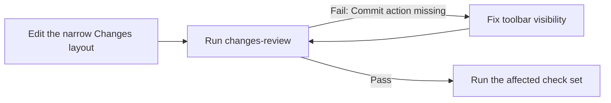

# Validation tools for Shepherd agents

An agent should be able to change Shepherd, run the affected checks against real Shepherd code, fix what fails, and repeat until the checks pass. Each run should say exactly what failed, show expected versus actual, point to logs and screenshots, and give the agent one place to start looking. The same checks should let the foundation rebuild prove a replacement preserves the behavior that matters. Aim for seconds to a few minutes on a warm worktree. The same inputs should give the same verdict; an intermittent failure is not a clean pass or proof that the edit broke the app. Keep the whole loop away from the user's running Shepherd and data.

## What exists today

| Tool and how to run it | What it proves and where it stops |
| --- | --- |
| [Swift tests](../testing.md#local-validation), `swift test --filter '<suite or test>'`. | Unit tests cover models and projections. Integration tests cover real sockets, processes and Git. A filter cuts execution, not the cold package build. Check that the named tests actually ran. |
| [`ShepherdTestIsolation`](../../Tests/ShepherdTestIsolation), [`ShepherdTestKit`](../../Tests/ShepherdTestKit), [`ShepherdTestSupport`](../../Tests/ShepherdTestSupport). Run the suite that imports them, e.g. `swift test --filter ReviewFlowTests`. | Load-time isolation sets scratch support, pi, shell, Git, MCP and hooks paths. `ScratchDefaults`, `ScratchServer`, `makeScratchRepo`, `StubPi`, `FakePiSDK` and named `eventually` waits let tests exercise real behavior with fixture inputs. The stub is pi RPC, not a model. `FakePiSDK` is for sign-in. `ScratchServer` relaxes extension peer checks unless the test opts back in. |
| [Mac app integration](../../Tests/ShepherdAppIntegrationTests/Support) and [previews](../../Tests/ShepherdPreviewTests). Run `swift test --filter ModelSettingsPopoverTests` for controls or `SHEPHERD_PREVIEW_DIR=/tmp/shepherd-previews swift test --filter ChangesPreviewTests/changesNarrow` for PNGs. | `AppHarness` uses real app stores and `ShepherdHost.Services` over a scratch Unix socket. `OffscreenWindow` and `ControlPress` exercise accessibility actions without taking focus. `Preview.render` captures both appearances; some suites have baselines. Neither launches the shipped app or proves its startup or signing. |
| [iOS checks](../../Tests/ShepherdIOSChecks). Run `bash Tests/ShepherdIOSChecks/run.sh` or `bash Tests/ShepherdIOSChecks/run-simulator.sh --list`, then `bash Tests/ShepherdIOSChecks/run-simulator.sh -d <owned-udid> -o <dir> thread`. | `run.sh` runs macOS-side client checks, not simulator UI. The simulator script draws production views with fixture hosts, waits for `FIXTURE READY`, and captures both appearances. The caller supplies and cleans up the simulator. These runs don't prove device pairing, push delivery or the shipped app's lifecycle. |
| [Dev build](../build-and-run.md), engine and extension checks. Stage with `python3 scripts/pi_engine.py stage`, then build the existing `Shepherd (Dev)` scheme. Set `SHEPHERD_ENGINE_SMOKE=.build/pi-engine` and run each of `swift test --filter EngineSmokeTests` and `swift test --filter EngineThreadTests`. Run extensions with `PI_PACKAGE_DIR=<staged-package> node --test Tests/Extensions/instructions.test.mjs`. | Dev covers app-only behavior, but its default `Shepherd-dev` data and preferences aren't disposable per run. Engine/extension checks prove real pinned pi and extension behavior with fixtures. [`LiveModelUseCaseTests`](../../Tests/ShepherdPreviewTests/LiveModelUseCaseTests.swift) drives a real edit/review flow with `SHEPHERD_LIVE_MODEL`, but opts into the user's pi configuration. Exclude it and [`scripts/perf/stress.sh`](../../scripts/perf/stress.sh), which assumes a fixed scratch path and drives a window, from unattended validation. |
| Fleet suites such as `swift test --filter FleetDispatchTests`, `FleetContentSyncTests` and `FleetUpdateTests`, and iOS `FakeFleetMacs`. | Scratch servers cover dispatch, settings sync and the update protocol; the update suite stands in for the updater. They don't prove communication between physical Macs or the installed updater and host restart. |
| [`scripts/ci_plan.py`](../../scripts/ci_plan.py), `python3 scripts/ci_plan.py <newline-delimited-paths-file>`, and [hosted CI/cache](../testing.md#ci). | The planner maps paths to Swift filters and can check them against a native test inventory. PR CI runs into `master` only. The [Nightly build cache](../../.github/workflows/build-cache.yml) warms hosted products after relevant pushes; it neither runs tests nor warms local worktrees. The run's external `gated` script caps local concurrency but doesn't choose checks or save evidence. |

## Gaps, in priority order

1. **Routine builds and renders consume the machine.** The 20-agent run reported a cold Swift test build of about 20 minutes. Fifteen worktrees filled a 927 GB disk and drove load to about 940. Workers wrote separate render scripts, spent hours on inconsistent matrices and left a 6.5 GB private package cache and hundreds of simulator processes. Only the iOS 27.1 runtime was installed, with no provisioned iPad. Missing a provisioned device is different from missing a compatible device type or runtime.
2. **Agents can't close the loop on the app.** A PNG doesn't tell an agent whether a control works. The default Dev launch isn't safe for unattended use, and the tests don't assemble an obvious edit → turn → Changes → review → commit path with one report.
3. **Fleet mistakes slipped past local tests.** The two-Mac run found wrong branch summaries, status/activity mismatches, provider errors marked done and settings not followed by the receiving host. Update requests also need a physical-host check; fake-updater success isn't an install.
4. **Load failures are hard to interpret.** [#684](https://github.com/bailycase/shepherd/issues/684) passed alone after intermittent startup timeouts in parallel; [#678](https://github.com/bailycase/shepherd/issues/678) may be a race exposed by load. Neither is a reason to turn a red run green.
5. **Nightly reviewers get uneven evidence.** Local runs are the evidence before review. Automate their selection and reporting before adding another CI lane.

## One command and a definition of done

Teach this in `AGENTS.md`: run `python3 scripts/validate.py` after each edit. It selects checks from the `origin/nightly` merge base and the current working tree, including uncommitted and untracked source changes. Use the same entry point with `--case changes-review` for a focused rerun; that is not a substitute for the affected check set before opening a PR. A change is verified when the required selected checks ran and passed on the final inputs. Report any unmet platform, hardware or app-only check as not run; a flake, missing prerequisite, or zero matched tests does not count as passing.

Write a short terminal summary and `result.json` in a fresh owned artifact folder. Each failed step carries an exact check name, a readable expected/actual diff, a log path, screenshots and a diff image when available, and a short, rule-based pointer to the likely code or prerequisite. Distinguish build/setup failures, assertion failures, intermittent results and checks not run. Include the source identity, including dirty inputs, selected checks, toolchain and elapsed build/test time. Exit zero only when the requested checks finish and pass. Use fixture state, named readiness conditions and known completion markers, not a model's judgment or a successful process exit alone.

### Worked example: a broken Changes control



Illustrative output, not a run from this PR:

```text
FAIL mac/changes-review/open-commit-sheet [narrow, dark]
- Expected: enabled Commit… action in the Changes toolbar
+ Actual:   no Commit… action in the toolbar's accessibility tree
Look first: the narrow toolbar branch in DiffReviewView.swift.
Evidence: mac/run.log, mac/toolbar-expected.png, mac/toolbar-actual.png, mac/toolbar-diff.png
```

After the fix, `python3 scripts/validate.py --case changes-review` finds the action and presses it. The commit sheet lists `calc.py` in light and dark. The agent runs `python3 scripts/validate.py` before handing off. The assertion decides whether the action works; the PNG diff helps locate the problem. Where no supported baseline exists, report that limit rather than blessing a new image or failing on pixels from a different OS.

## Slices, in order

1. **Close one Mac loop (1 to 2 days).** Add `scripts/validate.py`, a `changes-review` case in `Tests/ShepherdAppIntegrationTests/ReviewFlowTests.swift` or its existing support, and a short `AGENTS.md` entry that names the one supported case and still points other changes to existing checks. Reuse the scratch repo, off-screen app and existing `ChangesPreviewTests` fixtures. Press the Changes toolbar's Commit action and assert the sheet offers the expected changed file without committing. Compare one stable crop with a fixture baseline on the matching OS, scale and appearance; keep accessibility assertions authoritative for behavior. Done when a known missing action fails at the right step with the evidence above, the unchanged code passes, and a warm edit/rerun takes under three minutes on the reference Mac. An unsupported baseline is named, never generated from the failed image.
2. **Characterize behavior before a rebuild (2 days).** Start with one seeded thread flow. Use `ScratchServer` and the `LocalHostRuntimeTests` setup for observed state transitions, `Tests/ShepherdProtocolUnitTests` for named request/reply fields, a scratch `state.json` plus reload for persistence, and `ControlPress` for the visible UI outcome. Add a small fixture beside the owning suite with the reference revision, inputs and expected observations. Normalize only known nondeterminism such as temp roots, generated IDs and timestamps. Run the same named case on the reference revision and on the replacement before the swap. Compare named fields and ordered steps, not whole logs, private types or every PNG. Done when two baseline runs match, a deliberate changed reply or lost persisted field produces a field-level diff, and the case runs in seconds once built. Label observations as characterization, not new requirements. Keep known bugs out of the equivalence contract and review intended behavior changes explicitly. The foundation audit picks the next module, not a new capture format.
3. **One render matrix (2 days).** Wire `render` into `scripts/validate.py`. Map named screens to `Tests/ShepherdPreviewTests` and `Tests/ShepherdIOSChecks/run-simulator.sh` fixtures. Render the requested screen on Mac, iPhone and iPad, light and dark by default. Build iOS products once; create short-lived devices from a compatible installed runtime, one at a time, even when none are provisioned. Done when the six PNGs and their names are predictable, a missing runtime/type names the missing cells as not run. Success, failure and Ctrl-C must leave no new booted devices. Record owned UDIDs so a later run can clean up after a hard kill. Never use someone else's device, open Simulator, or install a runtime automatically.
4. **Select affected checks and keep builds warm (2 days).** In `scripts/validate.py`, reuse `scripts/ci_plan.py` and its inventory validation. Add only local docs, preview and extension routing the Swift planner doesn't cover. Widen unknown source or shared-contract changes rather than silently dropping checks. Preserve per-worktree incremental products, coordinate expensive builds machine-wide using the `gated` approach, and share pinned downloads only if bounded, keyed by resolved inputs/toolchain and safe for concurrent readers. Never share writable `.build` or DerivedData across worktrees. Done when docs don't invoke Swift, a new test never selects zero checks, missed or stale inputs force a rebuild, and two worktrees show queue time, cold/warm time and disk growth. Defer shared compiled products until measurements justify the invalidation and storage work.
5. **Cover the edit-to-commit flow (2 days).** Extend the named Swift case in `Tests/ShepherdAppIntegrationTests` and reuse the scripted [`stub-pi.py`](../../Tests/ShepherdTestSupport/Resources/stub-pi.py) and scratch Git helpers. Start a real thread through the app client, have the stub perform a deterministic file edit through the turn, then exercise Changes, Review and Commit. Done when the tool result, edited bytes, displayed diff and exact committed tree agree, an unchecked file stays out of the commit, and a missing tool result or wrong commit fails at its own step. No second scenario DSL, pushes or model credentials.
6. **Reuse an isolated Dev host (3 to 4 days).** Extend `scripts/validate.py` to own a bounded, worktree-local host session for named cases, first for startup/reconnect against the existing Dev bundle's `--host`. Use the existing remote client on an authenticated loopback endpoint for host checks; never relax `host.sock` peer identity or add a production driving API. Keep the app-side checks off-screen with the existing harness. Prefer the existing scheme and check isolation in `App/ShepherdLauncher.swift` and `Sources/ShepherdApp/ShepherdApp.swift` before adding any Debug-only seam. A support override alone is insufficient: keep preferences, hooks, Keychain access, shell/Git, pi and MCP off the user's state; no launchd, notifications, external services or posted input. Done when repeat scenarios reset fixture state without restarting an unchanged host, a host binary or fixture version change invalidates reuse, and two isolated sessions don't see each other's state. Stop by owned process only on request or idle expiry; refuse the bundle run if isolation can't be established. Don't ship an interactive app driver unless a needed app-only check has no safer proof.
7. **Triage a flaky step (1 to 2 days).** Add a bounded `triage` mode to `scripts/validate.py`. Build once, repeat the exact test N times in fresh scratch state, first alone and optionally with capped contention after approval. Save every result and host load with the same binary, toolchain and test settings. Done when a stable failure stays red, mixed results say intermittent, and failure observed only under contention says so without claiming cause. A clean retry never erases the original failure. Use #684 or #678 as a case to investigate, not a flaky-test allowlist.
8. **Prove Fleet on two Macs (3 to 4 days plus machine time).** Add a named `fleet-smoke` case under `scripts/` and reuse the fixtures in `Tests/ShepherdSessionsIntegrationTests/FleetDispatchTests.swift`, `FleetContentSyncTests.swift` and `FleetUpdateTests.swift`. Use two explicitly enrolled disposable Dev hosts on lab Macs, scratch credentials/repos and a named fixture branch. Capture a correlated trace on each side. Done when the receiver shows the expected branch and follows a setting changed on the sender, and the reported activity and state agree through the dispatch, and the sender reports an injected provider error as failed rather than done. Check the update request and target in fixtures; leave actual install, restart, and post-update reconnection not run until a disposable signed update environment is approved. Don't substitute two localhost servers for physical evidence or touch an everyday Fleet.

Don't build a second test runner, an all-screens visual gate, a live-model judge, or a nightly CI service. The existing suites own assertions; the local command selects them and makes failures usable. Consider opt-in PR CI only if these reports still leave review without needed evidence.

## Decisions for Baily

- Approve the reference Xcode/runtime and phone/iPad types, a shared download/artifact disk cap and retention, and a machine-wide build/boot budget. Start with one expensive job at a time and opt in to contention tests. Measure before raising limits or funding a compiled cache.
- Keep Python's standard library, current dependencies and existing schemes/targets. If a safe Dev bundle launch needs a new target, scheme, entitlement, dependency or disposable macOS login, bring that choice back before proceeding. No release signing or CI changes in this plan PR.
- Name two disposable Fleet Macs and decide whether to fund a signed update lab. Keep live-model tests off unless separately approved with fixture-only credentials, a model and a spend cap. Decide on any `nightly` CI change after seeing local reports, not as part of the first slice.
